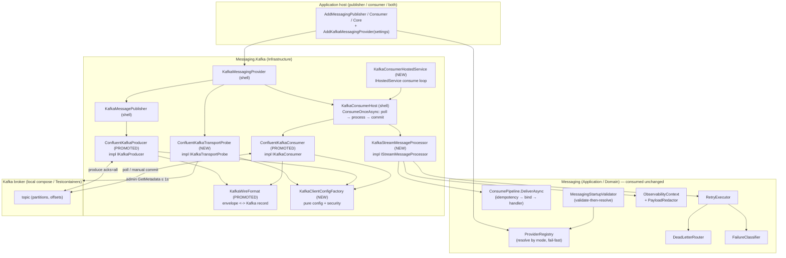
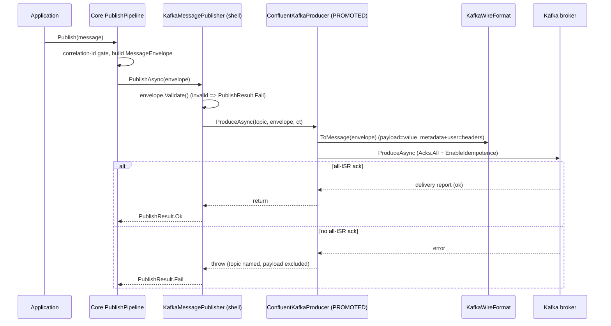
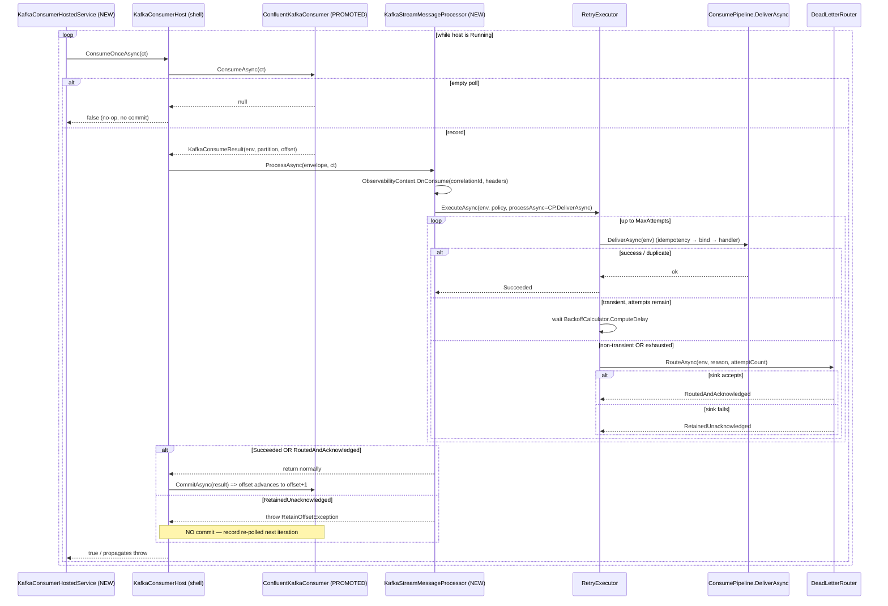

# Design Document: Kafka Provider

## Overview

This feature makes Apache Kafka a live transport for the Messaging Core by completing the
`Messaging.Kafka` adapter **shell** that already exists in the codebase (`src/Messaging.Kafka/Streaming/`).
The shell was deliberately left open against four seam ports and one hosting gap; this feature
supplies their production implementations and the DI wiring that stands them up, over the **native
Confluent.Kafka** client — **not** the MassTransit Kafka Rider — without changing any
transport-neutral core contract.

Unlike the RabbitMQ provider — which reaches its broker *through MassTransit* — Kafka is realized
through the native `Confluent.Kafka` producer and consumer. The deciding factor is Streaming's
defining concern: explicit consumer-group/partition assignment plus **manual offset-commit** control.
The MassTransit Kafka Rider abstracts those exact mechanics away, so the native client is used to
keep commit timing and group membership under the provider's own control (Req 1.1). This asymmetry
with the RabbitMQ provider is deliberate and is carried through every decision below.

**The four seams and the hosting gap:**

- **`IKafkaProducer`** (`src/Messaging.Kafka/Streaming/IKafkaProducer.cs`) — produce a `MessageEnvelope`
  to a topic with durable, idempotent writes. Today only the port exists; a *test-local*
  `ConfluentKafkaProducer` proves the shape. This feature adds a production `ConfluentKafkaProducer`
  over a configured `IProducer<Null, byte[]>` (Req 1.2).
- **`IKafkaConsumer`** (`src/Messaging.Kafka/Streaming/IKafkaConsumer.cs`) — consumer-group
  membership, partition assignment, and **manual** offset commit with auto-commit disabled. This
  feature adds a production `ConfluentKafkaConsumer` over `IConsumer<Ignore, byte[]>` (Req 1.3, 1.4).
- **`IStreamMessageProcessor`** (`src/Messaging.Kafka/Streaming/IStreamMessageProcessor.cs`) — the
  single point where the core consume steps (correlation propagation, idempotency gate, contract
  binding, handler invocation, failure classification, retry, dead-letter routing) run for each
  consumed envelope ahead of the application handler. This feature adds the production
  `KafkaStreamMessageProcessor`, modeled on `Messaging.MassTransit.Consuming.CoreConsumeProcessor`
  (Req 1.6, 5, 6, 7).
- **`IKafkaTransportProbe`** (`src/Messaging.Kafka/Streaming/IKafkaTransportProbe.cs`) — cluster
  reachability via the admin client's cluster metadata. This feature adds the production
  `ConfluentKafkaTransportProbe` (Req 1.7, 11).
- **Hosting gap** — the shell's `KafkaConsumerHost.ConsumeOnceAsync` is one deterministic
  consume → process → commit iteration but owns no polling loop. This feature adds
  `KafkaConsumerHostedService` (`IHostedService`) that pumps `ConsumeOnceAsync` while the host is
  Running, with graceful drain and a continue-on-failure policy (Req 8).

**What is already built and consumed unchanged** (verified by reading the source):

- The provider shell `KafkaMessagingProvider` (`Mode => Streaming`, `Publisher`, `ConsumerHost`,
  `RequiredSettings => KafkaProviderSettings.Describe()`, `CheckTransportAsync` → the probe) and its
  `IMessagingProvider` contract.
- `KafkaMessagePublisher` — validates the envelope, delegates to `IKafkaProducer.ProduceAsync`, maps
  an invalid envelope or a produce failure to a failed `PublishResult` (never throws except on
  cancellation), and logs by correlation id only, never the payload.
- `KafkaConsumerHost` — wraps the Application-layer `ConsumerHostStateMachine`, and in
  `ConsumeOnceAsync` **polls one record → `IStreamMessageProcessor.ProcessAsync` → `IKafkaConsumer.CommitAsync`
  strictly in that order**, committing *only after* the processor returns without throwing. This
  commit-after-process ordering is the at-least-once gate and needs **no change** (Req 4.2, 4.3, 6).
- `KafkaProviderSettings` (`Kafka:BootstrapServers`, `Kafka:ConsumerGroupId`, `Kafka:Topic`),
  `KafkaConsumeResult` (envelope + partition + offset), `InvalidConsumerHostStateException`.
- The Application-layer consume pipeline: `ConsumePipeline.DeliverAsync` (idempotency gate → bind →
  invoke handler), `IdempotencyGate`, `IContractBinder`, `IHandlerInvoker`, `ConsumerHostStateMachine`.
- The core resilience engine: `FailureClassifier`, `BackoffCalculator`, `DeadLetterRouter`,
  `RetryExecutor` (owns the bounded-attempt policy and dead-letter routing), with `RetryResult` /
  `RetryOutcome` / `DeadLetterRoutingResult`.
- The observability facade `ObservabilityContext` + `PayloadRedactor`, the startup gate
  `MessagingStartupValidator` + `ConfigurationValidator` + `MessagingStartupHostedService`,
  `ProviderRegistry`, `ConfigurationBounds`, and `RetryPolicyConfig` / `LifecycleConfig`.
- `MessagingMode.Streaming` already exists and `KafkaMessagingProvider.Mode` already returns it — **no
  enum change is required**.

### Key design decisions (resolved up front)

1. **Reuse the test-local native wiring as the production blueprint.** The existing
   `tests/Messaging.Kafka.Tests/KafkaIntegrationTestSupport.cs` already proves, against a real broker,
   the exact shape the production seams need: a `KafkaWireFormat` (payload → Kafka record value; message
   id / correlation id / message type / created-at / contract version → reserved Kafka record headers;
   user headers → Kafka record headers; a reserved-header set), a `ConfluentKafkaProducer`
   (`Acks.All` + `EnableIdempotence = true`), and a `ConfluentKafkaConsumer` (`EnableAutoCommit = false`,
   `AutoOffsetReset = Earliest`, an in-flight `ConsumeResult` map so `CommitAsync` commits the *exact*
   offset of the record the host asks for). This feature **promotes** `KafkaWireFormat`,
   `ConfluentKafkaProducer`, and `ConfluentKafkaConsumer` into `src/Messaging.Kafka/Streaming/`
   (Infrastructure) and hardens them (security config, no payload/secret logging). This keeps risk low
   and matches a pattern the team already validated against a live broker (Req 1.2, 1.3, 1.4, 9).

2. **Keep `KafkaTopicAdmin` test-only.** Topic creation/administration is an operational concern — the
   parallel to the steering rule that migrations are never auto-applied from app startup. The
   production path does not create topics; `KafkaTopicAdmin` stays in the test project to avoid racing
   topic auto-creation before a produce. The admin client is used in production *only* for the
   read-only reachability probe (Req 1.7 scope note; code-conventions "no auto-migrations at startup").

3. **Native client, not MassTransit Rider — explicit rationale.** Streaming needs manual
   offset-commit and explicit consumer-group/partition assignment. Those are exactly what the Rider
   abstracts away. Using `Confluent.Kafka` directly keeps commit timing (the at-least-once gate) and
   group membership under the provider's control (Req 1.1). This is the one place the Kafka provider
   diverges from the RabbitMQ provider's transport choice, and it is intentional.

4. **`IStreamMessageProcessor` is a thin Infrastructure adapter that drives the Application pipeline,
   not a reimplementation.** `KafkaStreamMessageProcessor` mirrors `CoreConsumeProcessor`: it composes
   `ObservabilityContext`, `RetryExecutor`, `ConsumePipeline` (via `DeliverAsync`), `DeadLetterRouter`,
   and `RetryPolicyConfig`, so a record consumed over Kafka behaves identically to every other mode
   (Req 1.6, 5, 6, 7). See *Components and Interfaces*.

5. **Commit-gated semantics are already in the shell; the processor is the ack-vs-retain gate.** The
   existing `KafkaConsumerHost.ConsumeOnceAsync` commits only after the processor returns — no shell
   change. The processor's **return-vs-throw** is the acknowledge-vs-retain decision: a success or a
   routed-and-acknowledged dead-letter returns (host commits); a retained-unacknowledged dead-letter
   throws a new `RetainOffsetException` so the host does **not** commit and the record is reprocessed
   (Req 4, 6). `RetainOffsetException` is the Kafka analogue of MassTransit's
   `RetainForRedeliveryException`.

6. **The core `RetryExecutor` is the single source of retry/backoff.** The native consumer configures
   **no** client-side redelivery policy that would multiply the attempt count; redelivery over Kafka is
   simply "the offset was not committed, so the record is polled again." The processor returns normally
   to acknowledge (commit) and throws to retain (no commit) — exactly one reprocessing per uncommitted
   record, never an extra attempt loop (Req 7.6).

7. **Config + security live in a pure `KafkaClientConfigFactory`.** It builds `ProducerConfig`,
   `ConsumerConfig`, and `AdminClientConfig` from `KafkaProviderSettings` plus injected security
   material: optional `SecurityProtocol` (default `Plaintext`), optional `SaslMechanism`, injected SASL
   username/password, optional TLS CA location. Producer: `Acks.All` + `EnableIdempotence`. Consumer:
   `EnableAutoCommit = false` + `AutoOffsetReset = Earliest`. Being a pure function of its inputs makes
   it trivially unit- and property-testable, and secrets are injected, never logged (Req 3, 12).

8. **Reachability** is a bounded (≤ 1s) admin-client `GetMetadata` mapped to `TransportHealth` by the
   production `ConfluentKafkaTransportProbe`: reachable → `TransportHealth(true, null)`;
   unreachable / timeout / throw → `TransportHealth(false, "Kafka (bootstrap servers)")`; never
   propagate (Req 11).

9. **Role-scoped, additive DI.** `AddKafkaMessagingProvider` is extended to `TryAdd` the four
   production seams, compose `ConsumePipeline` from already-registered parts exactly as MassTransit's
   `BuildConsumePipeline` does, register `KafkaStreamMessageProcessor` with the same core collaborators
   `CoreConsumeProcessor` uses, register `KafkaConsumerHostedService` as `IHostedService`, and keep the
   `IMessagingProvider` singleton accumulation. `TryAdd` means a caller or test fake that already
   supplied a seam keeps control (Req 2, 5, 8).

10. **Local docker-compose Kafka** (`confluentinc/cp-kafka:7.6.1`, PLAINTEXT, pinned tag, no secrets) is
    net-new; it follows the `infrastructure.md` steering — compose runs the broker, the service runs on
    the host and connects to it (Req 14).

11. **Integration verification against a real broker** uses the existing `KafkaContainerFixture`
    (Testcontainers, `confluentinc/cp-kafka:7.6.1`), re-pointed at the **production** adapters, covering
    at-least-once redelivery, correlation-id propagation, and the success-path commit (not redelivered)
    (Req 13).

### Research notes

- **Confluent.Kafka version & pin.** The adapter `.csproj` already references `Confluent.Kafka` pinned
  to the exact `2.15.1` (and `Microsoft.Extensions.Logging.Abstractions` / `...DependencyInjection.Abstractions`
  at `8.0.2`). The test project uses the same client. The design keeps `2.15.1` and does **not** change
  it (Req 1.9). `Confluent.Kafka` ships the producer, consumer, and admin client used here; no separate
  client package is added. The design adds one package to the adapter project:
  `Microsoft.Extensions.Hosting.Abstractions` pinned to `8.0.x` (aligned with the other abstractions),
  needed only for the `IHostedService` consume loop (decision 9, Req 8).
  [Confluent.Kafka .NET client docs](https://docs.confluent.io/kafka-clients/dotnet/current/overview.html).
  Content was rephrased for compliance with licensing restrictions.
- **Durable, idempotent produce.** The test-local producer already sets `Acks = Acks.All` and
  `EnableIdempotence = true`; with idempotence enabled the client requires all-in-sync-replica
  acknowledgement, which is the exact durability requirement in Req 1.2 and the fail-on-non-ack
  requirement in Req 1.5. The design keeps these as the production defaults.
  [Confluent idempotent producer guidance](https://docs.confluent.io/platform/current/clients/producer.html).
  Content was rephrased for compliance with licensing restrictions.
- **Manual commit / earliest reset.** The test-local consumer sets `EnableAutoCommit = false` and
  `AutoOffsetReset = AutoOffsetReset.Earliest`; `Commit(consumeResult)` stores *offset + 1* as the
  resume point, which is precisely Req 4.6. A fresh group with no committed offset starts at the
  earliest offset (Req 1.4). The in-flight `ConsumeResult` map is what lets `CommitAsync` commit the
  exact offset the host hands back (Req 1.3).
  [Confluent consumer offset-management docs](https://docs.confluent.io/platform/current/clients/consumer.html).
  Content was rephrased for compliance with licensing restrictions.
- **Testcontainers image tag.** The existing `KafkaContainerFixture` pins
  `confluentinc/cp-kafka:7.6.1` — an explicit release tag, not `latest` (Req 13.2). The docker-compose
  service uses the identical tag (Req 14.2).

## Architecture

The provider sits in the Infrastructure ring. Dependencies point inward only: the promoted adapters,
the processor, the probe, and the hosted service depend on Application (`Messaging`) and Domain
(`Messaging.Abstractions`, `Messaging.Contracts`) ports, never the reverse (Req 1.8,
clean-architecture steering).



### Message flow — Publish



### Message flow — Consume (one iteration, with retry / dead-letter)



The ack/retain contract (Req 4.2, 4.3, 6.1–6.5, 7.6) is realized by one rule: **the processor returns
normally to let the host commit, and throws `RetainOffsetException` to leave the offset uncommitted.**
Because the native consumer configures no client-side redelivery, a throw maps to exactly one
re-poll of the same uncommitted record on the next iteration or next partition assignment — never an
extra attempt loop that would multiply the core attempt count (Req 7.6).

## Components and Interfaces

### 1. `ConfluentKafkaProducer : IKafkaProducer, IDisposable` (PROMOTED from tests, Infrastructure)

**Location:** `src/Messaging.Kafka/Streaming/ConfluentKafkaProducer.cs`
**Responsibility (SRP):** own a configured `IProducer<Null, byte[]>` and produce an envelope to a
topic, awaiting the broker's acknowledgement. No core policy lives here.

| Member | Behavior | Requirements |
| --- | --- | --- |
| ctor `(KafkaClientConfigFactory, KafkaProviderSettings, ILogger)` | Build `ProducerConfig` via the factory (`Acks.All` + `EnableIdempotence = true` + security) and the `IProducer`. | 1.2, 12 |
| `ProduceAsync(topic, envelope, ct)` | `KafkaWireFormat.ToMessage(envelope)` → `IProducer.ProduceAsync`; awaits the delivery report. A produce that does not get all-ISR acknowledgement surfaces as a thrown exception whose message names the topic and excludes payload bytes; `KafkaMessagePublisher` turns that into `PublishResult.Fail` (Req 1.5). | 1.2, 1.5, 9.1 |
| `Dispose()` | `Flush` then dispose, so in-flight produces are not lost on shutdown. | 8.3 |

Hardening over the test-local version: the config comes from `KafkaClientConfigFactory` (so SASL/TLS
is applied, decision 7), and any log/exception text references the topic and correlation id only —
never payload bytes or credentials (Req 10.3).

### 2. `ConfluentKafkaConsumer : IKafkaConsumer, IDisposable` (PROMOTED from tests, Infrastructure)

**Location:** `src/Messaging.Kafka/Streaming/ConfluentKafkaConsumer.cs`
**Responsibility (SRP):** own a configured `IConsumer<Ignore, byte[]>`, join the group, take a
partition assignment, and perform **manual, exact-offset** commits. No core policy lives here.

| Member | Behavior | Requirements |
| --- | --- | --- |
| ctor `(KafkaClientConfigFactory, KafkaProviderSettings, ILogger)` | Build `ConsumerConfig` via the factory (`GroupId`, `EnableAutoCommit = false`, `AutoOffsetReset = Earliest` + security) and the `IConsumer`. | 1.3, 1.4, 4.1, 12 |
| `Subscribe(topic)` | `IConsumer.Subscribe(topic)` — join the group, receive an assignment. | 1.3 |
| `ConsumeAsync(ct)` | `IConsumer.Consume(pollTimeout)`; `null` / `IsPartitionEOF` → return `null` (empty poll). Otherwise `KafkaWireFormat.ToEnvelope(...)`, build `KafkaConsumeResult(env, partition, offset)`, and retain the underlying `ConsumeResult` in an in-flight map keyed by the `KafkaConsumeResult` so the commit targets the exact offset. | 1.3, 4.4, 9 |
| `CommitAsync(result, ct)` | Remove the retained `ConsumeResult` from the in-flight map and `IConsumer.Commit(consumeResult)` — advances the committed offset to *offset + 1*. A commit the broker does not acknowledge throws, so the host leaves the offset unchanged and surfaces the partition/offset (Req 4.7). | 4.2, 4.6, 4.7, 6.5 |
| `Close()` | `IConsumer.Close()` — leave the group so partitions rebalance onto remaining members. | 8.3 |

The in-flight `ConsumeResult` map (a `ConcurrentDictionary<KafkaConsumeResult, ConsumeResult<Ignore, byte[]>>`)
is the mechanism that makes commits exact-offset (Req 1.3) rather than "latest polled."

### 3. `KafkaWireFormat` (PROMOTED from tests, Infrastructure)

**Location:** `src/Messaging.Kafka/Streaming/KafkaWireFormat.cs`
**Responsibility (SRP):** the lossless envelope ↔ Kafka-record mapping. The payload bytes are the
Kafka record **value**; the five required metadata fields and every user header are Kafka record
**headers**. Carrying each field as data (not relying on any client envelope convention) is what
guarantees byte-for-byte, field-for-field fidelity (Req 9.1–9.4).

- `ToMessage(MessageEnvelope) : Message<Null, byte[]>` — value = `Payload.ToArray()`; headers =
  reserved metadata (`x-message-id`, `x-correlation-id`, `x-message-type`, `x-created-at-utc` as
  round-trip `"O"` format for full precision, `x-contract-version`) plus every user header.
- `ToEnvelope(Message<Ignore, byte[]>) : MessageEnvelope` — the inverse: parse the reserved headers
  back into their typed fields, collect non-reserved headers as the user-header dictionary (ordinal
  comparer), and wrap `message.Value ?? Array.Empty<byte>()` as `ReadOnlyMemory<byte>` (empty payload
  is preserved as zero-length — Req 9.1).
- `ReservedHeaders` — the `HashSet<string>` (ordinal) separating metadata headers from user headers so
  the round trip does not duplicate metadata into the user map.

**Missing-header hardening (Req 9.6):** `ToEnvelope` throws a domain-specific
`MissingRequiredHeaderException` (naming the header) when a required reserved header is absent or
unreadable. `KafkaStreamMessageProcessor` classifies that as non-transient, so the record is routed
through the dead-letter path and **no partially reconstructed envelope** ever reaches the application
handler. (The test-local version threw a bare `InvalidOperationException`; the production version uses
the dedicated type per code-conventions "throw domain-specific exceptions.")

### 4. `KafkaClientConfigFactory` (NEW, Infrastructure)

**Location:** `src/Messaging.Kafka/Streaming/KafkaClientConfigFactory.cs`
**Responsibility (SRP):** a **pure** function from `KafkaProviderSettings` + injected
`KafkaSecuritySettings` to the three Confluent config objects. No I/O, no logging, so it is trivially
unit- and property-testable.

| Member | Behavior | Requirements |
| --- | --- | --- |
| `CreateProducerConfig()` | `BootstrapServers`, `Acks = Acks.All`, `EnableIdempotence = true`, + security. | 1.2, 12 |
| `CreateConsumerConfig()` | `BootstrapServers`, `GroupId`, `EnableAutoCommit = false`, `AutoOffsetReset = Earliest`, + security. | 1.3, 1.4, 4.1, 12 |
| `CreateAdminClientConfig()` | `BootstrapServers` + security — for the probe. | 1.7, 11, 12 |
| `ApplySecurity(config)` (private) | Set `SecurityProtocol` (default `Plaintext`); when SASL, set `SaslMechanism`, `SaslUsername`, `SaslPassword`; when TLS, set `SslCaLocation` when a CA is provided, else leave default-trust. | 12.1, 12.5, 12.7, 12.8 |

Security material (`SaslUsername`, `SaslPassword`, `SslCaLocation`) is injected into the factory from
the environment/secret store and is **never** logged or embedded in source (Req 12.9, 12.10).

### 5. `KafkaStreamMessageProcessor : IStreamMessageProcessor` (NEW, Infrastructure)

**Location:** `src/Messaging.Kafka/Streaming/KafkaStreamMessageProcessor.cs`
**Responsibility (SRP):** for each consumed envelope, run the core consume steps ahead of the handler
and translate the terminal outcome into the commit-vs-retain signal. It **drives** core components; it
does not reimplement them. This mirrors `CoreConsumeProcessor` member-for-member.

Composition (constructor injection only, each null-guarded):

- `ObservabilityContext` — `OnConsume(correlationId, headers)` for the consume event + span, best-effort
  (Req 10.2, 10.6).
- `RetryExecutor` — bounds attempts and routes to dead-letter (Req 7).
- `ConsumePipeline` — the per-attempt unit of work, invoked via `DeliverAsync` (idempotency → bind →
  handler) (Req 5).
- `DeadLetterRouter` — the routing seam the executor shares (kept aligned with the core wiring).
- `RetryPolicyConfig` — the single retry policy passed to the executor (Req 7.6).

`ProcessAsync` algorithm (identical in shape to `CoreConsumeProcessor`, differing only in the thrown
type):

```
using span = ObservabilityContext.OnConsume(envelope.CorrelationId, envelope.Headers) // best-effort (Req 10.2, 10.6)
result = await RetryExecutor.ExecuteAsync(
    envelope, retryPolicy,
    processAsync: ct => consumePipeline.DeliverAsync(envelope, ct),   // idempotency + bind + handler
    idempotencyKey: null, cancellationToken)
switch result.Outcome:
  Succeeded                                  -> return            // host commits (Req 6.1)
  DeadLetteredNonTransient / Exhausted:
      if result.DeadLetterRouting == RetainedUnacknowledged
          throw new RetainOffsetException()   // host does NOT commit; re-polled (Req 6.3, 6.4)
      else
          return                              // RoutedAndAcknowledged: host commits (Req 6.2)
```

Notes (inherited from the core, same as the MassTransit processor):
- `UnknownContractException` / `MissingRequiredHeaderException` from `DeliverAsync` /
  `KafkaWireFormat` are classified **non-transient** → dead-lettered without retries, handler never
  invoked, reason names the contract/header (Req 5.7, 9.6).
- `MissingIdempotencyKeyException` (idempotency enabled) is thrown by the gate before the handler →
  non-transient → dead-letter; no key recorded (Req 5.5).
- Correlation id is propagated unchanged because `DeliverAsync` hands the original `envelope` to the
  handler (the core already guarantees this — Req 5.2).

### 6. `RetainOffsetException` (NEW, Infrastructure)

**Location:** `src/Messaging.Kafka/Streaming/RetainOffsetException.cs`
The Kafka analogue of `Messaging.MassTransit.RetainForRedeliveryException`. Thrown by
`KafkaStreamMessageProcessor` **only** when the dead-letter sink retained the message
(`RetainedUnacknowledged`), so `KafkaConsumerHost` does not commit and the record is re-polled at the
same offset (Req 6.3, 6.4). Domain-specific, never a bare `Exception` (code-conventions). The host's
existing `ConsumeOnceAsync` needs no change: an exception from `ProcessAsync` propagates *before* the
`CommitAsync` line, which is exactly the retain behavior.

### 7. `ConfluentKafkaTransportProbe : IKafkaTransportProbe` (NEW, Infrastructure)

**Location:** `src/Messaging.Kafka/Streaming/ConfluentKafkaTransportProbe.cs`
**Responsibility (SRP):** check cluster reachability through the admin client's cluster metadata and
map the result to `TransportHealth`.

| Outcome | Returns | Requirements |
| --- | --- | --- |
| `AdminClient.GetMetadata(≤ 1s)` lists ≥ 1 broker within the budget | `TransportHealth(true, null)` | 11.1, 11.2 |
| no broker / metadata empty within budget | `TransportHealth(false, "Kafka (bootstrap servers)")` | 11.3 |
| `GetMetadata` throws | `TransportHealth(false, "Kafka (bootstrap servers)")`, error **not** propagated | 11.4 |
| check exceeds the 1-second budget | `TransportHealth(false, "Kafka (bootstrap servers)")`, timeout **not** propagated | 11.5 |

The probe builds an admin client from `KafkaClientConfigFactory.CreateAdminClientConfig()`, wraps the
metadata call with a 1-second budget (`GetMetadata(TimeSpan.FromSeconds(1))` plus a
`Task.WhenAny(check, Task.Delay(1s, ct))` guard), and the unavailable-dependency name is the fixed
string `"Kafka (bootstrap servers)"` — the **non-secret** bootstrap-servers display value, never SASL
material (Req 11.3, 10.3). The outer `KafkaMessagingProvider.CheckTransportAsync` already delegates
straight to `ProbeAsync` — no shell change.

### 8. `KafkaConsumerHostedService : IHostedService` (NEW, Infrastructure)

**Location:** `src/Messaging.Kafka/Streaming/KafkaConsumerHostedService.cs`
**Responsibility (SRP):** own the background consume loop that pumps the shell's `ConsumeOnceAsync`
while the host is Running, with graceful drain and continue-on-failure. It depends only on
`Microsoft.Extensions.Hosting.Abstractions` (`IHostedService`), the shell `KafkaConsumerHost`, the
`LifecycleConfig`, and `ILogger` — never a concrete host, keeping the inward-dependency rule intact.

| Member | Behavior | Requirements |
| --- | --- | --- |
| `StartAsync(ct)` | `await host.StartAsync(ct)` (subscribe + advance to Running), then launch the background loop task. | 8.1 |
| background loop | While `host.State == Running`: call `ConsumeOnceAsync`; begin the next iteration within 1s of the previous returning (Req 8.1). When not Running, do not iterate (Req 8.2). On a thrown `RetainOffsetException`/other, catch, log the correlation id (never payload), delay a bounded backoff (1–60s, default 5s), and **continue** — never tear down the host (Req 8.5, 8.6). A client-reported rebalance is non-fatal; the loop continues (Req 8.7). | 8.1, 8.2, 8.5, 8.6, 8.7 |
| `StopAsync(ct)` | Signal the loop to stop starting new iterations, allow an in-flight iteration to finish its process-then-commit, and `await host.StopAsync` within the configured graceful-shutdown timeout (`LifecycleConfig.ShutdownTimeoutSeconds`, 1–300s, default 30). If the drain exceeds the timeout, stop the host without committing the uncompleted record and log the correlation id (no payload) indicating the drain exceeded the timeout. | 8.3, 8.4 |

The loop owns **no** offset logic and **no** processing policy — all of that is in the shell + the
processor. Its single job is "call `ConsumeOnceAsync` while Running, survive a throw, drain on
shutdown." The backoff after a throw is why a retained record is reprocessed rather than hot-looping
(Req 8.6).

### 9. DI wiring — `AddKafkaMessagingProvider` extended (Infrastructure)

**Location:** `src/Messaging.Kafka/Streaming/KafkaMessagingProviderServiceCollectionExtensions.cs`
The existing method registers the provider, publisher, and consumer host and leaves the four seams for
the caller. It is extended to `TryAdd` the production seams and compose the pipeline exactly as
MassTransit's `AddMassTransitMessagingProvider` does:

- `services.TryAddSingleton<KafkaClientConfigFactory>(...)` built from the settings + injected
  `KafkaSecuritySettings`.
- `services.TryAddSingleton<IKafkaProducer, ConfluentKafkaProducer>()`.
- `services.TryAddSingleton<IKafkaConsumer, ConfluentKafkaConsumer>()`.
- `services.TryAddSingleton<IKafkaTransportProbe, ConfluentKafkaTransportProbe>()`.
- `services.TryAddSingleton<IStreamMessageProcessor>(sp => new KafkaStreamMessageProcessor(`
  `ObservabilityContext, RetryExecutor, BuildConsumePipeline(sp), DeadLetterRouter, RetryPolicyConfig))`
  — where `BuildConsumePipeline` composes `ConsumePipeline` from the already-registered
  `ConsumerHostStateMachine`, `IContractBinder`, `IHandlerInvoker`, and the **optional**
  `IdempotencyGate` (`sp.GetService<IdempotencyGate>()`), identical to MassTransit's
  `BuildConsumePipeline`. (The core registers `ConsumePipeline` only behind `IMessageConsumerHost`,
  which is shadowed here by `KafkaConsumerHost`, so the pipeline must be composed from its parts rather
  than resolved — the same reason the MassTransit extension documents.)
- `services.AddSingleton<IHostedService>(sp => sp.GetRequiredService<KafkaConsumerHostedService>())`
  plus `services.TryAddSingleton<KafkaConsumerHostedService>()`.
- The `IMessagingProvider` singleton accumulation is **unchanged** (plain `AddSingleton`, not
  `TryAdd`), so the registry's provider set still accumulates and resolves Streaming to exactly one
  Kafka provider (Req 2.1, 2.2). `TryAdd` on the seams means a caller or test fake that already
  supplied one wins (Req 2.1).

Because Kafka backs **only** Streaming, there is no role/mode branch like MassTransit's; the provider's
`Mode` is fixed to `Streaming` and `MessagingStartupValidator` fails fast if the configured mode
resolves to something else (Req 2.4). Zero/duplicate registrations for Streaming surface as
`ProviderResolutionException` from the registry (Req 2.3).

### 10. Required-settings validation (consumed unchanged + Kafka security specifics)

`KafkaProviderSettings.Describe()` already declares `Kafka:BootstrapServers`, `Kafka:ConsumerGroupId`,
and `Kafka:Topic` as required. This feature adds the security descriptors to `Describe()` so the
existing `ConfigurationValidator` gate checks them in the same single aggregating pass (Req 3.1, 3.5):

- `Kafka:SecurityProtocol` — permitted set `{Plaintext, Ssl, SaslPlaintext, SaslSsl}`, optional
  (default `Plaintext`) (Req 12.1, 12.2).
- `Kafka:SaslMechanism` — permitted set `{None, Plain, ScramSha256, ScramSha512}`, optional (Req 12.3).
- `Kafka:SaslUsername`, `Kafka:SaslPassword`, `Kafka:TlsCaLocation` — injected-only, secret-bearing
  (username/password), reported **by name only** with the value excluded (Req 3.6, 12.6, 12.10).

The conditional rule — a SASL `SecurityProtocol` requires a `SaslMechanism` other than `None` plus a
username and password — is a cross-field check added to `KafkaProviderSettings` construction and
surfaced as descriptor errors (one per absent setting, by name, secrets excluded) so the existing
validator aggregates them (Req 12.5, 12.6). The validator already reports every failure in one pass
and excludes each secret value (Req 3.5, 3.6).

## Data Models

No core contract changes. The feature promotes/adds Infrastructure-local types only.

### Kafka wire format (headers carried by `KafkaWireFormat`)

| Envelope field | Kafka carrier | Encoding | Notes |
| --- | --- | --- | --- |
| `Payload` (`ReadOnlyMemory<byte>`) | record **value** | raw bytes | same length & bytes, incl. zero-length (Req 9.1) |
| `MessageId` (`Guid`) | header `x-message-id` | UTF-8 `"D"` | verbatim (Req 9.2) |
| `CorrelationId` (`string`) | header `x-correlation-id` | UTF-8 | char-for-char (Req 9.2, 9.5) |
| `MessageType` (`string`) | header `x-message-type` | UTF-8 | verbatim (Req 9.2) |
| `CreatedAtUtc` (`DateTimeOffset`) | header `x-created-at-utc` | UTF-8 `"O"` (round-trip) | full precision, no truncation (Req 9.2) |
| `ContractVersion` (`int`) | header `x-contract-version` | UTF-8 decimal | verbatim (Req 9.2) |
| `Headers` (`IReadOnlyDictionary<string,string>`) | one record header per entry | UTF-8 | same count/keys/values, incl. zero entries (Req 9.3) |

`ReservedHeaders` is the ordinal set of the five `x-*` names, so user headers never collide with
metadata on the round trip.

### `KafkaSecuritySettings` (NEW record)

Injected-only security material, bound from configuration/secret store, held separately from the
non-secret `KafkaProviderSettings`:

| Field | Type | Secret? | Notes |
| --- | --- | --- | --- |
| `SecurityProtocol` | `enum {Plaintext, Ssl, SaslPlaintext, SaslSsl}` | no | default `Plaintext` (Req 12.1) |
| `SaslMechanism` | `enum {None, Plain, ScramSha256, ScramSha512}` | no | default `None` (Req 12.3) |
| `SaslUsername` | `string?` | **yes** | injected, never logged (Req 12.9, 12.10) |
| `SaslPassword` | `string?` | **yes** | injected, never logged (Req 12.9, 12.10) |
| `TlsCaLocation` | `string?` | path | injected; absent → host default trust (Req 12.7, 12.8) |

### `RetainOffsetException` (NEW)

Thrown by `KafkaStreamMessageProcessor` only on `RetainedUnacknowledged`, so the host leaves the offset
uncommitted (Req 6.3, 6.4). Domain-specific, mirroring `RetainForRedeliveryException`.

### `MissingRequiredHeaderException` (NEW)

Thrown by `KafkaWireFormat.ToEnvelope` when a required metadata header is absent or unreadable; carries
the offending header name for diagnostics, classified non-transient so the record is dead-lettered with
no partial envelope reaching the handler (Req 9.6).

### Configuration (consumed unchanged)

`KafkaProviderSettings` (`Kafka:BootstrapServers`, `Kafka:ConsumerGroupId`, `Kafka:Topic`),
`RetryPolicyConfig` (MaxAttempts 1–100/def 5, PerAttemptDelaySeconds 1–300/def 5, Backoff),
`LifecycleConfig` (ShutdownTimeoutSeconds 1–300/def 30), `IdempotencyConfig` — all bounds from
`ConfigurationBounds`. The poll timeout (1–300s, default 5s) and the hosted-service backoff (1–60s,
default 5s) are the two Kafka-local bounds the hosted service / consumer carry (Req 4.4, 8.5).

## Correctness Properties

*A property is a characteristic or behavior that should hold true across all valid executions of a
system — essentially, a formal statement about what the system should do. Properties serve as the
bridge between human-readable specifications and machine-verifiable correctness guarantees.*

This feature's pure-logic surfaces are amenable to property-based testing: the wire-format round trip,
missing-header rejection, the processor's commit/retain mapping, the bounded attempt count, dead-letter
context preservation, secret/payload redaction, and startup-validation aggregation are all universal
over large input spaces (arbitrary envelopes, byte sequences, header maps, terminal outcomes, attempt
counts, secret values, invalid configs). Broker behavior (offset advance, redelivery timing), lifecycle
timings, DI composition, and the core gate/backoff internals are covered by example, integration, or
existing core tests instead (see *Testing Strategy*).

The seven properties below are the consolidated set after property reflection: the correlation-id
preservation (Req 5.2, 9.5) is folded into the wire-format round trip; the host's commit gate (Req 4.2,
4.3) and the processor's ack/retain mapping (Req 6.1–6.5) are one rule; attempt bounds across failure
kinds are one property; and every secret/payload-leak aspect is one redaction property.

### Property 1: Wire-format round-trip identity

*For any* valid `MessageEnvelope`, mapping it to a Kafka record and back
(`KafkaWireFormat.ToEnvelope(KafkaWireFormat.ToMessage(e))`) yields an envelope whose message id,
correlation id, message type, UTC creation timestamp (at full `"O"` precision), and contract version
each equal the originals; whose user-header collection has the same number of entries with every key
present and mapped to its original value, including the zero-entry case; and whose payload byte sequence
is equal in length and in every byte position, including the zero-length case.

**Validates: Requirements 9.1, 9.2, 9.3, 9.4, 5.2, 9.5, 10.5**

### Property 2: Missing required header is rejected, never partially reconstructed

*For any* valid `MessageEnvelope` mapped to a Kafka record from which exactly one required metadata
header (message id, correlation id, message type, created-at, or contract version) is then removed,
`KafkaWireFormat.ToEnvelope` raises `MissingRequiredHeaderException` naming the missing header and
produces no partially reconstructed envelope.

**Validates: Requirements 9.6**

### Property 3: Commit iff terminal success or routed-and-acknowledged

*For any* terminal `RetryResult`, `KafkaStreamMessageProcessor.ProcessAsync` returns normally — so the
`KafkaConsumerHost` performs the offset commit and advances the partition — if and only if the outcome
is `Succeeded` or a dead-letter whose routing is `RoutedAndAcknowledged`; and it throws
`RetainOffsetException` — so the host performs no commit and the committed offset is unchanged — if and
only if the outcome is a dead-letter whose routing is `RetainedUnacknowledged`.

**Validates: Requirements 4.2, 4.3, 6.1, 6.2, 6.3, 6.5**

### Property 4: Bounded attempt count by failure kind

*For any* retry policy with `MaxAttempts` in the inclusive range [1, 100], driving a message whose
processing always fails yields exactly one processing attempt when the failure is classified
non-transient, and exactly `MaxAttempts` attempts when it is classified transient, before the message
is dead-lettered; the total number of processing attempts is always at least 1 and never exceeds
`MaxAttempts` (the native consumer configures no additional redelivery that would multiply the count).

**Validates: Requirements 7.1, 7.6**

### Property 5: Dead-letter preserves context

*For any* `MessageEnvelope` that is dead-lettered, the resulting dead-letter record preserves the
original message id, the correlation id (char-for-char), the payload bytes (equal in length and every
byte), and the exact total attempt count performed, where that count equals 1 for a message routed
without any retry.

**Validates: Requirements 7.5**

### Property 6: Redaction totality — no secret or payload in diagnostics

*For any* configured SASL credential value and *for any* payload byte sequence, no diagnostic the
provider emits — produce-failure report, consume/retry/dead-letter log entries, and the transport-health
unavailable-dependency name — contains that credential value or any payload bytes; the cluster is
referenced only by its non-secret bootstrap-servers display value, and any value under a sensitive key
is replaced by the fixed redaction marker, which shares no character-sequence fragment with the original
and does not reveal its length.

**Validates: Requirements 1.5, 10.3, 10.4, 11.3, 11.4, 11.5, 12.6, 12.10**

### Property 7: Startup validation aggregates all failures and excludes secret values

*For any* set of missing or invalid Kafka settings (required-setting absence, empty/whitespace value,
enum value outside its permitted set, or a SASL protocol without a mechanism/username/password), the
startup validator reports a separate configuration error for each offending setting — identified by its
configuration setting name (and, for an enum, its permitted set) — rather than stopping at the first,
and no reported error contains any configured SASL credential value in whole or in fragment.

**Validates: Requirements 3.1, 3.2, 3.3, 3.4, 3.5, 3.6, 12.4, 12.5, 12.6**

## Error Handling

The design keeps failures classified and localized; it logs where a failure is handled, never
double-logs across layers, and never leaks a secret or payload (code-conventions).

### Publish-side failures

- An invalid envelope or a produce that does not receive all-ISR acknowledgement is caught by the
  existing `KafkaMessagePublisher` and returned as a failed `PublishResult` (not thrown), logging
  correlation id + topic only — never payload bytes or credentials (Req 1.5, 10.3).
  `OperationCanceledException` propagates unchanged (a caller signal, not a transport failure).

### Consume-side failures

- Per-attempt failures are classified by `FailureClassifier`: transient → retry with backoff;
  non-transient → immediate dead-letter (Req 5.8, 7.1, 7.3). The attempt bound guarantees a terminal
  state (Req 7.6).
- **Unknown / unbindable contract** (`UnknownContractException`) is non-transient → dead-lettered with
  attempt count 1, handler never invoked, reason names the contract (Req 5.7).
- **Missing / unreadable required header** (`MissingRequiredHeaderException` from `KafkaWireFormat`) is
  non-transient → dead-lettered; no partial envelope reaches the handler (Req 9.6).
- **Missing idempotency key** (`MissingIdempotencyKeyException`, enabled-only) is thrown by the gate
  before the handler → non-transient → dead-letter; no key recorded (Req 5.5).
- **Dead-letter sink failure**: `DeadLetterRouter` returns `RetainedUnacknowledged`; the processor
  throws `RetainOffsetException` so the host does **not** commit and the record is re-polled at the same
  offset (Req 6.3, 6.4). The routing failure is logged once by the router.
- **Commit not acknowledged by the broker**: `ConfluentKafkaConsumer.CommitAsync` throws; the host
  leaves the committed offset unchanged and surfaces the partition/offset, so the record is delivered
  again on the next poll/assignment (Req 4.7).

### Lifecycle failures

- **Consume-iteration throw**: the hosted service catches it, logs the correlation id (no payload),
  waits a bounded backoff, and continues the loop — it never tears the host down for one uncommitted
  record (Req 8.5, 8.6). A client-reported rebalance is non-fatal (Req 8.7).
- **Graceful drain timeout**: `StopAsync` allows an in-flight process-then-commit to finish, then stops
  the host within `LifecycleConfig.ShutdownTimeoutSeconds`; if the drain exceeds the timeout, the host
  is stopped without committing the uncompleted record and a structured entry (correlation id, no
  payload) records that the drain exceeded the timeout (Req 8.3, 8.4).

### Reachability / readiness

- `ConfluentKafkaTransportProbe.ProbeAsync` is bounded to ≤ 1s and returns `TransportHealth(false, ...)`
  on no-broker, error, or timeout; it never propagates (Req 11.3, 11.4, 11.5). The provider's
  `CheckTransportAsync` delegates straight to it. The unavailable-dependency name is the fixed
  `"Kafka (bootstrap servers)"` display value — no SASL material (Req 11.3, 10.3).

### Production readiness for secured clusters (Req 12)

- SASL credentials and the TLS CA location are read from the environment/secret store and injected into
  `KafkaClientConfigFactory`; they are never committed or logged, and a secret-bearing setting is
  referenced by configuration name only (Req 12.9, 12.10).
- **Startup validation**: an absent required setting is reported missing by name; an empty/whitespace or
  out-of-set value is reported invalid by name (with the permitted set for enums); a SASL protocol
  without a mechanism/username/password reports each absent setting separately — all before any record
  is processed, with every SASL value excluded (Req 3, 12.4, 12.5, 12.6).
- **Unreachable at startup** (local compose or otherwise): the readiness/transport-health path reports
  the unavailable dependency by the non-secret bootstrap-servers display value, and the startup gate
  fails fast before a processing-ready state (Req 14.7).

## Testing Strategy

A dual approach: property-based tests for the universal logic properties above, example/unit tests for
discrete behaviors and wiring, and containerized integration tests for broker behavior. The existing
`Messaging.Kafka.Tests` project (xUnit + `FsCheck.Xunit` + `Testcontainers.Kafka`) is the home for all
of these; the test-local `KafkaWireFormat` / `ConfluentKafkaProducer` / `ConfluentKafkaConsumer` are
**superseded by the promoted production types** and the tests re-pointed at them. `KafkaTopicAdmin`
remains test-only.

### Property-based tests (library: FsCheck.Xunit, already referenced)

- Do **not** implement property testing from scratch; use `FsCheck.Xunit` (`[Property]`).
- Minimum **100 iterations** per property (FsCheck default is 100; set explicitly where overridden).
- Tag each test with a comment: **Feature: kafka-provider, Property {n}: {property text}**.
- One property-based test per correctness property:
  1. **Property 1 — Wire-format round trip**: generate arbitrary `MessageEnvelope` (random id,
     correlation 1–128 chars, type, UTC timestamp, version ≥ 1, 0–64 user headers with arbitrary
     keys/values, arbitrary payload bytes incl. empty); assert `ToEnvelope(ToMessage(e))` preserves
     every field, header, full-precision timestamp, and byte. Pure, in-memory, no broker.
  2. **Property 2 — Missing-header rejection**: generate arbitrary envelopes, map to a record, remove
     one required header; assert `ToEnvelope` throws `MissingRequiredHeaderException` naming it and
     yields no envelope.
  3. **Property 3 — Commit iff terminal success/routed-ack**: generate arbitrary terminal
     `RetryResult`s (success / non-transient+routed / exhausted+routed / retained); assert the
     processor returns iff committable and throws `RetainOffsetException` iff retained, driving it with
     a fake `RetryExecutor` seam so no broker is needed.
  4. **Property 4 — Bounded attempt count**: generate `MaxAttempts` in [1, 100] and a failure kind; an
     always-failing attempt yields exactly 1 (non-transient) or exactly `MaxAttempts` (transient)
     invocations, never more. Inject the delay function so there is no wall-clock wait; mock the sink.
     (Core-owned behavior the Kafka processor inherits by composing `RetryExecutor`.)
  5. **Property 5 — Dead-letter preservation**: generate arbitrary failing envelopes + attempt counts;
     assert the captured dead-letter record preserves id, correlation, payload bytes, and attempt count.
  6. **Property 6 — No secret/payload leak**: generate arbitrary SASL credential values and payloads;
     assert none appears (as substring) in any emitted diagnostic (produce-failure report via a
     capturing logger, probe dependency name, consume/dead-letter log entries), and that a
     sensitive-keyed value equals the fixed `PayloadRedactor.RedactionMarker`.
  7. **Property 7 — Validation aggregation**: generate arbitrary sets of missing/invalid Kafka settings;
     assert the validator reports exactly one error per offending setting (by name, with permitted set
     for enums) and that no error text contains any configured SASL credential value.

### Unit / example tests (xUnit, `Method_Scenario_ExpectedResult`)

- `KafkaClientConfigFactory`: producer config has `Acks.All` + `EnableIdempotence`; consumer config has
  `EnableAutoCommit = false` + `AutoOffsetReset = Earliest`; default `SecurityProtocol = Plaintext`;
  SASL protocol maps mechanism/username/password; TLS maps `SslCaLocation` when present, default-trust
  when absent — Req 1.2, 1.3, 1.4, 12.1, 12.5, 12.7, 12.8.
- Processor delegation: `KafkaStreamMessageProcessor` drives `RetryExecutor` over
  `ConsumePipeline.DeliverAsync`; duplicate → handler not invoked, committable; unknown-contract /
  missing-header / missing-key → dead-letter, handler not invoked — Req 1.6, 5.4, 5.5, 5.7.
- Host no-op: `ConsumeOnceAsync` on an empty poll returns `false` and performs no commit; a throw from
  the processor skips the commit — Req 4.3, 4.4 (shell behavior re-asserted against the real seams).
- Probe mapping: reachable → `TransportHealth(true, null)`; no-broker / throwing / timeout →
  `TransportHealth(false, "Kafka (bootstrap servers)")`, never propagates — Req 11.2–11.5.
- Hosted service: while Running it calls `ConsumeOnceAsync`; a thrown `RetainOffsetException` is caught,
  logged (correlation only), and the loop continues; not Running → no call; drain-timeout stops without
  committing and logs the timeout — Req 8.1, 8.2, 8.4, 8.5, 8.6.
- DI composition: `AddKafkaMessagingProvider` `TryAdd`s the four seams, registers
  `KafkaConsumerHostedService` as `IHostedService`, composes `ConsumePipeline` from parts, and keeps one
  accumulating `IMessagingProvider` for Streaming; a pre-registered fake seam wins — Req 2.1, 5, 8.
- Registry/startup: one Streaming registration resolves; repeated resolution returns the
  reference-identical instance; zero/duplicate → `ProviderResolutionException`; a non-Streaming mode
  resolving to Kafka fails fast with no partial registration — Req 2.2, 2.3, 2.4, 2.5.

Example tests should stay few; the properties above carry the broad input coverage.

### Integration tests (Testcontainers, real broker — Req 13)

Reuse `KafkaContainerFixture` (pinned `confluentinc/cp-kafka:7.6.1`, ready within the readiness bound,
reaped at process exit — Req 13.2, 13.3, 13.5) and the `[Collection("kafka-integration")]` sharing.
Re-point the integration test(s) at the **production** `ConfluentKafkaProducer` /
`ConfluentKafkaConsumer` / `KafkaStreamMessageProcessor` (not the test-local copies):

1. **At-least-once redelivery**: a record whose processing fails before its offset is committed is
   redelivered, within 60s, to a consumer in the same `ConsumerGroupId` — Req 13.6 (end-to-end evidence
   for Property 3 over the wire).
2. **Correlation-id propagation**: the consumed envelope's correlation id equals the produced envelope's
   char-for-char, end to end — Req 13.7 (end-to-end evidence for Property 1 over the wire).
3. **Success-path commit, not redelivered**: a successfully processed record has its offset committed
   and is **not** redelivered to a newly started consumer in the same group observed over ≥ 30s after it
   reaches its partition assignment — Req 13.8.

If the container does not become ready within the readiness bound, the suite fails with a timeout naming
the container and runs no assertions (Req 13.4). These broker-dependent timings (Req 13.6 "within 60s",
Req 13.8 "over ≥ 30s") are intentionally integration-only; they measure broker/wall-clock behavior, not
input-varying logic, so they are not property-tested.

### Local docker-compose Kafka (Req 14)

A net-new `docker-compose.yml` (there is none in the repo today) adds a single Kafka service on
`confluentinc/cp-kafka:7.6.1` — the **identical** pinned tag the integration verification uses (Req
14.2) — exposing a PLAINTEXT listener (Req 14.3) and embedding **no** SASL credentials, TLS private key,
or other secret (Req 14.4). Following the `infrastructure.md` steering, compose runs the broker and the
service runs on the host, connecting via the local `Kafka:BootstrapServers` with no code change (Req
14.1, 14.5, 14.6). The compose file is verified by file-content assertions (pinned tag, PLAINTEXT
listener, no secret keys) rather than property tests — it is declarative IaC, so PBT does not apply; a
startup-unreachable run fails fast via the same transport-health/startup gate that Property 6 and the
probe example cover (Req 14.7).

## Tradeoffs and Alternatives

Decisions where the choice was non-obvious:

1. **Native Confluent.Kafka vs. MassTransit Kafka Rider.**
   *Chosen:* the native client. *Alternative:* route Streaming through the MassTransit Rider, matching
   the RabbitMQ provider. The Rider abstracts away manual offset-commit and explicit
   consumer-group/partition assignment — the two mechanics Streaming's at-least-once guarantee depends
   on. Owning them directly keeps commit timing and group membership under the provider's control
   (Req 1.1); the cost is an intentional asymmetry with the RabbitMQ provider, accepted and documented.

2. **Promote the test-local native wiring vs. write production adapters from scratch.**
   *Chosen:* promote `KafkaWireFormat` / `ConfluentKafkaProducer` / `ConfluentKafkaConsumer` into
   Infrastructure and harden them. *Alternative:* a clean-room production implementation. The test-local
   code already proves the wire shape and manual-commit behavior against a real broker, so promoting it
   lowers risk and keeps one implementation; the cost is a small hardening pass (security config,
   domain-specific exceptions, no payload/secret logging), which the design calls out explicitly.

3. **Drive the core pipeline vs. reimplement consume logic in the adapter.**
   *Chosen:* `KafkaStreamMessageProcessor` composes `RetryExecutor` + `ConsumePipeline.DeliverAsync` +
   `DeadLetterRouter`, mirroring `CoreConsumeProcessor`. *Alternative:* reimplement
   idempotency/bind/retry inside the Kafka consume loop. The chosen path reuses tested core logic and
   guarantees Kafka behaves identically to other modes (SRP); the cost is one indirection (processor →
   pipeline), which eliminates duplicated policy and divergence risk.

4. **Return/throw as the commit gate vs. a boolean "shouldCommit" return.**
   *Chosen:* the processor returns to commit and throws `RetainOffsetException` to retain, leaving the
   shell's `ConsumeOnceAsync` unchanged (the throw naturally short-circuits the `CommitAsync` call).
   *Alternative:* change `IStreamMessageProcessor` to return a commit decision and have the host branch
   on it. The chosen path needs **no** shell change and reuses the exact ack/retain idiom the MassTransit
   processor already proved; the cost is using an exception for control flow, which is the established,
   intentional pattern here (`RetainForRedeliveryException`), scoped to the single retain outcome.

5. **Core `RetryExecutor` as the single retry source vs. native-client redelivery.**
   *Chosen:* configure **no** client-side redelivery; a retain is simply an uncommitted offset re-polled
   once. *Alternative:* a native retry/redelivery policy. Native redelivery would multiply the attempt
   count and fragment the policy across transports; the chosen path keeps attempt bounds uniform and
   verifiable (Property 4), with a retain mapping to exactly one re-poll — the at-least-once semantics
   the core already assumes.

## Requirements Coverage Summary

- Req 1 (native transport, four seams, infra placement, pinned client) → promoted
  `ConfluentKafkaProducer`/`ConfluentKafkaConsumer`/`KafkaWireFormat`, new
  `KafkaStreamMessageProcessor`/`ConfluentKafkaTransportProbe`; Properties 1, 3; example tests; csproj pin.
- Req 2 (selection/resolution for Streaming) → extended DI (accumulating `IMessagingProvider`) + existing
  `ProviderRegistry`/`MessagingStartupValidator`; example tests.
- Req 3 (startup validation) → `KafkaProviderSettings.Describe()` (+ security descriptors) + unchanged
  `ConfigurationValidator`; Property 7, example tests.
- Req 4 (at-least-once via manual commit) → unchanged `KafkaConsumerHost.ConsumeOnceAsync` + promoted
  `ConfluentKafkaConsumer`; Property 3, integration redelivery, example no-op.
- Req 5 (core-consistent consumption) → `KafkaStreamMessageProcessor` driving the core pipeline;
  Properties 1, 3; example tests.
- Req 6 (commit-gated retain) → processor return/throw + `RetainOffsetException`; Property 3, integration.
- Req 7 (retry/backoff/dead-letter, single policy) → core `RetryExecutor`/`DeadLetterRouter`, no native
  redelivery; Properties 4, 5, integration.
- Req 8 (hosted consume loop + graceful drain) → new `KafkaConsumerHostedService`; example tests,
  integration for timing.
- Req 9 (envelope fidelity, missing-header rejection) → `KafkaWireFormat` + `MissingRequiredHeaderException`;
  Properties 1, 2, integration correlation propagation.
- Req 10 (observability, no secrets) → `ObservabilityContext` + `PayloadRedactor`; Property 6, example tests.
- Req 11 (reachability/readiness) → `ConfluentKafkaTransportProbe`; example mapping tests, Property 6 for
  bootstrap-only naming.
- Req 12 (injected-only security, PLAINTEXT default) → `KafkaSecuritySettings` + `KafkaClientConfigFactory`
  + validator descriptors; Properties 6, 7, example tests.
- Req 13 (containerized verification) → `KafkaContainerFixture` + three integration tests on the promoted
  production adapters.
- Req 14 (local docker-compose) → net-new `docker-compose.yml` (pinned tag, PLAINTEXT, no secrets);
  file-content checks + startup fail-fast reuse.
