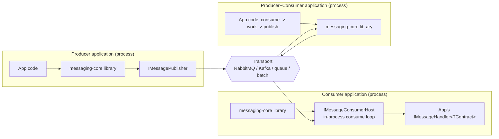
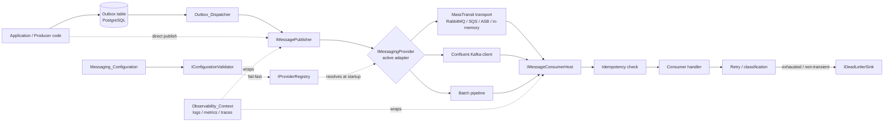
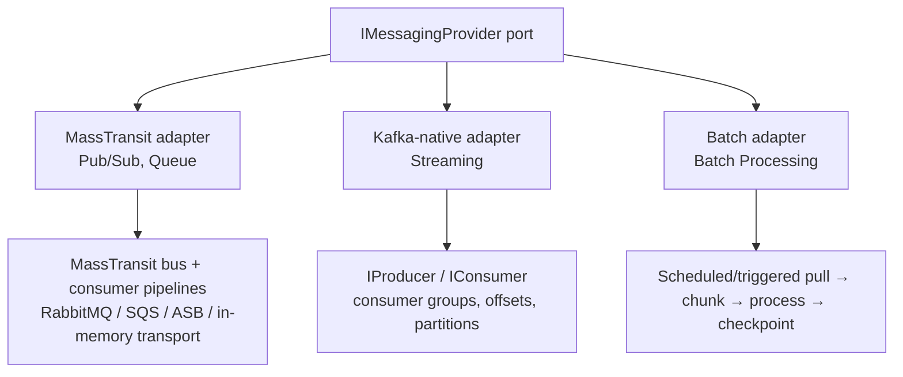
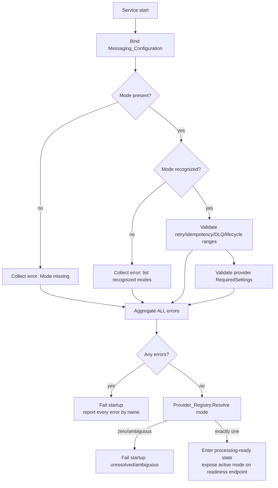
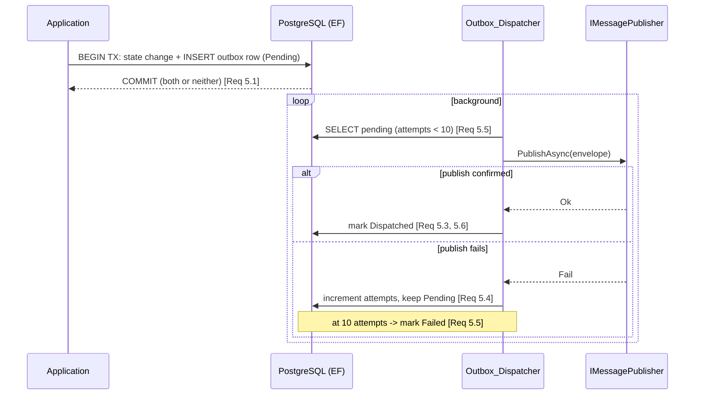

# Design Document

## Overview

Messaging Core is the foundational, **mode-agnostic** layer of a configurable
messaging **library**. One library is embedded by many applications; each embedding instance is
pinned at startup to exactly one `Messaging_Mode` (Publish-Subscribe, Message Queue, Streaming, or
Batch Processing) through validated configuration. This spec defines the shared ports,
extension points, and cross-cutting machinery that let a concrete mode be plugged in as an
adapter and selected via configuration — nothing more.

The design follows **ports and adapters (hexagonal) inside Clean Architecture**: the core
depends only on abstractions declared in the inward layers (`Domain`/`Application`), and each
mode is a swappable `Messaging_Provider` adapter living in `Infrastructure`, resolved at
startup by the `Provider_Registry`. The core is delivered as a shared library embedded in
producer/consumer applications (see **Deployment and Consumer/Producer Model**), not as a
standalone service. Cross-cutting concerns — reliable publishing (outbox), idempotency, and
observability — are implemented once in the core and applied uniformly regardless of the active
mode; retry/backoff with delivery semantics and dead-letter handling are defined as a **uniform
policy** in the core and **delegated to each transport's native mechanism** rather than driven
by a bespoke engine.

### Scope boundaries

**In scope (foundational):**

- The port contracts a mode must implement: publishing, consuming lifecycle, provider identity.
- Configuration-driven mode selection and fail-fast startup validation (Req 1, 2).
- The transport-neutral `Message_Envelope` and its invariants (Req 4).
- Cross-cutting concerns applied across all modes: outbox (Req 5), retry/delivery semantics
  (Req 6), idempotency (Req 7), dead-letter/poison handling (Req 8), observability (Req 9),
  lifecycle/health (Req 10).
- Provider registration and resolution via DI (Req 3).

**Out of scope (later specs):** the internal mechanics of each mode. This document shows only
*how an adapter plugs into the core* — just enough of each strategy (MassTransit-based,
Kafka-native, Batch) to make the plug-in contract concrete. Broker-specific tuning, topology,
partitioning strategy, batch windowing internals, and concrete business message schemas are
deferred.

> Terms in `This_Case` are defined in the requirements glossary and used verbatim here.

---

## Deployment and Consumer/Producer Model

This section fixes *how the core is delivered and embedded*, because it shapes every other
decision in the document. The clarifications here are binding: later sections are written to be
consistent with them.

### Shared library/host — not a standalone service

Messaging Core is delivered as a **shared .NET library** (a NuGet-style package)
that producer and consumer applications **embed** directly. It is **not** a standalone
messaging microservice:

- There is **no** standalone Messaging Core service process, **no** network gateway, **no**
  push/pull edge API, and **no** over-the-wire ack/nack protocol between an application and
  a remote Messaging Core service.
- Each embedding application talks to the underlying transport (RabbitMQ / Kafka / queue /
  batch) **directly through the library's ports** (`IMessagePublisher`,
  `IMessageConsumerHost`, `IMessagingProvider`). The library introduces **no extra network
  hop** — the only hop is the application ↔ broker hop that any transport client makes.
- The ports and cross-cutting pipeline (outbox, retry policy, idempotency, dead-letter,
  observability) run **in-process** within the embedding application.



### One library, publish and consume capabilities

A single application can be a **producer**, a **consumer**, or **both at once** (for example:
consume an event, do work, then publish a result) using the same library. The library exposes
both the publish side and the consume side; which capabilities a given application activates is
chosen at DI registration (see *Use-what-you-need DI registration* below).

### In-process consumer connection model

"Consumer" here means the embedding application's **in-process message handler** — not a client
connecting to a remote Messaging Core service. The handler contract is explicit:

```csharp
// Implemented by the embedding consumer application; invoked in-process by the library's
// consumer host with an already contract-bound envelope (Req 3.3, 4.5, 4.6).
public interface IMessageHandler<TContract>
{
    Task HandleAsync(MessageEnvelope envelope, TContract message, CancellationToken cancellationToken);
}
```

- The library's `IMessageConsumerHost` runs **in-process inside the application** and **owns
  the broker subscription / consume loop**. It pulls/consumes messages, runs them through the
  core pipeline (idempotency → bind contract → handler → retry/dead-letter), and invokes the
  registered `IMessageHandler<TContract>` with an already contract-bound `Message_Envelope`.
- Applications do **not** connect to a remote Messaging Core service to receive messages; they
  **host the consume loop themselves** via the library. The host's lifecycle (`StartAsync` /
  `StopAsync`, state, graceful drain — Req 10.5–10.7) is the application's own lifecycle.

### Shared contracts package split

The pieces that **both** producer and consumer must agree on — the `Message_Envelope` shape and
the message contracts (`MessageType` / payload shapes) — live in a **small, separately
versioned contracts package**, distinct from the core library:

- The contracts package is kept to **cross-cutting / contract level only**. It carries the
  envelope and contract type definitions, nothing domain-specific to either application.
- Per the infrastructure steering — *"No shared library couples services at the domain level;
  shared code is limited to cross-cutting concerns (logging, contracts)"* — this package must
  **not** couple the two applications at the domain level. Producer and consumer depend on the
  shared contract types, not on each other's domain models.
- Independent versioning lets contracts evolve additively (Req 4.7) without forcing a lockstep
  release of the core library or either application.

### Use-what-you-need DI registration

DI registration lets an application activate **only** the capabilities it needs:

- **Publish-only:** registers `IMessagePublisher` (and, if used, the outbox dispatcher). A
  publisher-only application **does not** start a consumer host or a consume loop.
- **Consume-only:** registers the application's `IMessageHandler<TContract>` and starts
  `IMessageConsumerHost`. A consumer-only application **does not** wire the publish side it does
  not use.
- **Both:** registers the publish side and the consume side together, for applications that
  consume, do work, and publish a result.

The registration surface makes the active role explicit so a publisher-only app never spins up a
consume loop and a consumer-only app never stands up unused publish machinery.

### Resilience delegated to the transport, surfaced uniformly

The core **does not implement its own additional resilience / circuit-breaker engine**. Retry,
redelivery, and dead-lettering are **delegated to each transport's native mechanism**, while the
`RetryPolicyConfig` remains a **uniform configuration surface** that **maps down** to the active
provider's native capability:

- **Pub/Sub + Queue (MassTransit):** MassTransit's native retry / redelivery / DLQ.
- **Streaming (Kafka):** Kafka's offset / consumer-group mechanics (manual offset commit,
  reprocessing from the last committed offset).
- **Batch:** batch checkpointing (reprocess from the last checkpointed window).

The core's role is therefore **"define uniform policy + delegate to transport,"** not "own the
redelivery engine." The uniform `RetryPolicyConfig` (max attempts, backoff strategy, per-attempt
delay) and the correctness properties and backoff bounds in this document still hold — they
describe the **policy the core defines and maps onto each transport**, not a bespoke engine the
core runs itself.

**No circuit breaker between consumer and a remote service is needed, because there is no remote
service.** The consumer pulls/consumes **in-process at its own pace**, which gives natural
backpressure: the host simply consumes more slowly under load rather than overwhelming a
downstream hop that does not exist in this model.

---

## Architecture

### Clean Architecture layering

Dependencies point inward. The core abstractions and envelope live in `Domain`; orchestration,
validation, and cross-cutting policies live in `Application`; concrete adapters, EF, and broker
clients live in `Infrastructure`. The library is composed into the **embedding application's**
host (DI composition and, where the app exposes them, health/readiness endpoints) — there is no
separate standalone Messaging Core service host (see **Deployment and Consumer/Producer Model**). `Domain` has
no external package dependencies, satisfying Req 3.8.

```mermaid
graph TD
    subgraph Host["Embedding application host"]
        H[Startup / DI composition\n(use-what-you-need)]
        HE[Health & Readiness endpoints\n(app-exposed, optional)]
    end
    subgraph Infra["Infrastructure (adapters)"]
        MT[MassTransit Provider\nPub/Sub + Queue]
        KF[Kafka-native Provider\nStreaming]
        BA[Batch Provider\nBatch Processing]
        EFO[EF Outbox + Idempotency stores]
        OTEL[OpenTelemetry exporters]
        DLS[Dead-letter sink adapters]
    end
    subgraph App["Application (use cases & policies)"]
        PUB[Publish pipeline]
        CONS[Consume pipeline]
        REG[Provider resolution]
        VAL[Configuration validation]
        DISP[Outbox dispatch]
        RETRY[Retry / classification policy]
        IDEM[Idempotency policy]
    end
    subgraph Domain["Domain (ports + model)"]
        IPUB[IMessagePublisher]
        ICON[IMessageConsumerHost]
        IPROV[IMessagingProvider]
        IREG[IProviderRegistry]
        IVAL[IConfigurationValidator]
        IDISP[IOutboxDispatcher]
        IDLS[IDeadLetterSink]
        IIDEM[IIdempotencyStore]
        ENV[Message_Envelope]
    end

    Host --> App
    Host --> Infra
    App --> Domain
    Infra --> Domain
    MT -.implements.-> IPROV
    KF -.implements.-> IPROV
    BA -.implements.-> IPROV
    EFO -.implements.-> IDISP
    EFO -.implements.-> IIDEM
    DLS -.implements.-> IDLS
```

Note the inward-only arrows: `Infrastructure` adapters implement `Domain` ports; nothing in
`Domain`/`Application` references a concrete provider (Req 3.8).

### Component view

The core is the set of ports plus the cross-cutting pipeline. A `Messaging_Provider` is the
single plug point: it supplies a publisher and a consumer host for one mode. The outbox,
idempotency store, dead-letter sink, retry policy, and observability sit *in front of or
around* the provider, so every mode inherits them unchanged.



### The three adapter strategies behind one set of ports

All three strategies implement the **same** `IMessagingProvider` → `IMessagePublisher` /
`IMessageConsumerHost` contract. Their internals differ and are shallow here by design:



The tradeoff that drives this split is analyzed in **MassTransit Tradeoff Analysis** below.

---

## Components and Interfaces

All I/O methods are `async`, return `Task`/`ValueTask`, and accept a `CancellationToken`
(code-conventions: naming & structure). Ports live in `Domain`/`Application`; the signatures
below are the committed core contract. Provider internals are intentionally not specified.

### Core ports (Domain)

```csharp
// The transport-neutral publishing port. Application code depends only on this (Req 3.1, 3.8).
public interface IMessagePublisher
{
    // Validates envelope invariants, then hands off to the active provider.
    // Throws / returns a failed result on invalid envelope; leaves it undelivered (Req 3.2, 4.3).
    Task<PublishResult> PublishAsync(MessageEnvelope envelope, CancellationToken cancellationToken);
}

// Manages the consumption lifecycle for the active mode (Req 3.3, 10.5–10.7).
public interface IMessageConsumerHost
{
    ConsumerHostState State { get; } // Stopped | Starting | Running | Stopping | Stopped

    Task StartAsync(CancellationToken cancellationToken);

    // Stops accepting new messages; drains in-flight within the shutdown timeout (Req 10.5, 10.6).
    Task StopAsync(CancellationToken cancellationToken);
}

public enum ConsumerHostState { Stopped, Starting, Running, Stopping }

// One adapter per Messaging_Mode. The single plug point (Req 3.4).
public interface IMessagingProvider
{
    MessagingMode Mode { get; }                 // the mode this provider serves
    IMessagePublisher Publisher { get; }
    IMessageConsumerHost ConsumerHost { get; }

    // Declares provider-specific required settings so the validator can check them (Req 2.5).
    IReadOnlyCollection<ProviderSettingDescriptor> RequiredSettings { get; }

    // Backs the readiness probe: can the provider reach its transport? (Req 10.3, 10.4)
    Task<TransportHealth> CheckTransportAsync(CancellationToken cancellationToken);
}

public enum MessagingMode { PublishSubscribe, MessageQueue, Streaming, BatchProcessing }
```

```csharp
// Maps a configured mode to exactly one provider; resolves the active one at startup (Req 1.5, 3.4, 3.5).
public interface IProviderRegistry
{
    // Fails (throws ProviderResolutionException) on zero or more-than-one match (Req 1.6, 3.5, 3.7).
    IMessagingProvider Resolve(MessagingMode mode);

    IReadOnlyCollection<MessagingMode> RegisteredModes { get; }
}

// Fail-fast startup validation (Req 2).
public interface IConfigurationValidator
{
    // Aggregates ALL errors; never stops at the first (Req 2.2, 2.3, 2.4, 2.5).
    ConfigurationValidationResult Validate(MessagingConfiguration configuration);
}

// Reads pending outbox entries and publishes them (Req 5.2–5.6).
public interface IOutboxDispatcher
{
    Task DispatchPendingAsync(CancellationToken cancellationToken);
}

// Records processed idempotency keys; detects duplicates (Req 7).
public interface IIdempotencyStore
{
    Task<bool> IsProcessedAsync(string idempotencyKey, CancellationToken cancellationToken);

    // Records within retention window; failure surfaces so the message is NOT acked (Req 7.3, 7.5).
    Task RecordProcessedAsync(string idempotencyKey, TimeSpan retention, CancellationToken cancellationToken);
}

// Destination for messages that exhaust retries or are poison (Req 6.6, 8).
public interface IDeadLetterSink
{
    Task SendAsync(DeadLetterMessage message, CancellationToken cancellationToken);
}
```

```csharp
// Classifies failures to decide retry vs immediate dead-letter (Req 6.2, 6.3).
public interface IFailureClassifier
{
    FailureKind Classify(Exception error); // Transient | NonTransient
}

public enum FailureKind { Transient, NonTransient }

// Derives a deterministic idempotency key from the envelope (Req 7.1).
public interface IIdempotencyKeyProvider
{
    // Same logical message => identical key. Returns false if underivable (Req 7.6).
    bool TryDerive(MessageEnvelope envelope, out string idempotencyKey);
}
```

### Supporting result types

```csharp
public sealed record PublishResult(bool Succeeded, string? Error)
{
    public static PublishResult Ok() => new(true, null);
    public static PublishResult Fail(string error) => new(false, error);
}

public sealed record ConfigurationValidationResult(IReadOnlyList<ConfigurationError> Errors)
{
    public bool IsValid => Errors.Count == 0; // (Req 2.6)
}

public sealed record ConfigurationError(string SettingName, string Message, string? PermittedValuesOrRange);

public sealed record ProviderSettingDescriptor(string Name, bool Required, string? PermittedValuesOrRange);

public sealed record TransportHealth(bool Reachable, string? UnavailableDependency); // (Req 10.4)
```

### How each adapter plugs in (shallow, by design)

- **MassTransit adapter (Pub/Sub + Queue):** wraps a configured MassTransit bus. `Publisher`
  delegates to `IPublishEndpoint`/`ISendEndpoint`; `ConsumerHost` wraps the MassTransit bus
  start/stop. The core's retry classification, idempotency check, and dead-letter routing run
  inside the MassTransit consumer pipeline as filters, or ahead of it, so behavior matches the
  other modes. Transport is chosen by provider-specific settings (RabbitMQ / SQS / ASB /
  in-memory transport).
- **Kafka-native adapter (Streaming):** wraps `Confluent.Kafka` `IProducer`/`IConsumer`.
  `Publisher` produces to a topic; `ConsumerHost` owns the consumer-group loop with manual
  offset commit so a message is committed only after the core pipeline (idempotency → handler →
  retry/DLQ) completes — preserving at-least-once (Req 6.7).
- **Batch adapter (Batch Processing):** `ConsumerHost` runs a scheduled/triggered pull that
  reads a bounded window, chunks it, runs each item through the same pipeline, then checkpoints
  the window. `Publisher` writes to the batch destination. Checkpointing plays the role offset
  commit / ack plays in the other modes.

Each adapter's deeper internals are owned by its own later spec.

---

## Data Models

### Message_Envelope (Domain)

The transport-neutral message (Req 4). Immutable; the publisher preserves every field through
to delivery (Req 4.4).

```csharp
public sealed record MessageEnvelope
{
    public required Guid MessageId { get; init; }          // unique message id (Req 4.1)
    public required string CorrelationId { get; init; }    // 1..128 chars; generated if absent (Req 4.1–4.3)
    public required string MessageType { get; init; }      // contract identifier for binding (Req 4.5)
    public required DateTimeOffset CreatedAtUtc { get; init; } // UTC creation timestamp (Req 4.1)
    public required IReadOnlyDictionary<string, string> Headers { get; init; } // 0..64 entries (Req 4.1)
    public required ReadOnlyMemory<byte> Payload { get; init; } // opaque bytes; bound on consume (Req 4.5)
    public int ContractVersion { get; init; } = 1;         // additive versioning (Req 4.7)
}
```

| Field | Type | Constraint | Requirement |
|-------|------|-----------|-------------|
| MessageId | Guid | non-empty, unique | 4.1 |
| CorrelationId | string | 1–128 chars; auto-generated if missing | 4.1, 4.2, 4.3 |
| MessageType | string | non-empty; identifies contract | 4.1, 4.5 |
| CreatedAtUtc | DateTimeOffset | UTC | 4.1 |
| Headers | dict<string,string> | 0–64 entries | 4.1 |
| Payload | bytes | opaque; validated against contract on consume | 4.5, 4.6 |
| ContractVersion | int | ≥1; additive, backward-compatible | 4.7 |

### Messaging_Configuration (Application)

Bound from configuration at startup and validated before processing (Req 1, 2, 6, 7, 10).
Provider-specific settings hang off an open extension bag validated via
`ProviderSettingDescriptor`.

```csharp
public sealed record MessagingConfiguration
{
    public required MessagingMode? Mode { get; init; }      // null => fail-fast (Req 1.2)
    public RetryPolicyConfig Retry { get; init; } = new();
    public OutboxConfig Outbox { get; init; } = new();
    public IdempotencyConfig Idempotency { get; init; } = new();
    public DeadLetterConfig DeadLetter { get; init; } = new();     // per-mode (Req 8.5)
    public ObservabilityConfig Observability { get; init; } = new();
    public LifecycleConfig Lifecycle { get; init; } = new();
    public IReadOnlyDictionary<string, string> ProviderSettings { get; init; } // extension point (Req 2.5, 3.6)
        = new Dictionary<string, string>();
}

public sealed record RetryPolicyConfig
{
    public int MaxAttempts { get; init; } = 5;              // 1..100 (Req 6.1)
    public BackoffStrategy Backoff { get; init; } = BackoffStrategy.ExponentialWithJitter; // (Req 6.1)
    public int PerAttemptDelaySeconds { get; init; } = 5;   // 1..300 (Req 6.4)
}

public enum BackoffStrategy { Fixed, Exponential, ExponentialWithJitter }

public sealed record OutboxConfig { public bool Enabled { get; init; } = true; public int MaxDispatchAttempts { get; init; } = 10; } // (Req 5.5)

public sealed record IdempotencyConfig
{
    public bool Enabled { get; init; } = true;
    public int RetentionSeconds { get; init; } = 86_400;    // 1..2_592_000, default 24h (Req 7.3)
}

public sealed record DeadLetterConfig { public string? Target { get; init; } } // per-mode (Req 8.5)

public sealed record ObservabilityConfig { public bool TracingEnabled { get; init; } = true; public string ServiceName { get; init; } = "messaging-core"; }

public sealed record LifecycleConfig { public int ShutdownTimeoutSeconds { get; init; } = 30; } // 1..300 (Req 10.6)
```

**Startup validation flow (fail-fast, aggregating):**



Validation always collects the complete error set in one pass (Req 2.2–2.5); it never stops at
the first error.

### Provider resolution (DI)

Providers register themselves in DI as `IMessagingProvider` keyed by `Mode`. The
`Provider_Registry` is constructed from the registered set.

**Package mapping (Clean Architecture layers → namespace packages).** The layers above map onto
the `Messaging` namespace sub-packages as follows:

- **`Messaging.Abstractions`** — Domain ports + `Message_Envelope` (no external dependencies).
- **`Messaging` (Application)** — pipelines/policies; the Application layer lives in the core
  package.
- **`Messaging.MassTransit` / `Messaging.Kafka` / `Messaging.Batch`** — the Infrastructure
  adapter packages, one per mode strategy.
- **`Messaging.Contracts`** — the separately-versioned shared contracts package (envelope +
  message contracts that both producer and consumer agree on).

- **Registration (extension point, Req 3.6):** each adapter package exposes
  `services.AddXyzMessagingProvider(...)` which registers its `IMessagingProvider`. Adding a
  new mode is a new registration — no change to `Application`/`Domain` (Req 3.6).
- **Resolution (Req 1.5, 3.4, 3.5, 3.7):** at startup the registry looks up the configured
  `Mode`. Exactly one match → active provider. Zero matches → fail with "unresolved/unsupported
  mode" (Req 1.6, 3.7). More than one match → fail with "ambiguous mapping" (Req 3.5). The
  resolved provider is the single `IMessagingProvider` bound into the publish/consume pipeline;
  the mode cannot change after startup (Req 1.4).

### Outbox & Idempotency persistence (PostgreSQL)

PostgreSQL is the one engine across all environments (infrastructure steering). The in-memory
*message-queue transport* option is a **transport** only — the outbox and idempotency stores
always use PostgreSQL via EF, never an in-memory substitute. Tables are detailed in **Data
model** below.

---

## MassTransit Tradeoff Analysis

The core decision: *what sits behind `IMessagingProvider` per mode.* The user-selected
direction is a **hybrid**: MassTransit for the broker-shaped modes, native Kafka client for
streaming, a purpose-built pipeline for batch. The ports are identical across all three, so
this choice is reversible per mode without touching `Domain`/`Application`.

### What MassTransit buys us (and where it fits)

MassTransit is a mature .NET messaging abstraction over broker transports. For
**Publish-Subscribe (RabbitMQ)** and **Message Queue (SQS / Azure Service Bus / in-memory
transport)** it provides, out of the box, machinery we would otherwise hand-roll:

- Retry, redelivery, and scheduled redelivery pipelines.
- First-class **EF outbox** integration, which aligns directly with Req 5.
- Consumer pipelines/filters — a natural insertion point for our idempotency check, failure
  classification, and correlation-id propagation.
- Dead-letter / skipped / error queue handling that maps onto Req 8.
- A uniform publish/send API across RabbitMQ, SQS, and ASB, so one adapter covers three
  broker transports plus an in-memory transport for local/dev of the queue mode.

For these modes the model is a genuine broker: competing consumers, acks, redelivery, and a
dead-letter concept MassTransit already expresses. Using it reduces bespoke plumbing and the
bugs that come with it, which is where its value is highest.

### Where MassTransit does not fit

- **Streaming (Kafka):** MassTransit's Kafka support is the **Rider** abstraction, which
  presents Kafka through a consumer-pipeline lens similar to brokers. True streaming needs
  explicit **consumer-group/partition assignment, offset-commit control, and log-based
  retention/replay** — concerns the Rider deliberately abstracts away. For a mode whose
  defining characteristic *is* offset and partition control, that abstraction is a liability,
  not a convenience.
- **Batch Processing:** this is not a broker or a stream at all. It is a bounded-window pull →
  chunk → process → checkpoint loop. Neither MassTransit nor a streaming client models bounded
  batch windows well; forcing batch into either would distort the mode.

### Chosen approach per mode

| Mode | Behind the ports | Why |
|------|------------------|-----|
| Publish-Subscribe (RabbitMQ) | **MassTransit** | Broker semantics; retry/outbox/DLQ for free |
| Message Queue (SQS / ASB / in-memory transport) | **MassTransit** | One adapter spans three+ transports; competing consumers |
| Streaming (Kafka) | **Confluent.Kafka (native)** | Needs offset/partition/consumer-group control & retention |
| Batch Processing | **Purpose-built batch pipeline** | Bounded windows + checkpointing, not a broker/stream model |

### Alternatives considered and rejected

1. **MassTransit everywhere, including the Kafka Rider.**
   *Pros:* one abstraction, one mental model, least code. *Cons:* the Rider hides exactly the
   controls that make streaming *streaming* (manual offset commit, partition assignment,
   replay). We would fight the abstraction to regain them, and the batch mode still does not
   fit. **Rejected** because it compromises the streaming mode's defining requirements and
   still leaves batch unaddressed.
2. **Hand-rolled abstraction everywhere (no MassTransit).**
   *Pros:* full control, zero third-party coupling, uniform code. *Cons:* we reimplement
   retry, redelivery, EF outbox integration, DLQ routing, and consumer pipelines for RabbitMQ,
   SQS, and ASB — high-risk, high-maintenance plumbing that MassTransit already hardens.
   **Rejected** as poor use of effort for the broker-shaped modes where a proven library fits.

The hybrid captures MassTransit's leverage where the model matches a broker, and keeps native
control where it does not. **Confidence: high** for the broker/streaming split; **medium** for
batch, since its internals are a later spec and may reveal reusable pieces. *What would change
our mind:* if a later streaming spec finds the Kafka Rider's offset controls sufficient, the
streaming adapter can swap to MassTransit behind the unchanged port.

---

## Cross-Cutting Concerns

These are implemented once in the core and wrap every provider, so all four modes behave
identically with respect to reliability and observability.

### Outbox flow (Req 5)



An entry is marked `Dispatched` only after the publisher confirms (Req 5.6) — guaranteeing
at-least-once and never losing a committed entry. State change and outbox row share one
transaction (Req 5.1).

### Retry / backoff and transient classification (Req 6)

The core **defines a uniform retry policy and maps it onto each transport's native
retry/redelivery/DLQ mechanism** — it does not run its own redelivery engine (see
*Resilience delegated to the transport* in **Deployment and Consumer/Producer Model**).
`RetryPolicyConfig` is the single configuration surface; the active provider translates it to
MassTransit retry/redelivery (Pub/Sub + Queue), Kafka offset/consumer-group reprocessing
(Streaming), or batch checkpoint reprocessing (Batch).

- `IFailureClassifier` maps an exception to `Transient` (timeout, connection failure,
  downstream-unavailable — Req 6.2) or `NonTransient` (validation failure, malformed payload —
  Req 6.3). Classification is core logic; it decides *whether* the transport should redeliver.
- `NonTransient` → straight to dead-letter, **no retry** (Req 6.3).
- `Transient` → retry per `RetryPolicyConfig`: `MaxAttempts` (1–100, default 5), backoff
  (fixed / exponential / exponential-with-jitter, default exponential-with-jitter), per-attempt delay
  clamped 1–300s (Req 6.1, 6.4), realized by the transport's native retry mechanism. On
  exhaustion → dead-letter (Req 6.5).
- Delivery semantics documented as **at-least-once** (Req 6.7); idempotent consumers absorb
  duplicates.
- Because the consumer runs **in-process and pulls at its own pace**, backpressure is natural
  and **no circuit breaker to a remote service is required** — there is no remote hop between
  the consumer and a remote Messaging Core service.

### Idempotency store (PostgreSQL) (Req 7)

- `IIdempotencyKeyProvider.TryDerive` produces a deterministic key: same logical message →
  identical key (Req 7.1). If idempotency is enabled and the key cannot be derived, the
  envelope is rejected before side effects with an error (Req 7.6).
- Before the handler runs, `IsProcessedAsync` checks the key; a hit exposes a duplicate
  indication and the message is acked with **no** side-effect re-execution (Req 7.2, 7.4).
- After successful handling, `RecordProcessedAsync` persists the key with the retention window
  (1s–30 days, default 24h — Req 7.3). If recording fails, the message is **not** acked and an
  error is surfaced (Req 7.5), so the record and the ack cannot diverge.

### Dead-letter routing (Req 8)

- Routing is triggered by retry exhaustion (Req 8.1) or an unbindable/poison payload with no
  retry (Req 8.3). Target is configurable per mode (Req 8.5).
- The `DeadLetterMessage` preserves the original envelope byte-for-byte, correlation id,
  failure reason, total attempt count, and the UTC dead-letter timestamp (Req 8.2, 6.6);
  routing happens within 5s of the final failure and removes the message from the active
  pipeline (Req 8.1).
- Each dead-letter emits one metric and one structured log with correlation id, failure
  reason, attempt count (Req 8.4).
- If routing to the sink itself fails, the message stays in the active pipeline, a log entry
  records the routing failure, and the message is **not** acked to its source (Req 8.6).

### Observability (Req 9) — OpenTelemetry

- **Correlation id:** generated if the producer omits it (Req 9.3), attached to the envelope,
  and propagated unchanged producer → publish → delivery → consumer (Req 9.4), included on
  every log entry and trace span (Req 9.1, 9.2).
- **Metrics (monotonic counters, Req 9.5):**
  `messaging.published.count`, `messaging.consumed.count`, `messaging.retry.count`,
  `messaging.deadletter.count`.
- **Tracing (Req 9.6):** a publish span and a consume span linked via the correlation id
  (propagated as the trace/baggage carrier through headers), so a logical operation is one
  traceable flow across the publish/consume boundary.
- **Redaction (Req 9.7):** secrets and sensitive raw payloads are replaced with a fixed marker
  before the log call; sensitive values are referenced by key name, never written
  (code-conventions security).
- **Non-blocking (Req 9.8):** failures in logging, metrics, or tracing never fail the
  publish/consume operation — observability is best-effort around the message path.

### Lifecycle, health, graceful shutdown (Req 10)

The library provides health check logic and the in-process consumer host lifecycle; the
embedding application wires these into its own host (for example, exposing liveness/readiness
endpoints via the app's health-check infrastructure). The library does not stand up its own
service endpoints.

- **Liveness** returns healthy whenever the process runs, within 1s (Req 10.1, 10.2).
- **Readiness** calls `IMessagingProvider.CheckTransportAsync`; ready within 1s when the
  transport is reachable (Req 10.3), not-ready with the unavailable dependency named otherwise
  (Req 10.4). Readiness also reports the active mode (Req 1.7).
- **Shutdown:** on signal, `ConsumerHost.StopAsync` stops accepting new messages (Req 10.5),
  drains in-flight within the configured timeout (default 30s, 1–300s — Req 10.6); if the
  timeout elapses the host is terminated and the count of incomplete in-flight messages is
  recorded as a non-negative integer (Req 10.7).

---

## Data Model

Both tables are PostgreSQL, mapped with EF (`DbContext` in `Infrastructure`; no EF types in
`Domain`). Parameterized access only; migrations applied the same way across environments and
never auto-applied to production at startup (steering).

### Outbox table — `messaging_outbox`

| Column | Type | Notes |
|--------|------|-------|
| id | uuid | PK (= envelope MessageId) |
| correlation_id | varchar(128) | NOT NULL (Req 4.1) |
| message_type | varchar(256) | NOT NULL |
| contract_version | int | NOT NULL default 1 |
| headers | jsonb | 0–64 entries |
| payload | bytea | the envelope payload |
| status | smallint | 0 Pending, 1 Dispatched, 2 Failed (Req 5.3–5.5) |
| attempt_count | int | NOT NULL default 0; cap 10 (Req 5.5) |
| created_at_utc | timestamptz | NOT NULL |
| dispatched_at_utc | timestamptz | nullable; set on confirm (Req 5.3) |
| last_error | text | nullable; redacted (Req 9.7) |

Index on `(status, created_at_utc)` for the dispatcher's pending scan. EF maps `status` to the
`OutboxStatus` enum; `headers` to `jsonb`.

### Idempotency table — `messaging_idempotency`

| Column | Type | Notes |
|--------|------|-------|
| idempotency_key | varchar(256) | PK (Req 7.1) |
| correlation_id | varchar(128) | NOT NULL |
| processed_at_utc | timestamptz | NOT NULL (Req 7.3) |
| expires_at_utc | timestamptz | NOT NULL; = processed + retention (Req 7.3) |

PK on `idempotency_key` makes the duplicate check a single indexed lookup and makes
record-on-success atomic (Req 7.2, 7.4). A background sweep removes rows past `expires_at_utc`.
EF maps the PK; inserts use `ON CONFLICT DO NOTHING` semantics via the provider so a concurrent
duplicate cannot double-insert.

---

## Error Handling

Mapped to requirements; fail fast on invalid state, throw domain-specific exceptions, log
where handled (code-conventions).

| Condition | Behavior | Requirement |
|-----------|----------|-------------|
| Missing mode at startup | Fail startup, report mode missing | 1.2, 2.4 |
| Unrecognized mode | Fail startup, list recognized modes | 1.3, 2.4 |
| Unresolved mode (no provider) | Fail startup/init, report unresolved mode | 1.6, 3.7 |
| Ambiguous mode (>1 provider) | Fail init, report ambiguous mapping | 3.5 |
| Missing/invalid config values | Aggregate all, report each by name + permitted set/range | 2.2, 2.3, 2.5 |
| Invalid envelope on publish | Reject, return validation error, leave undelivered | 3.2, 4.3 |
| Correlation id empty / >128 chars | Reject with invalid-correlation-id error | 4.3 |
| Unknown message contract on consume | Reject, return unknown-contract error; dead-letter as poison | 4.6, 8.3 |
| Transient processing error | Retry per policy, then dead-letter | 6.2, 6.5 |
| Non-transient processing error | Dead-letter immediately, no retry | 6.3 |
| Idempotency key underivable (enabled) | Reject before side effects, surface error | 7.6 |
| Idempotency record fails | Do not ack, leave record unchanged, surface error | 7.5 |
| Dead-letter routing fails | Keep in pipeline, log routing failure, do not ack | 8.6 |
| Observability emit fails | Continue processing; do not fail publish/consume | 9.8 |
| Outbox publish fails | Keep Pending, increment attempts, retry; fail at 10 | 5.4, 5.5 |
| In-flight not drained at shutdown | Terminate host, record incomplete count | 10.7 |

Exceptions are domain-specific (`ProviderResolutionException`, `ConfigurationInvalidException`,
`EnvelopeValidationException`, `UnknownContractException`, `IdempotencyRecordException`). The
library surfaces them to the embedding application through the port return types and typed
exceptions; it does not expose a network error contract of its own. If the embedding
application fronts the library with an HTTP API, that application maps these to Problem Details
without leaking internals.

---

## Correctness Properties

*A property is a characteristic or behavior that should hold true across all valid executions
of a system — essentially, a formal statement about what the system should do. Properties
serve as the bridge between human-readable specifications and machine-verifiable correctness
guarantees.*

These properties cover the **pure/core logic** of the foundational layer: envelope invariants,
provider resolution, configuration validation, the outbox/retry/idempotency/dead-letter
pipeline, and observability contracts. Provider internals (later specs) are exercised through a
**fake provider** so the core behavior is isolated; the outbox and idempotency stores use a
real PostgreSQL instance (Testcontainers) where transactional semantics matter. Endpoint
wiring and timing-bound criteria are covered by integration tests in the Testing Strategy, not
as properties.

### Property 1: Provider resolution is exact, fail-fast, and stable

*For all* sets of registered providers and any configured mode: if exactly one provider has
that mode, `Resolve` returns it and repeated resolution returns the same provider for the
instance lifetime; if zero providers have that mode, `Resolve` fails with an unresolved-mode
error; if more than one has that mode, `Resolve` fails with an ambiguous-mapping error.

**Validates: Requirements 1.4, 1.5, 1.6, 3.4, 3.5, 3.7**

### Property 2: Configuration validation reports every missing value

*For all* configurations missing an arbitrary subset of required settings (including
provider-specific required settings), the validation result's errors name every missing
setting in that subset — never only the first.

**Validates: Requirements 2.2, 2.5**

### Property 3: Range and set validation is complete and sound

*For all* numeric settings driven outside their permitted range (max attempts 1–100,
per-attempt delay 1–300s, idempotency retention 1–2,592,000s, shutdown timeout 1–300s) or
values outside a permitted set, validation yields an error naming the setting with its
permitted range/set; and *for all* configurations whose required values are present and whose
numerics are within bounds, validation reports zero errors.

**Validates: Requirements 2.3, 2.6**

### Property 4: Invalid envelopes are rejected and never delivered

*For all* envelopes with a missing or malformed required field (including a correlation id that
is empty or exceeds 128 characters), `PublishAsync` returns a failure result and the underlying
provider receives nothing.

**Validates: Requirements 3.2, 4.3**

### Property 5: A correlation id is always generated when absent

*For all* submissions without a correlation id, the resulting envelope carries a non-empty
correlation id of at most 128 characters, and independent submissions receive distinct ids.

**Validates: Requirements 4.2, 9.3**

### Property 6: Publishing preserves envelope fields to delivery

*For all* valid envelopes, the envelope the provider receives at delivery is equal to the
published envelope on message id, correlation id, message type, creation timestamp, and every
header entry.

**Validates: Requirements 4.4**

### Property 7: Correlation id propagates unchanged end-to-end

*For all* messages published and then consumed through the core, the correlation id observed at
consume equals the correlation id at publish, unchanged.

**Validates: Requirements 9.2, 9.4**

### Property 8: Unknown contracts are rejected before the consumer

*For all* received messages whose message type matches no known contract, binding is rejected
with an unknown-contract error and the consumer handler is never invoked.

**Validates: Requirements 4.6**

### Property 9: Additive versioning stays backward-compatible

*For all* payloads that extend an earlier contract version with additional optional fields, a
consumer bound to the earlier version still binds successfully and ignores the unrecognized
fields.

**Validates: Requirements 4.7**

### Property 10: Outbox delivers every committed entry at least once

*For all* sets of committed pending outbox entries, each entry is published through the
publisher at least once; an entry is marked dispatched only after the publisher confirms
publication; and once dispatched it is never dispatched again.

**Validates: Requirements 5.2, 5.3, 5.6**

### Property 11: Outbox failures are retained and bounded

*For all* outbox entries whose publication fails, the entry remains pending with its originating
state change unchanged and becomes eligible for a later attempt; and *for all* entries that
keep failing, dispatch attempts never exceed 10, after which the entry is marked failed and
excluded from further automatic dispatch.

**Validates: Requirements 5.4, 5.5**

### Property 12: Retry is bounded and routes to dead-letter on exhaustion

*For all* transient processing failures, the message is retried up to the configured maximum
attempt count and the attempt count never exceeds that maximum before the message is routed to
the dead-letter sink; and *for all* non-transient failures, the message is routed to the
dead-letter sink with zero retry attempts.

**Validates: Requirements 6.2, 6.3, 6.5**

### Property 13: Backoff delay stays within bounds

*For all* backoff strategies (fixed, exponential, exponential-with-jitter) and attempt indices,
the computed per-attempt delay is at least 1 second and at most 300 seconds.

**Validates: Requirements 6.4**

### Property 14: Dead-lettering preserves the message and its context

*For all* messages routed to the dead-letter sink, the dead-letter record preserves the original
envelope byte-for-byte and carries the correlation id, the idempotency key, the failure reason,
the total processing attempt count, and the UTC dead-letter timestamp.

**Validates: Requirements 6.6, 8.2**

### Property 15: Idempotency keys are deterministic

*For all* pairs of envelopes representing the same logical message, the derived idempotency key
is identical, and deriving the key repeatedly from one envelope yields the same value.

**Validates: Requirements 7.1**

### Property 16: Idempotent consumption executes side effects exactly once

*For all* sequences of deliveries of the same logical message, the consumer's side effect
executes exactly once and every delivery after the first is detected as a duplicate and
acknowledged without re-executing the side effect.

**Validates: Requirements 7.2, 7.4**

### Property 17: A failed idempotency record never acknowledges the message

*For all* failures while recording a processed idempotency key, the message is not acknowledged,
the processed-key store is left unchanged, and an error indication is surfaced to the consumer.

**Validates: Requirements 7.5**

### Property 18: An underivable idempotency key rejects before side effects

*For all* envelopes from which the idempotency key cannot be derived while idempotent
consumption is enabled, the envelope is rejected before any side effect runs and an error
identifying the missing key is surfaced.

**Validates: Requirements 7.6**

### Property 19: Unbindable payloads are poison and skip retry

*For all* received payloads that cannot be bound to a known contract, the message is routed to
the dead-letter sink as a poison message with zero retry attempts.

**Validates: Requirements 8.3**

### Property 20: Dead-letter routing failure keeps the message unacknowledged

*For all* failures while routing a message to the dead-letter sink, the message is retained in
the active pipeline and is not acknowledged to its source.

**Validates: Requirements 8.6**

### Property 21: Metrics counters are monotonic and count events

*For all* sequences of publish, consume, retry, and dead-letter events, each corresponding
counter is non-decreasing and its final value equals the number of events of that type.

**Validates: Requirements 9.5**

### Property 22: Redaction removes sensitive values before logging

*For all* log inputs containing a value flagged as a secret or sensitive payload, the written
log entry contains the fixed redaction marker and does not contain the original sensitive value.

**Validates: Requirements 9.7**

### Property 23: Observability failures never fail the message operation

*For all* failures in logging, metric recording, or trace recording, the associated publish or
consume operation still completes successfully.

**Validates: Requirements 9.8**

### Property 24: Readiness reflects transport reachability

*For all* transport-health results, the readiness status is ready when and only when the
transport is reachable, and when not reachable the readiness response names the unavailable
dependency.

**Validates: Requirements 10.3, 10.4**

### Property 25: Shutdown records the exact incomplete in-flight count

*For all* counts of in-flight messages that do not complete within the shutdown timeout, the
consumer host terminates and the recorded incomplete-in-flight count equals that number and is
never negative.

**Validates: Requirements 10.7**

---

## Testing Strategy

A **dual approach**: property-based tests verify the universal properties above across many
generated inputs; example-based unit tests and integration tests cover concrete scenarios,
wiring, timing, and infrastructure behavior that are not input-varying.

### Why property-based testing applies here

The foundational core is rich in pure, input-varying logic: envelope preservation and
round-trips, deterministic idempotency keys, bounded retry/backoff, outbox at-least-once, and
provider-resolution rules. These express genuine "for all inputs" statements, so PBT is the
right tool. Provider internals (MassTransit/Kafka/batch mechanics) are **not** property-tested
here — they are later specs and are faked at this layer. Infrastructure behavior (real
transactions, broker reachability), endpoint wiring, and timing bounds (<1s, <5s, 30s drain)
are covered by integration tests, not properties.

### Property-based tests

- **Library:** FsCheck (via `FsCheck.Xunit`) for the C#/xUnit stack. Do not hand-roll
  generators-plus-loops; use the library's generators and shrinking.
- **Iterations:** each property test runs a **minimum of 100** generated cases.
- **Tagging:** each property test is tagged with a comment in the form
  **Feature: messaging-core, Property {number}: {property_text}** referencing the
  property above, and is implemented as a **single** property-based test per property.
- **Isolation:** a `FakeMessagingProvider` captures published/delivered envelopes and simulates
  confirm/fail outcomes so core behavior is tested without a real transport. Pure functions
  (backoff delay, idempotency-key derivation, redaction, readiness mapping, config validation)
  are tested directly.
- **Stores:** Properties 10 and 11 (outbox) and 16/17 (idempotency) that depend on persistence
  run against a PostgreSQL Testcontainer, since the one-engine rule forbids an in-memory DB
  substitute; generated inputs drive many entries/keys through the real store.

Property-to-test mapping: Properties 1–25 above each map to exactly one property-based test.

### Unit tests (example-based)

Focused examples and edge cases that are not universal:

- Startup fails with the right message for: missing mode (1.2), unrecognized mode listing the
  recognized set (1.3, 2.4).
- Consumer host state sequence Stopped → Starting → Running → Stopping → Stopped (3.3).
- Header-count edges: 0, 1, 64 accepted; 65+ rejected (4.1 edge cases).
- Idempotency retention boundary: key within window still blocks; key past `expires_at_utc`
  no longer blocks (7.3 edge case).
- Dead-letter emits exactly one metric and one structured log with correlation id, reason, and
  attempt count, via mocks (8.4).
- Structured log fields present for publish/consume/retry/dead-letter events via a mock logger
  (9.1).
- Per-mode dead-letter target binding (8.5).
- Shutdown stops accepting new messages once `StopAsync` begins (10.5).
- Architecture test (NetArchTest or equivalent) asserting `Domain` and `Application` reference
  no concrete provider assembly (3.1, 3.8).

### Integration tests (Testcontainers)

Per the infrastructure steering, integration tests use ephemeral containers of the **same
engine/version as production** and apply migrations the same way; each run starts clean. These
cover infrastructure behavior and wiring that properties cannot:

- **PostgreSQL:** outbox atomicity — commit persists both the state row and the outbox row;
  forced failure persists neither (5.1).
- **RabbitMQ (MassTransit adapter):** publish/consume round-trip and dead-letter routing for
  the Pub/Sub and Queue modes, including routing occurs within 5s of final failure and the
  message leaves the active pipeline (8.1).
- **Kafka (native adapter):** produce/consume with manual offset commit demonstrating
  at-least-once and correlation propagation for the Streaming mode.
- **OpenTelemetry:** in-memory exporter asserting publish and consume spans are linked via the
  correlation id (9.6).
- **Endpoints & timing:** liveness returns healthy within 1s (10.1, 10.2); readiness returns
  ready within 1s when transport reachable and not-ready naming the dependency otherwise (10.3,
  10.4); readiness/info exposes the active mode (1.7); graceful drain completes in-flight within
  the shutdown timeout (10.6).

Integration tests use 1–3 representative examples each — they verify wiring and external
behavior, not input-varying logic, so repeated randomized iterations add no value there.
