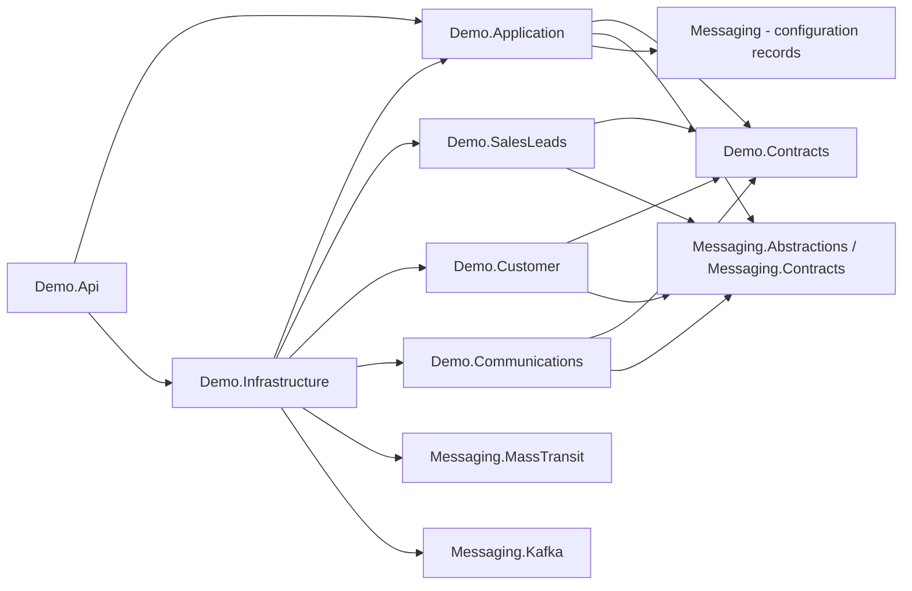
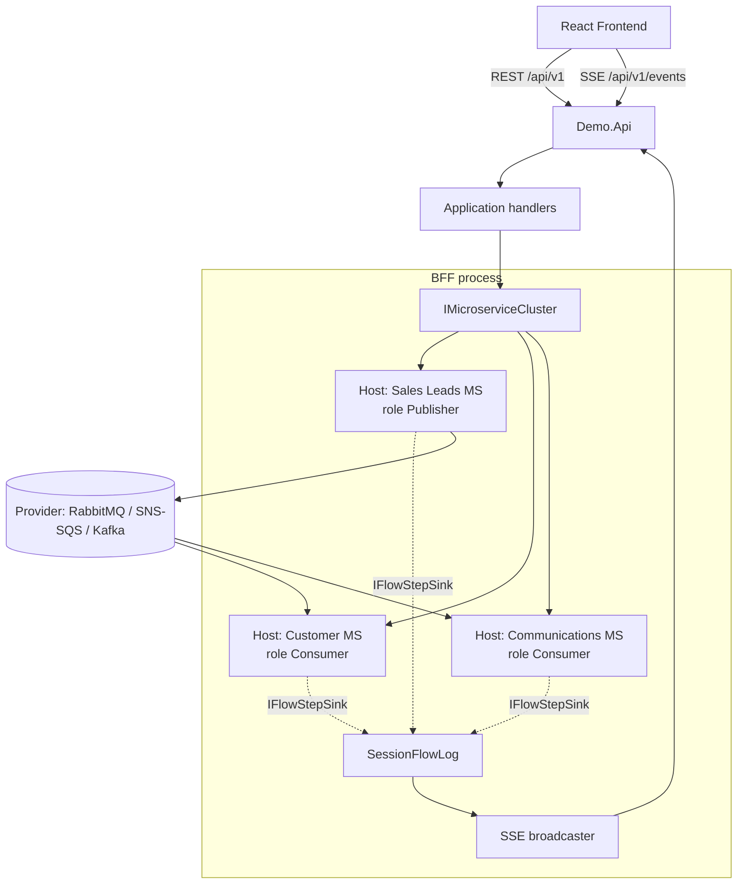
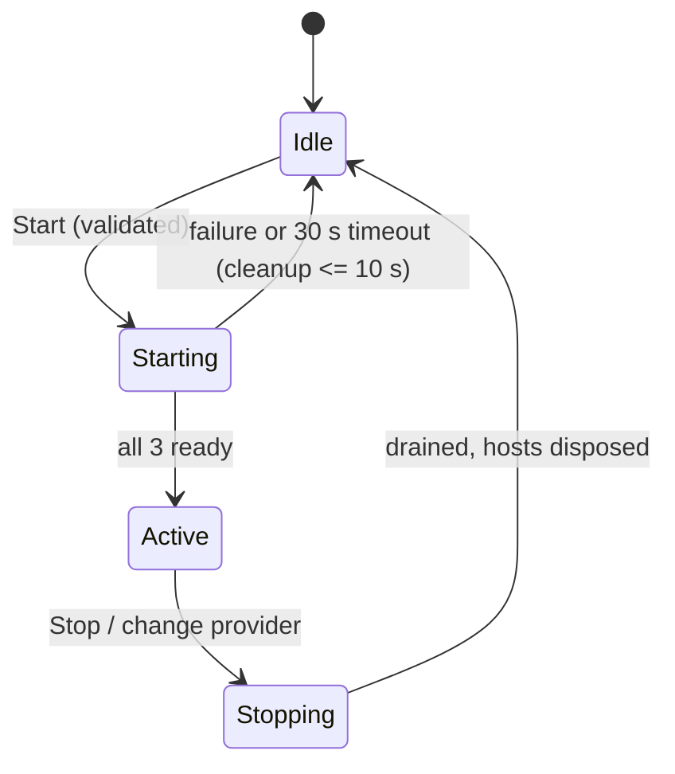
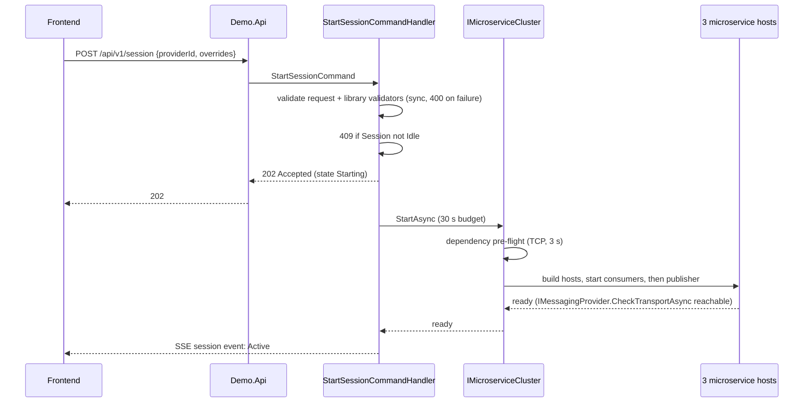
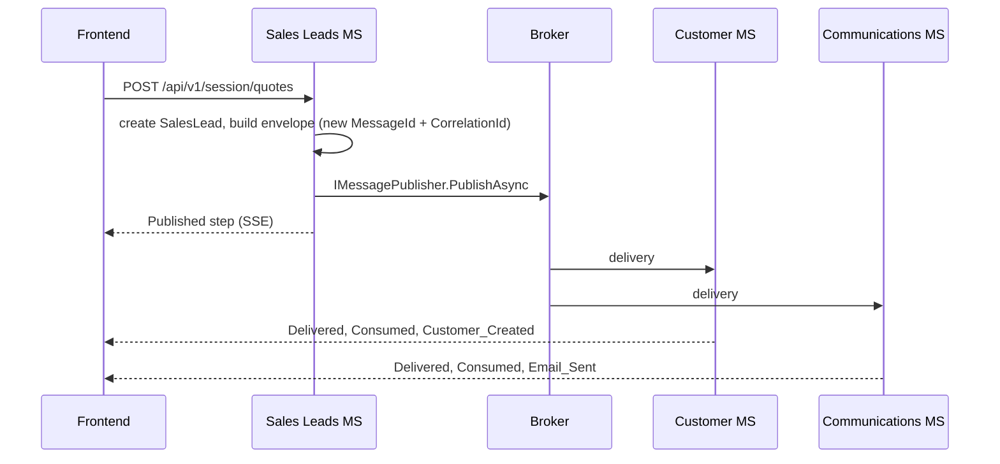

# Design Document: Messaging Demo App

## Overview

The Messaging Demo App is a local, single-user tool under `demo/` that shows the Messaging Core library working end to end. A React Frontend talks to a .NET Backend_For_Frontend (BFF). The user picks a provider, reviews its defaults, starts it, and clicks "Quote Accepted". Three mock microservices then exchange that event through the selected provider, and the Frontend animates the flow.

Nothing in `src/`, `tests/`, `MessagingCore.sln`, `global.json` or the root `docker-compose.yml` changes (Req 1.3, 1.4). The demo has its own solution, `demo/MessagingDemo.sln`, that references the library projects by path.

### Summary of decisions

| # | Decision | Recommendation | Confidence |
|---|---|---|---|
| D1 | Hosting of the three mock microservices | One BFF process. Each microservice gets its own isolated `IHost` and DI container, created per Session. | High |
| D2 | Pushing flow steps to the browser | Server-Sent Events (SSE) with a per-Session sequenced event log and replay on connect. | Medium-high |
| D3 | Idempotency store and dead-letter sink | In-memory demo adapters. This deviates from the "no in-memory substitute" database rule; see D3. | Medium |
| D4 | When the library is registered | At BFF startup as a self-check, and again per Session with the user's settings. | Medium |
| D5 | Source of Retrying and Dead_Lettered flow steps | Demo decorators and an `IDeadLetterLog` adapter, not the library's `IMessagingLog` Retry event. | High (forced by library behavior) |

### Findings in the library that shape the design

The design was grounded in the code under `src/`. Several behaviors are not what the library's specs or README imply. The demo cannot change `src/` (Req 1.3), so it works around each one in `demo/` and lists them as follow-ups for the library (see "Library follow-ups").

| ID | Finding | Evidence | Consequence for the demo |
|---|---|---|---|
| F1 | `AddMassTransitMessagingProvider` only wires the RabbitMQ bus seam. The `sns-sqs-provider` design (section 10) says it selects an Amazon SQS seam by `settings.Transport`, but the code has no `AmazonSqs` reference. | `MassTransitMessagingProviderServiceCollectionExtensions.cs` (`RegisterBusSeam` always calls `RabbitMqBusAdapter.Create`) | The demo composes the SNS/SQS seams itself: `AmazonSqsBusAdapter.Create`, `SnsSqsTopologyManager`, `AwsSnsSqsTopologyClient`, `AmazonSqsMetrics`, `SqsDeadLetterSink`, `AmazonSqsBusHostedService`. It registers `IMassTransitBusAdapter` first so the library's `TryAdd` does not replace it. |
| F2 | The RabbitMQ receive queue is always `messaging-core` when wired through DI. `RabbitMqBusAdapter.Create` accepts `receiveQueueName`, but the DI factory never passes it. | `RegisterBusSeam`, `RabbitMqBusAdapter.DefaultReceiveQueueName` | Two consumers wired through DI would share one queue and compete instead of fan out (violates Req 5.7). The demo pre-registers its own `IMassTransitBusAdapter` built with `receiveQueueName` = `customer-ms` or `communications-ms`. |
| F3 | Nothing starts the RabbitMQ bus for a publisher-only role, and nothing calls `IMessageConsumerHost.StartAsync` for a consumer. Only `AmazonSqsBusHostedService` (SNS/SQS) and `KafkaConsumerHostedService` (Kafka) exist. | grep of `StartBusAsync` / `StartAsync` usages | The demo adds a small `TransportLifecycleHostedService` for RabbitMQ. |
| F4 | `RetryExecutor` and `CoreConsumeProcessor` never call `ObservabilityContext.OnRetry`, so `IMessagingLog` never receives a `Retry` event. | grep: `OnRetry` has no callers | Retrying steps cannot come from the library log. The demo derives them from a handler decorator that counts attempts (D5). |
| F5 | The only `IDeadLetterSink` implementation is `SqsDeadLetterSink`. RabbitMQ and Kafka have none. | grep `IDeadLetterSink` | The demo supplies `InMemoryDeadLetterSink` for RabbitMQ and Kafka, and wraps `SqsDeadLetterSink` for SNS/SQS. |
| F6 | `IMessagingLog.MessageEvent(type, correlationId, timestamp)` carries no message type, but Req 11.5 requires it in log entries. `IDeadLetterLog.DeadLettered` carries no failure kind. | `IMessagingLog.cs`, `IDeadLetterLog.cs` | The demo log adapter adds the message type from the single registered contract and resolves the failure kind from its own attempt tracker. |
| F7 | `JsonContractBinder` is tolerant: missing or empty fields bind successfully. The binder only fails on malformed JSON or an unknown message type. | `JsonContractBinder.cs` | Req 7.6 / 8.1 (invalid payload must not reach the handler) needs a validating `IHandlerInvoker` in the demo. |
| F8 | `KafkaClientConfigFactory` uses `AutoOffsetReset.Earliest`. `AddKafkaMessagingProvider` always registers `KafkaConsumerHostedService`, even when the host only publishes. | `KafkaClientConfigFactory.cs`, `KafkaMessagingProviderServiceCollectionExtensions.cs` | Group ids and the topic stay stable across Sessions so committed offsets prevent replay of old events. The Sales Leads host removes the consumer hosted-service descriptor so the publisher does not consume. |
| F9 | The library registers one `IMessageConsumerHost`, one `IHandlerInvoker`, one `IIdempotencyStore`, and one provider per container, and keys idempotency on `MessageId` + `MessageType` + payload. | `MessagingServiceCollectionExtensions.cs`, `DefaultIdempotencyKeyProvider.cs` | Two consumers in one container would share one idempotency store, so the second consumer would treat the event as a duplicate. This drives D1. |
| F10 | Core defaults are `MaxAttempts` 5, per-attempt delay 5 s, shutdown timeout 30 s. `Fail once` needs `MaxAttempts` >= 2. | `ConfigurationBounds.cs` | The demo applies `MaxAttempts` 3, `Fixed` backoff, 1 s delay, shutdown timeout 10 s and shows them as the applied defaults (Req 3.5). |
| F11 | The Messaging static validators `KafkaStartupValidator.Validate` and `AmazonSqsStartupValidator.Validate` are pure and public. `MassTransitProviderSettings.ToRequiredSettings()` and `KafkaProviderSettings.Describe()` give descriptors for `ConfigurationValidator`. | respective source files | Settings validation (Req 3.7, 4.6) runs before any bus is built or started. |

## Design Decisions

### D1. Hosting: one BFF process with one isolated host per microservice

**Options**

| Option | Description | Pros | Cons |
|---|---|---|---|
| A (recommended) | One BFF process. Three child `IHost` instances, one per microservice, each with its own `ServiceCollection`. | Matches F9: each microservice has its own publisher/consumer role, idempotency store, queue or group identity, and failure behavior. Start and stop stay in-process, so the 30 s start limit and 10 s cleanup limit (Req 4.5, 4.10) are enforceable. Flow steps need no network back-channel. One README command. | Less realistic than separate processes. A crash in one microservice can take down the BFF. |
| B | BFF plus three separate .NET processes. | Real process isolation. Shows the library in a true multi-service layout. | Needs process orchestration (ports, start order, restarts). Needs a telemetry back-channel from each service to the BFF, which adds synchronous HTTP coupling the demo is meant to avoid. Start and stop timing is harder to guarantee. Harder to test. Multiple commands to run. |
| C | One DI container with `AddMessagingCore` and all roles. | Smallest code. | Does not work: F9 and F2 mean both consumers would share a queue or an idempotency store. Req 5.7 and 8.7 fail. |

**Recommendation:** Option A. The `Demo.SalesLeads`, `Demo.Customer` and `Demo.Communications` projects reference neither ASP.NET nor the BFF. Their only outward channel is the `IFlowStepSink` port. To move to Option B later, implement an HTTP or OTLP `IFlowStepSink` and host each microservice project in its own worker. Confidence is high. I would change my mind if the demo must show one service being killed independently; the "Always fail" toggle covers most of that story.

Each Session builds the three hosts, starts them, and disposes them on stop. Nothing about a provider lives past a Session (Req 4.7).

### D2. Push channel: Server-Sent Events

**Requirements that drive the choice:** push within 500 ms with no polling (9.5); replay of every Flow_Step after the last clear, in order, within 5 s of reconnect (9.10); disconnected indicator within 2 s (9.11); reconnect every 1-10 s (9.11). Traffic is one-way (server to browser). Commands already use REST.

| Option | Pros | Cons |
|---|---|---|
| SSE (recommended) | One-way fits the need. Plain HTTP, no extra npm package, works with `curl` for debugging. Event `id:` plus a sequence number maps directly onto replay. Works with standard CORS. | `EventSource` cannot set headers. Its built-in reconnect does not meet the 1-10 s rule exactly, so the Frontend wraps it. ASP.NET Core 8 has no first-class SSE helper (that arrives in .NET 9), so the BFF writes `text/event-stream` itself. Detecting a silent network drop needs a heartbeat. |
| SignalR | Built-in reconnect policy, typed hubs, bidirectional. | Extra server and npm dependency. It does not replay missed messages, so a sequence/replay protocol is still needed. A bidirectional channel adds no value here. |
| Raw WebSocket | Full control. | Everything (reconnect, framing, replay, CORS) is hand-written. |
| Polling | Simplest. | Violates "without the Frontend polling" (9.5). |

**Recommendation:** SSE, with these rules:

- Endpoint: `GET /api/v1/events`. It works with or without an active Session so the Frontend can observe Starting, Active, and Failed.
- Each flow step has a monotonically increasing `sequence` and is sent with `id: <sequence>`.
- On connect the BFF sends a `session` snapshot, a `counters` snapshot, then replays every retained step after the last clear, in sequence order. The Frontend de-duplicates by `sequence`, so replay after a short drop is idempotent and a page refresh restores the full feed.
- The BFF sends a `heartbeat` event every 500 ms. The Frontend treats 1.5 s without any event as disconnected (inside the 2 s limit), closes the `EventSource`, and reconnects itself with delays 1 s, 2 s, 4 s, 8 s, then 10 s (inside the 1-10 s rule).

Confidence is medium-high. I would switch to SignalR if the app later needs client-to-server messages on the same channel.

### D3. Idempotency store, dead-letter sink and outbox

`infrastructure.md` says one engine (PostgreSQL) in every environment, no in-memory substitute for the database, and the outbox pattern for "update state and publish". The demo deliberately has no database: the requirements make Mock_Customer and Mock_Email in-memory only (Req 7.1, 8.5), and the library's `EfIdempotencyStore` needs PostgreSQL.

- **Decision:** `InMemoryIdempotencyStore` (one instance per microservice host) and `InMemoryDeadLetterSink`. State is lost when the BFF stops, and each Session starts clean.
- **Why it is acceptable:** the demo is a local single-user tool, it holds no authoritative data, and each store is per-microservice, which is the property that matters for idempotency semantics (F9).
- **Alternative:** add PostgreSQL to the demo compose file and use `EfIdempotencyStore`. This is more faithful and shows the persistence package, but adds a container, migrations, and a start-up dependency to every provider path.
- **Outbox:** not used. Sales Leads has no state change to commit atomically with the publish. A failed publish discards the lead (Req 6.7).

If you want the PostgreSQL variant, say so; it is an additive change behind `IIdempotencyStore`.

### D4. Library registration timing

Req 11.1 and 11.2 speak of registering the library "when the BFF starts", but the provider is chosen after start. The design satisfies both:

1. At BFF startup, `ProviderCompositionSelfCheck` builds, without starting, a service provider for each supported provider using its defaults and resolves `IMessagingProvider`. Any exception stops startup, logs the failed registration, and exits non-zero before the BFF accepts requests.
2. On Start, the same composition code runs again with the user's validated overrides.

Assumption to verify in the first implementation task: building the buses (`Bus.Factory.CreateUsing...`, Confluent client builders) performs no network I/O. If it does, the self-check is limited to validators and descriptor resolution.

### D5. Where retry and dead-letter flow steps come from

Because of F4 and F6:

- **Retrying:** a `FlowReportingHandler` decorator wraps the real handler. It counts attempts per correlation id. When the wrapped handler throws and `IFailureClassifier` says Transient and `attempt < Retry.MaxAttempts`, it emits `Retrying(attempt)` and rethrows. Because `RetryExecutor` retries in-process, handler entries equal attempts.
- **Dead_Lettered:** `DemoDeadLetterLog : IDeadLetterLog` emits the step with the attempt count from the library. The failure kind comes from the attempt tracker (last classified kind for that correlation id). If the tracker has no entry, the message never reached the handler (unknown contract, invalid payload, missing key), which the library treats as non-transient, so the kind is "non-transient".
- **Delivered:** `DemoMessagingLog : IMessagingLog` emits `Delivered` on the `Consume` event and writes the structured log entry required by Req 11.5.

## Architecture

### Solution layout (all under `demo/`)

```
demo/
  MessagingDemo.sln
  Directory.Build.props            net8.0, nullable, implicit usings, warnings as errors
  README.md
  docker-compose.yml               RabbitMQ only (pinned tag)
  scripts/start-broker.sh          one command per provider, with cleanup on failure
  src/
    Demo.Contracts/                QuoteAcceptedEvent, FlowStep, FlowStepKind, IFlowStepSink
    Demo.SalesLeads/               mock publisher microservice (own Domain/Application folders)
    Demo.Customer/                 mock consumer microservice
    Demo.Communications/           mock consumer microservice
    Demo.Application/              CQRS handlers, validators, ports, session state machine, flow log, masking
    Demo.Infrastructure/           Messaging composition per provider, microservice hosts, in-memory stores, SSE broadcaster
    Demo.Api/                      Minimal API host, Problem Details, CORS, SSE endpoint
    frontend/                      React + TypeScript + Vite
  tests/
    Demo.Application.Tests/
    Demo.Services.Tests/
    Demo.Infrastructure.Tests/
    Demo.Api.Tests/
    Demo.IntegrationTests/         Testcontainers, [Trait("Category","Integration")]
    Demo.Architecture.Tests/
```

### Layering

Dependencies point inward, as `code-conventions.md` requires:



- `Demo.Api` reaches `Demo.Infrastructure` only to register it in the composition root. Endpoints call Application handlers and never touch Infrastructure types.
- `Demo.Application` never references `Messaging.MassTransit` or `Messaging.Kafka`. Provider settings classes (`AmazonSqsProviderSettings`, `KafkaProviderSettings`) stay in Infrastructure behind the `IProviderCatalog` port.
- The three microservice projects do not reference each other (infrastructure rule: no shared domain code between services). They share only `Demo.Contracts`, which holds the message contract and the telemetry port.
- `Demo.Architecture.Tests` enforces these edges, in the style of `Messaging.Architecture.Tests`.

### Runtime topology



### Session lifecycle



`SessionCoordinator` owns the state under a `SemaphoreSlim`, so a second Start while not Idle returns 409 naming the active provider (Req 12.6) and Trigger while not Active returns 409 (Req 12.5).

### Start sequence



On any failure or at 30 s, `C.StopAsync` runs with a 10 s budget and a `session` event with state `Idle` and a `lastError` is pushed (Req 4.5, 4.6, 4.10). Configuration validation runs synchronously before the 202, so Req 4.6 ("do not start any microservice") holds.

### Flow of one event



Customer MS and Communications MS run in separate hosts with separate consumer identities, so a failure in one cannot delay or alter the other (Req 8.7, 10.7).

## Components and Interfaces

### Demo.Contracts

```csharp
public sealed record QuoteAcceptedEvent(
    string LeadId, string CustomerName, string CustomerEmail,
    decimal QuoteAmount, DateTimeOffset AcceptedAtUtc)
{
    public const string MessageType = "quote-accepted";
}

public enum MicroserviceId { SalesLeads, Customer, Communications }
public enum FlowStepKind { Published, Delivered, Consumed, CustomerCreated, EmailSent, Retrying, DeadLettered, Failed }

public sealed record FlowStep(
    MicroserviceId Service, FlowStepKind Kind, string? CorrelationId, string? LeadId,
    DateTimeOffset OccurredAtUtc, int? Attempt = null, string? FailureKind = null, string? Reason = null);

public interface IFlowStepSink { void Emit(FlowStep step); }
```

`MessageType` `"quote-accepted"` is safe for the SNS/SQS naming convention (`SnsSqsNamingConvention.TopicName` sanitizes dots, and this value has none).

### Mock microservices

Each project has `Domain/` and `Application/` folders and no ASP.NET reference.

| Project | Public surface | Behavior |
|---|---|---|
| `Demo.SalesLeads` | `ISalesLeadsService.AcceptQuoteAsync(ct)` returning `AcceptQuoteResult(Succeeded, CorrelationId, LeadId, Error)`. Uses `IMessagePublisher`, `IMockDataGenerator`, `TimeProvider`, `IFlowStepSink`. | Creates a `SalesLead` with a unique `LeadId`. Generates name (1-100 chars), email (3-254, valid format), amount (0.01-999,999.99, 2 decimals). Builds a `MessageEnvelope` with a new `MessageId`, a 32-char hex `CorrelationId`, `MessageType` = `quote-accepted`, `CreatedAtUtc` from `TimeProvider`, empty headers, JSON payload. On `PublishResult.Succeeded` emits `Published` and marks the lead published. On failure or a narrow transport exception emits `Failed` with a sanitized reason and discards the lead (Req 6.7). |
| `Demo.Customer` | `CreateCustomerHandler : IMessageHandler<QuoteAcceptedEvent>`, `ICustomerStore` | `TryAdd` by `LeadId` into a `ConcurrentDictionary`. Emits `CustomerCreated` only when a new customer was added. A second event with the same `LeadId` and a new idempotency key adds nothing (Req 7.8). The customer is created in one atomic step after all checks, so a failure leaves nothing partial (Req 7.7). |
| `Demo.Communications` | `SendQuoteEmailHandler : IMessageHandler<QuoteAcceptedEvent>`, `IMockEmailOutbox` | Builds a `MockEmail` with a subject (<= 200 chars) and body (<= 5,000 chars) that both contain the amount formatted `F2` with the invariant culture. Emits `EmailSent`. Sends nothing over the network (Req 8.5). |

Both stores keep at most 10,000 entries (oldest evicted) so a long demo cannot grow without bound. Counters on the diagram come from flow steps, not from the stores.

### Demo.Application

**CQRS.** Plain interfaces, no mediator library (YAGNI for nine handlers):

```csharp
public interface ICommandHandler<in TCommand, TResult> { Task<Result<TResult>> HandleAsync(TCommand c, CancellationToken ct); }
public interface IQueryHandler<in TQuery, TResult>     { Task<Result<TResult>> HandleAsync(TQuery q, CancellationToken ct); }
```

`Result<T>` carries either a value or an `AppError` with a category (`Validation`, `Conflict`, `NotFound`, `Unavailable`, `Timeout`) and field errors. The Api maps categories to Problem Details.

| Handler | Kind | Notes |
|---|---|---|
| `ListProvidersQueryHandler` | Query | Returns four providers in the order Amazon SNS/SQS, RabbitMQ, Kafka, Azure Service Bus, each with `supported` and, when unsupported, a 1-200 char reason (Req 2.1, 2.6). |
| `GetProviderDefaultsQueryHandler` | Query | Reads raw settings from `IProviderCatalog`, masks every secret entry with `SecretMasker`, returns `ProviderDefaultsDto` (Req 3.1-3.6). 404 for an unknown provider, 409-style `Unsupported` validation error for Azure. |
| `ValidateProviderSettingsQueryHandler` | Query | Applies overrides to non-secret settings, runs library validators, returns field errors with permitted values (Req 3.7, 3.8). Rejects overrides to secret settings. |
| `StartSessionCommandHandler` | Command | Validates, checks state, returns 202, then runs `IMicroserviceCluster.StartAsync` in a background task owned by `SessionCoordinator`. |
| `StopSessionCommandHandler` | Command | Drains within the shutdown timeout, disposes hosts, returns to Idle (Req 4.8). |
| `TriggerQuoteAcceptedCommandHandler` | Command | Requires Active. Calls `ISalesLeadsGateway.AcceptQuoteAsync` with a 10 s linked timeout. Each call publishes one event (Req 6.9, 6.10). |
| `SetFailureModeCommandHandler` | Command | Sets `Off` / `FailOnce` / `AlwaysFail` for `customer` or `communications`. |
| `ClearFlowCommandHandler` | Command | Clears the flow log and resets counters, keeps the Session (Req 9.9). |
| `GetSessionStatusQueryHandler`, `GetIntegrationDetailsQueryHandler` | Query | Details come from the active host's `MessagingConfiguration` (mode, provider, idempotency, retry). 409 when no Session, never defaults (Req 11.8). |

**Validation.** FluentValidation validators per command/query, in Application. Unknown request fields are rejected at the Api boundary (see Api), and the validators cover bounds and enum values (Req 12.3).

**Ports (declared in Application, implemented in Infrastructure):**

```csharp
public interface IProviderCatalog {
    IReadOnlyList<ProviderDescriptor> List();
    ProviderSettingsSnapshot GetDefaults(ProviderId id);               // raw, with IsSecret flags
    IReadOnlyList<SettingError> Validate(ProviderId id, IReadOnlyDictionary<string,string> effective);
}
public interface IMicroserviceCluster {
    Task StartAsync(ClusterStartRequest request, CancellationToken ct);
    Task StopAsync(CancellationToken ct);
    ISalesLeadsGateway SalesLeads { get; }
    Task<ProviderHealth> CheckHealthAsync(CancellationToken ct);
    void SetFailureMode(ConsumerId consumer, FailureMode mode);
    IntegrationInfo Describe();
}
public interface IFlowEventBroadcaster { void Publish(SessionEvent e); IAsyncEnumerable<SessionEvent> SubscribeAsync(CancellationToken ct); }
public interface IDependencyProbe { Task<bool> CanReachAsync(string host, int port, TimeSpan timeout, CancellationToken ct); }
```

**Pure logic (unit and property tested):**

- `SecretMasker.Mask(string?)` returns the constant placeholder `"••••••"` for any input, so the output cannot depend on the secret.
- `SessionFlowLog`: thread-safe, bounded to 500 entries, assigns `sequence`, derives counters (Published, Customer_Created, Email_Sent), supports `Clear()`, and returns entries newest first with ties broken by sequence (Req 9.6). It also tracks which events are completed (Published + Customer_Created + Email_Sent for one correlation id, Req 9.8).
- `SessionStateMachine`: guarded transitions Idle, Starting, Active, Stopping.
- `FailureReasonSanitizer`: truncates to 200 chars and strips URI user-info, so a transport error cannot leak a connection string into a flow step or log (Req 11.6).

### Demo.Infrastructure

**Provider composition.** One class per provider implements `IProviderComposition`, so Azure Service Bus becomes selectable later by adding a class and a catalog entry:

```csharp
public interface IProviderComposition {
    ProviderId Id { get; }
    MessagingMode Mode { get; }
    ProviderSettingsSnapshot Defaults();
    IReadOnlyList<SettingError> Validate(IReadOnlyDictionary<string,string> effective);
    void ConfigurePublisher(IServiceCollection services, CompositionContext ctx);
    void ConfigureConsumer(IServiceCollection services, ConsumerIdentity identity, CompositionContext ctx);
}
```

Every microservice host also registers: the demo `IMessagingLog` and `IDeadLetterLog` adapter, `IFlowStepSink`, `InMemoryIdempotencyStore`, `InMemoryDeadLetterSink` (or the SQS sink), `QuoteAcceptedHandlerInvoker`, `ContractRegistration("quote-accepted", typeof(QuoteAcceptedEvent))`, and `MessagingConfiguration`.

`MessagingConfiguration` applied by the demo: `Retry` MaxAttempts 3, `Fixed`, 1 s; `Idempotency` enabled, retention 3,600 s; `DeadLetter.Target` set to a descriptive name; `Lifecycle.ShutdownTimeoutSeconds` 10; `Observability.ServiceName` set per microservice; `ProviderSettings` holds the provider's setting bag so the library validators see it.

| Provider | Mode | Publisher host | Consumer host |
|---|---|---|---|
| RabbitMQ | `PublishSubscribe` | Pre-register `IMassTransitBusAdapter` via `RabbitMqBusAdapter.Create(..., role: Publisher)`. Call `AddMassTransitMessagingProvider(mode, settings, MassTransitRole.Publisher)`, then `AddMessagingPublisher(config)`. `TransportLifecycleHostedService` calls `StartBusAsync` / `StopBusAsync`. | Pre-register the adapter with `receiveQueueName` = `customer-ms` or `communications-ms` (F2). Call the MassTransit extension before `AddMessagingConsumer`, so `MassTransitConsumerHost` is the registered `IMessageConsumerHost`. The lifecycle hosted service calls `IMessageConsumerHost.StartAsync`. Dead-letters go to `InMemoryDeadLetterSink`. |
| Amazon SNS/SQS | `PublishSubscribe` | Pre-register `AmazonSqsBusAdapter.Create(settings, Publisher, ...)` with `SnsSqsTopologyManager` and `AwsSnsSqsTopologyClient`. Library `AmazonSqsBusHostedService` starts it. | `EndpointName` = `customer-ms` or `communications-ms`, so each gets its own SQS queue subscribed to the same SNS topic. `SqsDeadLetterSink` wrapped by a recording decorator sends to `<queue>_error`. |
| Kafka | `Streaming` | `AddKafkaMessagingProvider` with group `sales-leads-ms`. The `KafkaConsumerHostedService` descriptor is removed, so the publisher never consumes (F8). | Same topic (`demo.quote-accepted`), `ConsumerGroupId` = `demo-customer-ms` or `demo-communications-ms`. Two groups on one topic give each microservice its own copy. |
| Azure Service Bus | n/a | Listed as unavailable with the reason "Messaging Core has no Azure Service Bus transport implementation yet". | n/a |

**Handler chain for consumers.** `QuoteAcceptedHandlerInvoker : IHandlerInvoker` validates the bound `QuoteAcceptedEvent` (non-empty LeadId, name, email; amount within bounds) and throws `MessageValidationException` (non-transient, so it dead-letters at attempt 1) before any handler runs (F7, Req 7.6, 8.1). It then calls `FlowReportingHandler`, which wraps `FailureSimulatingHandler`, which wraps the real handler:

```
IHandlerInvoker (validate) -> FlowReportingHandler (Consumed, Retrying) -> FailureSimulatingHandler -> real handler
```

- `FailureSimulatingHandler` reads the consumer's mode on attempt 1 and caches it per correlation id, so a mode change affects only events first delivered afterwards (Req 10.6). `FailOnce` throws `DownstreamUnavailableException` (transient) on attempt 1 only. `AlwaysFail` throws `MessageValidationException` (non-transient) on every attempt.
- The attempt tracker is a bounded cache (1,000 entries) keyed by correlation id.

**Microservice host and cluster.**

- `MicroserviceHost` wraps an `IHost` built with `Host.CreateApplicationBuilder`. It uses the parent `ILoggerFactory` (registered as an instance, so it is not disposed with the child) so all logs share one structured pipeline.
- `MicroserviceCluster` starts the two consumers in parallel and then the publisher, polls `IMessagingProvider.CheckTransportAsync` until reachable, and enforces the 30 s start budget and 10 s cleanup budget with linked `CancellationTokenSource`s.
- A `DependencyPreflight` TCP check (3 s) runs first so the error can name the provider and host and suggest the matching container command (Req 4.5), instead of waiting for a bus start to time out.
- Stop calls `IHost.StopAsync` with `HostOptions.ShutdownTimeout` of 10 s. The adapters drain in-flight work (SQS through `InFlightTracker`, MassTransit through `bus.StopAsync`, Kafka through `KafkaConsumerHostedService`).
- `ProviderHealthMonitor` (a `BackgroundService` in Api) calls `CheckHealthAsync` every 5 s, which aggregates each host's `MessagingHealthChecks.ReadinessAsync`, and emits a `session` event when health changes.

**SSE broadcaster.** One bounded `Channel<SessionEvent>` per subscriber (capacity 1,000). If a subscriber's channel fills, the broadcaster completes it, and the client reconnects and replays. Appending to `SessionFlowLog` and writing to subscriber channels happen under one lock, which keeps order identical to sequence order.

### Demo.Api

Minimal API with a `/api/v1` route group. Health endpoints are unversioned operational endpoints.

| Method and route | Handler | Success | Errors |
|---|---|---|---|
| `GET /api/v1/providers` | `ListProviders` | 200 `ProviderDto[]` | 500 |
| `GET /api/v1/providers/{id}/defaults` | `GetProviderDefaults` | 200 `ProviderDefaultsDto` | 404 unknown, 400 unsupported |
| `POST /api/v1/providers/{id}/settings/validate` | `ValidateProviderSettings` | 200 `{valid, errors[]}` | 400 |
| `POST /api/v1/session` | `StartSession` | 202 `SessionStatusDto` | 400 validation, 409 active Session |
| `DELETE /api/v1/session` | `StopSession` | 200 `SessionStatusDto` | 409 not active |
| `GET /api/v1/session` | `GetSessionStatus` | 200 `SessionStatusDto` | 500 |
| `POST /api/v1/session/quotes` | `TriggerQuoteAccepted` | 200 `TriggerResultDto`, header `X-Correlation-Id` | 409 no Session, 504 timeout |
| `PUT /api/v1/session/consumers/{consumerId}/failure-mode` | `SetFailureMode` | 200 | 400 bad mode, 409 no Session |
| `DELETE /api/v1/session/flow-steps` | `ClearFlow` | 204 | 409 no Session |
| `GET /api/v1/session/integration-details` | `GetIntegrationDetails` | 200 `IntegrationDetailsDto` | 409 no Session |
| `GET /api/v1/events` | SSE stream | `text/event-stream` | none (stream) |
| `GET /health/live`, `GET /health/ready` | `MessagingHealthChecks` | 200 | 503 not ready |

`POST /providers/{id}/settings/validate` is an addition to the endpoint list in Req 12.1. The Settings_Panel needs it to show per-field errors while the user edits (Req 3.8) without starting a Session.

Cross-cutting behavior:

- **Problem Details.** `AddProblemDetails` plus an `IExceptionHandler`. 400 responses list every invalid field, 500 responses have no stack trace or infrastructure detail and include `correlationId`. `UseStatusCodePages` turns bare 404/405 into Problem Details (Req 12.9).
- **Strict binding.** A `StrictJsonBody<T>` binder reads the body once, compares property names to the DTO's declared names, and rejects unknown fields with a 400 that names them (Req 12.8). `System.Text.Json` alone would ignore unknown members.
- **Body limit.** Kestrel `MaxRequestBodySize` = 1 MiB. The resulting `BadHttpRequestException` maps to a 413 Problem Details response (Req 12.10).
- **CORS.** One named policy that allows only `Demo:FrontendOrigin`. Other origins get no CORS headers (Req 12.7).
- **Correlation id.** Middleware sets `X-Correlation-Id` on every response. For the trigger endpoint the value is the event's `CorrelationId`, on success and error responses (Req 11.9).
- **Readiness.** With no Session there is no provider, so `/health/ready` returns 200 with `mode: null, state: "idle"`. With a Session it returns the library `ReadinessResult` within 2 s, 503 when the transport is unreachable, while `/health/live` stays 200 (Req 11.3, 11.4). This is an interpretation, noted under open points.
- **Startup validation.** `DemoOptions` is validated with `IValidateOptions` on start. Every missing or empty connection or credential setting is collected and printed by name, then the process exits non-zero (Req 13.9).

### Frontend (React, TypeScript, Vite)

Feature-first folders under `src/`:

```
api/            typed fetch client (10 s timeout via AbortController), DTO types, ProblemDetails parser
config/         parseBaseUrl (VITE_BFF_BASE_URL), ConfigError screen
state/          useReducer store: providers, defaults, session, steps, counters, connection
events/         useEventStream: EventSource wrapper, heartbeat watchdog, reconnect, de-dupe by sequence
features/providers/    ProviderSelector, SettingsPanel, StartControl
features/flow/         FlowDiagram, MicroserviceBlock, MessageMarker, TriggerButton, FailureToggle
features/activity/     ActivityFeed, CorrelationHighlight
features/integration/  IntegrationDetailsView, SessionBar (provider name, health)
```

- State is a single reducer in a context. No Redux (YAGNI). Reducer cases are pure, so they are property-testable (feed ordering and cap, counter reset, de-dupe).
- `ProviderSelector` renders unsupported providers as disabled with the reason always visible and ignores selection attempts (Req 2.3, 2.4). A request token (monotonic id) discards stale defaults responses (Req 2.8).
- `SettingsPanel` shows secret entries read-only with the placeholder (Req 3.10). On edit it calls the validate endpoint and keeps the last valid value when the BFF reports errors (Req 3.8).
- `FlowDiagram` is SVG with CSS transitions: three blocks, one broker element labelled with the provider, three connections. `Published` animates a marker from Sales Leads to the broker, `Delivered` from the broker to the consumer, each for 1,000 ms, starting within 500 ms of receipt (Req 9.1, 9.2). `CustomerCreated` and `EmailSent` highlight a block for 2,000 ms.
- `useEventStream` reconnects with delays 1, 2, 4, 8, 10 s, keeps existing feed entries while disconnected, and shows the disconnected indicator within 2 s.
- Base URL comes from `VITE_BFF_BASE_URL`. If it is missing or not an absolute URL, the app shows a configuration error and sends no request (Req 13.6, 13.10).
- Local URLs: Frontend `http://localhost:5173`, BFF `http://localhost:5080`.

### Local infrastructure

`demo/docker-compose.yml` defines RabbitMQ only: `rabbitmq:3.13.7-management-alpine`, ports 5672 and 15672, health check `rabbitmq-diagnostics -q ping`, throwaway user and password. Kafka and LocalStack come from the unmodified root compose file (`confluentinc/cp-kafka:7.6.1`, `localstack/localstack:4.14.0`).

`demo/scripts/start-broker.sh <rabbitmq|kafka|sns-sqs>` is the single documented command per provider. It checks that Docker is running and the port is free, runs `docker compose up -d --wait --wait-timeout 60 <service>`, and on any failure prints the failing container or port, removes that service's container, and exits non-zero (Req 13.7, 13.8).

## Data Models

### Request and response DTOs (typed, never domain entities, Req 12.2)

```csharp
record ProviderDto(string Id, string DisplayName, bool Supported, string? UnsupportedReason);
record SettingEntryDto(string Group, string Name, string Value, bool IsSecret, bool Editable, string? PermittedValuesOrRange);
record ProviderDefaultsDto(string ProviderId, string MessagingMode, IReadOnlyList<SettingEntryDto> Settings);
record StartSessionRequest(string ProviderId, IReadOnlyDictionary<string,string>? Overrides);
record ValidateSettingsRequest(IReadOnlyDictionary<string,string> Overrides);
record SettingErrorDto(string Field, string Message, string? PermittedValuesOrRange);
record SessionStatusDto(string State, string? ProviderId, string? ProviderName, string Health,
    IReadOnlyList<ServiceStatusDto> Services, ProblemSummaryDto? LastError);
record ServiceStatusDto(string Service, string Role, bool Ready);
record TriggerResultDto(string CorrelationId, string LeadId);
record SetFailureModeRequest(string Mode);                       // Off | FailOnce | AlwaysFail
record IntegrationDetailsDto(string MessagingMode, string ProviderName, bool IdempotencyEnabled,
    int RetryMaxAttempts, string BackoffStrategy);
```

Problem Details extensions: `correlationId` (string) and `errors` (array of `{field, messages[]}`).

### SSE events

| Event name | `id:` | Data |
|---|---|---|
| `session` | none | `SessionStatusDto` |
| `flowStep` | `sequence` | `{sequence, service, kind, correlationId?, leadId?, occurredAtUtc, attempt?, failureKind?, reason?, completed}` |
| `counters` | none | `{published, customersCreated, emailsSent}` |
| `heartbeat` | none | `{}` sent every 500 ms |

`completed` on a `flowStep` event marks the step that closed an event (Published, Customer_Created and Email_Sent all seen for one correlation id, Req 9.8). Missing `correlationId` or `leadId` is allowed on the wire and rendered empty (Req 9.12).

### Domain and configuration types

- `DemoSession` (Application): `Id`, `ProviderId`, `State`, `StartedAtUtc`, `FailureModes` (per consumer, default `Off`), `LastError`.
- `SalesLead` (Demo.SalesLeads): `LeadId` (32-char hex GUID), `CustomerName`, `CustomerEmail`, `QuoteAmount`, `AcceptedAtUtc`, `Status` (`Pending`, `Published`).
- `MockCustomer` (Demo.Customer): `LeadId`, `Name`, `Email`.
- `MockEmail` (Demo.Communications): `LeadId`, `To`, `Subject`, `Body`.
- `DemoOptions`: `FrontendOrigin`, `RabbitMq:ConnectionString`, `Kafka:BootstrapServers`, `Kafka:Topic`, `AmazonSqs:Region`, `AmazonSqs:ServiceUrl`, `AmazonSqs:AccessKeyId`, `AmazonSqs:SecretAccessKey`. Local throwaway values are in `appsettings.Development.json`. Environment variables override them.

### Provider default settings shown in the Settings_Panel

| Provider | Entries (secret entries masked) |
|---|---|
| Amazon SNS/SQS | Mode `PublishSubscribe`. Region `us-east-1`, ServiceUrl `http://localhost:4566`, EndpointName per microservice (`customer-ms`, `communications-ms`), AutoCreateTopology `true`, RawMessageDelivery `true`, Fifo `false`, MaxReceiveCount 5, VisibilityTimeoutSeconds 30, WaitTimeSeconds 20 (library defaults). AccessKeyId and SecretAccessKey are masked. |
| RabbitMQ | Mode `PublishSubscribe`. Transport `RabbitMq`, broker host `localhost:5672`, exchange `Messaging.MassTransit.Transport:EnvelopeMessage` (derived by MassTransit from the message type), queues `customer-ms` and `communications-ms`. Connection string masked. |
| Kafka | Mode `Streaming`. Bootstrap servers `localhost:9092`, topic `demo.quote-accepted`, security protocol `Plaintext`, consumer groups `demo-customer-ms` and `demo-communications-ms`. |
| All | Retry: MaxAttempts 3, backoff `Fixed`, delay 1 s. Idempotency: enabled, retention 3,600 s. Dead-letter target. Shutdown timeout 10 s. |

Editable entries are the numeric and boolean settings (for example `MaxReceiveCount`, retry values). Secrets, endpoints, and names are read-only in the panel.

## Correctness Properties

Correctness properties are characteristics or behaviors that should hold true across all valid executions of a system-essentially, a formal statement about what the system should do. They serve as the bridge between human-readable specifications and machine-verifiable correctness guarantees.

Reflection on the properties removed these overlaps from the prework: 2.3 and 14.4 became one property; 4.10 and 5.6 became one; 4.7 and 12.6 became one; 6.1 and 6.2 became one; 7.4, 8.4 and 14.8 became one; 7.5 and 7.8 became one; 7.7 and 8.6 became one; 8.7 and 10.7 became one; 12.3 and 12.8 became one. Criteria classified as EXAMPLE, SMOKE or INTEGRATION in the prework are covered by the Testing Strategy, not by properties.

### Property 1: Secret masking is constant and leaks nothing

*For any* string `s` (including empty, 1-character and 256-character values), `SecretMasker.Mask(s)` equals the fixed placeholder, and when `s` is non-empty and not a substring of the placeholder, the output does not contain `s`. *For any* provider settings snapshot containing secret entries with arbitrary values, the serialized `ProviderDefaultsDto` contains none of those non-trivial secret values.

**Validates: Requirements 3.6, 14.6**

Note: Req 14.6 as written cannot hold for the empty string (every string contains it) or for inputs that appear inside any fixed placeholder. The property is stated in the form that is satisfiable and still proves the output does not depend on the secret. Consider tightening 14.6 in the requirements to match.

### Property 2: Provider catalog invariants

*For any* catalog entry, an unsupported provider has a reason of 1 to 200 characters and a supported provider has none, and the listed order is Amazon SNS/SQS, RabbitMQ, Kafka, Azure Service Bus.

**Validates: Requirements 2.1, 2.6**

### Property 3: Unsupported providers are rendered unavailable and cannot be selected

*For any* provider list and any UI state, every unsupported provider renders as disabled with its reason visible, and dispatching a selection of an unsupported provider leaves the state unchanged and issues no defaults request.

**Validates: Requirements 2.3, 2.4, 14.4**

### Property 4: Latest selection wins

*For any* sequence of provider selections and *any* arrival order of their defaults responses, the Settings_Panel shows only the defaults of the most recently selected provider.

**Validates: Requirements 2.8**

### Property 5: Settings validation matches the library validators

*For any* map of overrides to non-secret settings, the validate handler reports exactly the errors that the library validators report for the effective settings, each error names the setting and its permitted values or range where the library supplies one, and an override that targets a secret setting is rejected.

**Validates: Requirements 3.7, 3.8, 4.6**

### Property 6: Session state machine

*For any* sequence of start, stop and readiness events, at most one Session is non-idle at a time, a start while the Session is not Idle is rejected naming the active provider and leaves it unchanged, the Session is Active if and only if all three microservices are ready, and when any one microservice fails to become ready, the result names that microservice, every host already started is stopped, and the Session returns to Idle.

**Validates: Requirements 4.4, 4.7, 4.10, 5.6, 12.6**

### Property 7: Trigger availability

*For any* Session snapshot, the Trigger_Button is enabled if and only if the Session is Active and all three microservices are ready, and no trigger request is sent when it is disabled.

**Validates: Requirements 6.1, 6.2**

### Property 8: Published events are valid

*For any* seed of the mock data generator and any fake clock time, the envelope built by Sales Leads passes `MessageEnvelope.Validate`, has a `CorrelationId` of 1 to 128 non-whitespace characters, `MessageType` `quote-accepted`, a `CreatedAtUtc` within 1 second of the publish call, and a payload whose name has 1 to 100 characters, whose email is valid with 3 to 254 characters, and whose amount is between 0.01 and 999,999.99 with two decimal places.

**Validates: Requirements 6.4, 6.5**

### Property 9: N triggers produce N distinct events and N results per consumer

*For any* N between 1 and 100, N triggers publish N events with pairwise distinct `MessageId`, `CorrelationId` and `LeadId`, and after delivery of all messages Customer MS holds exactly N Mock_Customers and Communications MS holds exactly N Mock_Emails, each with a distinct `LeadId`.

**Validates: Requirements 6.9, 14.7**

### Property 10: Quote accepted contract round trip

*For any* valid `QuoteAcceptedEvent`, serializing it as the publisher does and binding it through `JsonContractBinder` yields an event equal to the original in every field.

**Validates: Requirements 14.5**

### Property 11: Consumer outputs reflect the event

*For any* valid `QuoteAcceptedEvent`, the Mock_Customer holds the event's `LeadId`, name and email unchanged; the Mock_Email is addressed to the event's email, has a subject of at most 200 characters and a body of at most 5,000 characters, and both contain the amount; and the emitted `CustomerCreated` and `EmailSent` steps carry the event's correlation id and `LeadId`.

**Validates: Requirements 7.2, 7.3, 8.2, 8.3**

### Property 12: Invalid payloads never reach the handler

*For any* `QuoteAcceptedEvent` with at least one of `LeadId`, name or email missing or empty, the handler invoker throws a non-transient failure, the real handler is not called, and no Mock_Customer or Mock_Email is created.

**Validates: Requirements 7.6**

### Property 13: Redelivery is idempotent

*For any* valid event delivered k times (2 to 10) through the real consume pipeline with the in-memory idempotency store, Customer MS and Communications MS hold the same Mock_Customer and Mock_Email counts as after one delivery, and no extra `CustomerCreated` or `EmailSent` step is emitted.

**Validates: Requirements 7.4, 8.4, 14.8**

### Property 14: One customer per lead id

*For any* sequence of events, including events with distinct idempotency keys but repeated `LeadId`, the Customer store holds at most one Mock_Customer per `LeadId`, and a repeated `LeadId` leaves the existing customer unchanged.

**Validates: Requirements 7.5, 7.8**

### Property 15: Handler failure leaves no side effects

*For any* valid event and any injected handler failure, no Mock_Customer or Mock_Email is stored, no success step (`CustomerCreated`, `EmailSent`) is emitted for that attempt, and the failure is raised to the library so retry or dead-letter policy applies.

**Validates: Requirements 7.7, 8.6**

### Property 16: Consumers are independent

*For any* pair of failure modes (one per consumer) and any event, each consumer's outcome (success step, retry steps, dead-letter step) depends only on its own mode, so a failing or dead-lettering consumer does not prevent, delay or alter the other consumer's outcome.

**Validates: Requirements 8.7, 10.7**

### Property 17: Failure simulation behavior

*For any* event and `MaxAttempts` of at least 2, mode `FailOnce` makes attempt 1 fail with a transient failure and attempt 2 succeed, and mode `AlwaysFail` makes every attempt fail with a non-transient failure so the message is dead-lettered at attempt 1.

**Validates: Requirements 10.1, 10.2**

### Property 18: Failure mode is fixed at first delivery

*For any* interleaving of failure-mode changes and event deliveries, each event's behavior across all its attempts is determined by the mode in force at its first attempt.

**Validates: Requirements 10.6**

### Property 19: Retry and dead-letter steps

*For any* `MaxAttempts` between 2 and 10 and an always-transient failure, `Retrying` steps are emitted for attempts 1 to `MaxAttempts - 1`, each with its attempt number and the correlation id, followed by one `DeadLettered` step with failure kind "transient". *For any* non-transient failure, no `Retrying` step is emitted and the `DeadLettered` step has kind "non-transient". A dead-letter with no tracked handler failure reports "non-transient".

**Validates: Requirements 10.3, 10.4**

### Property 20: Counters are monotonic and reset on clear

*For any* sequence of flow steps and clear operations, the counters equal the number of `Published`, `CustomerCreated` and `EmailSent` steps since the last clear (or Session start), never decrease between clears, and are zero after a clear or a new Session.

**Validates: Requirements 5.9, 5.10, 9.9**

### Property 21: Activity feed order and bound

*For any* sequence of flow steps, including steps with missing correlation or lead ids, the feed is ordered by UTC timestamp newest first with ties broken by sequence, holds at most 500 entries by discarding the oldest first, and every step is added regardless of missing fields.

**Validates: Requirements 9.6, 9.12**

### Property 22: Event completion marking

*For any* sequence of flow steps, an event is marked completed if and only if a `Published`, a `CustomerCreated` and an `EmailSent` step have each been seen for its correlation id, regardless of arrival order.

**Validates: Requirements 9.8**

### Property 23: Correlation highlight

*For any* feed and *any* selected correlation id, the highlighted entries are exactly those that carry that correlation id.

**Validates: Requirements 9.7**

### Property 24: Replay reproduces the feed

*For any* history of flow steps and clears and *any* prefix of the retained steps already held by the client, applying the BFF's replay (all retained steps after the last clear, in sequence order) yields the same feed as a client that never disconnected, with no duplicate entries.

**Validates: Requirements 9.10**

### Property 25: Reconnect delay bounds

*For any* reconnect attempt number, the computed delay is between 1 and 10 seconds inclusive.

**Validates: Requirements 9.11**

### Property 26: Structured log entries carry required fields

*For any* publish, consume, retry or dead-letter event, the structured log entry includes the correlation id, the operation type and the message type.

**Validates: Requirements 11.5**

### Property 27: Sanitized output leaks no secrets

*For any* text containing a connection-string-like URI with user-info, a credential value or a message payload, the output of `FailureReasonSanitizer`, of the structured log adapter, and of a 500 Problem Details body contains none of those values, no stack trace, and (for 500) includes a correlation id.

**Validates: Requirements 11.6, 12.4**

### Property 28: Trigger responses carry the event correlation id

*For any* trigger outcome (success, publish failure, timeout), the response includes an `X-Correlation-Id` header equal to the event's correlation id.

**Validates: Requirements 11.9**

### Property 29: Request validation names exactly the invalid fields

*For any* request body, the 400 Problem Details lists exactly the set of fields that are invalid (missing, out of bounds, unsupported enum value) or unknown, and the Session state is unchanged.

**Validates: Requirements 12.3, 12.8**

### Property 30: CORS only for the configured origin

*For any* request origin, the response carries cross-origin permission headers if and only if the origin equals the configured Frontend origin.

**Validates: Requirements 12.7**

### Property 31: Missing configuration is named

*For any* subset of the required connection and credential settings that is missing or empty, startup validation fails and names exactly that subset.

**Validates: Requirements 13.9**

### Property 32: Base URL parsing

*For any* string, `parseBaseUrl` accepts it if and only if it is a valid absolute `http` or `https` URL, and when it is rejected the Frontend shows a configuration error and sends no request.

**Validates: Requirements 13.10**

## Error Handling

| Situation | Behavior | Requirement |
|---|---|---|
| Invalid request, unknown field, bad enum | 400 Problem Details listing each field. Session unchanged. | 12.3, 12.8 |
| Body larger than 1 MiB | 413 Problem Details, body not processed. | 12.10 |
| Unknown route or wrong method | 404 / 405 Problem Details. | 12.9 |
| Trigger with no Active Session | 409, nothing published. | 12.5 |
| Start while a Session exists | 409 naming the active provider, Session unchanged. | 12.6 |
| Unsupported provider (Azure Service Bus) | 400 with the unavailability reason; no start attempted. | 2.3, 2.4 |
| Library configuration validation fails on Start | 400 listing each failing setting with permitted values. Nothing started. | 4.6 |
| Broker unreachable in pre-flight or after 30 s | Hosts started so far are stopped within 10 s. `session` event with state Idle and `lastError` naming the provider and host and the matching container command. Start and selector re-enabled. | 4.5 |
| One microservice fails to become ready | Same cleanup. `lastError` names the microservice. | 4.10, 5.6 |
| Publish returns a failed `PublishResult`, or a narrow transport exception | `Failed` step with a sanitized reason. Lead discarded. Trigger stays enabled. | 6.7 |
| Trigger takes longer than 10 s | 504 Problem Details. No `Published` step. | 6.8 |
| Handler throws a transient failure | Library `RetryExecutor` retries with backoff. `Retrying` step per retry. | 10.3 |
| Handler throws a non-transient failure, retries exhausted, invalid payload, unknown contract | Dead-letter through the sink. `DeadLettered` step. Message acknowledged. | 10.4, 7.6 |
| Dead-letter sink fails | `DeadLetterRouter` returns `RetainedUnacknowledged`, the library redelivers. The demo adds no handling. | library behavior |
| SSE client too slow (channel full) | Server completes the stream. The client reconnects and replays. | 9.10 |
| SSE connection lost | Frontend shows disconnected within 2 s, keeps entries, reconnects after 1-10 s. | 9.11 |
| Unexpected exception | 500 Problem Details with `correlationId`, no stack trace or infrastructure detail. Full detail goes to structured logs once, where it is handled. | 12.4 |
| Missing configuration | Process exits non-zero and prints each missing setting by name. | 13.9 |
| Library registration fails at startup | Log the failed registration, terminate startup, accept no requests. | 11.2 |
| Invalid Frontend base URL | Configuration error screen, no requests sent. | 13.10 |

Rules that apply everywhere:

- Exceptions that are suppressed (best-effort health polling, SSE write after client abort) are still logged as structured entries. No empty catch blocks, per `code-conventions.md`.
- Failure reasons are passed through `FailureReasonSanitizer` before they reach a flow step, a log, or a response.
- Secrets never appear in responses, flow steps or logs. Settings are referenced by name.
- Exceptions raised for domain failures are domain-specific (`SessionConflictException`, `MessageValidationException`), not bare `Exception`.

## Testing Strategy

### Why property-based testing applies here

The demo has pure and near-pure logic with clear input and output behavior: masking, the flow log, the session state machine, the failure-simulation decorators, contract binding, request validation and reducers. Properties above cover those. Property-based testing is not used for UI rendering, broker behavior, Docker scripts, or build checks. Those use example, integration and smoke tests.

### Dual approach

- **Property tests** cover Properties 1 to 32. Each property is one test, runs at least 100 iterations, and carries a tag comment: `Feature: messaging-demo-app, Property {n}: {title}`.
- **Unit and example tests** cover the EXAMPLE and EDGE_CASE criteria: handlers per provider, component behavior, timeouts with fake clocks, 404/405/413, health endpoints.
- **Integration tests** cover real brokers (Req 14.2, 5.7, 9.5, 9.10 timing, 13.7, 13.8).
- **Smoke and architecture tests** cover Req 1.x, 12.1, 12.2, 13.1-13.5, and the layering edges.

### Libraries

| Area | Tooling | Reason |
|---|---|---|
| Backend unit and property | xUnit 2.5.3, FsCheck.Xunit 3.4.0 | Same versions as `Messaging.Kafka.Tests` and `Messaging.MassTransit.Tests`. |
| Backend API | `Microsoft.AspNetCore.Mvc.Testing` with `WebApplicationFactory` | In-process API and SSE tests. |
| Integration | Testcontainers 3.10.0 (`Testcontainers.RabbitMq`, `Testcontainers.Kafka`, `Testcontainers.LocalStack`) | Same as the library tests. Real brokers, same images as the compose files. |
| Fakes | Hand-written fakes (`FakePublisher`, `FakeClock` via `TimeProvider`, `RecordingFlowStepSink`) | Matches the existing test projects, which use hand-written fakes. |
| Frontend | Vitest, React Testing Library, fast-check | fast-check is the property-testing library for TypeScript. Property tests run 100 runs or more. |

Property-based testing is not implemented from scratch anywhere.

### Test projects and what they cover

| Project | Contents |
|---|---|
| `Demo.Application.Tests` | One test class per command and query handler (Req 14.1). `SecretMasker`, `SessionFlowLog`, `SessionStateMachine`, `FailureReasonSanitizer`, provider defaults per supported provider. Properties 1, 2, 5, 6, 20, 21, 22, 24 (server side), 27. |
| `Demo.Services.Tests` | The three microservices with fakes. Properties 8, 9, 10, 11, 12, 13, 14, 15, 16, 17, 18, 19. Uses the real `ConsumePipeline`, `IdempotencyGate`, `RetryExecutor` and `DeadLetterRouter` from the library with a loopback publisher. |
| `Demo.Infrastructure.Tests` | Provider compositions build and resolve `IMessagingProvider` without network I/O. Consumer identities differ per provider. Startup self-check. SSE broadcaster ordering and overflow. Property 26. |
| `Demo.Api.Tests` | `WebApplicationFactory` tests. Properties 27 (500 body), 28, 29, 30, 31. 404, 405, 413 boundary (1 MiB and 1 MiB + 1 byte). Health and readiness. SSE push within 500 ms and heartbeat. |
| `Demo.IntegrationTests` | `[Trait("Category","Integration")]`. For each provider, start a Session against a Testcontainers broker, trigger one event through Sales Leads, and assert within 30 s that Customer MS has one customer and Communications MS has one email for that `LeadId`. A fan-out test confirms both consumers get their own copy. An unreachable broker fails the test and is never skipped or passed (Req 14.9). |
| `Demo.Architecture.Tests` | Inward dependency rule across the demo projects. Microservice projects do not reference each other. `Demo.Communications` has no HTTP or SMTP package. Every handler type has a test class. Compose files parse, pin every image, and contain no `latest`. A repository check asserts `git diff` is empty for `src/`, `tests/`, `MessagingCore.sln`, `global.json`, and the root `docker-compose.yml`, and that new files are only under `demo/`. |
| `frontend/**/*.test.tsx` | Component tests for `ProviderSelector`, `SettingsPanel`, `TriggerButton` and `ActivityFeed`, plus `FlowDiagram`, `useEventStream` and the reducer. Properties 3, 4, 7, 21 (client side), 22, 23, 24 (client side), 25, 32. |

### Commands

Per the agent workflow rules, unit and container tests are run separately:

- Backend unit and property tests: `dotnet test demo/MessagingDemo.sln --filter "Category!=Integration"`
- Integration tests: `dotnet test demo/tests/Demo.IntegrationTests --filter "Category=Integration" --blame-hang-timeout 2m`
- Frontend: `npm run test -- --run` in `demo/src/frontend`

### Requirement traceability (criteria not covered by a property)

| Requirements | Verified by |
|---|---|
| 1.1-1.7, 13.1-13.5 | Architecture and smoke tests, CI build step, README check |
| 2.2, 2.5, 2.7, 3.1-3.5, 3.9, 3.10, 4.1-4.3, 4.5, 4.8, 4.9 | Handler examples and component tests |
| 5.1-5.5, 5.7, 5.8 | Component tests, composition tests, integration fan-out test, architecture test |
| 6.3, 6.6-6.8, 6.10 | Service and component examples |
| 7.1, 8.1, 8.5 | Pipeline example, architecture test |
| 9.1-9.5, 9.11 | Component tests with fake timers, API SSE test |
| 10.5, 10.8 | Component tests |
| 11.1-11.4, 11.7, 11.8 | Startup, API and component tests |
| 12.1, 12.2, 12.5, 12.9, 12.10 | API tests and architecture test |
| 13.6, 13.7, 13.8 | Unit test, script run in CI against Docker |
| 14.1-14.3, 14.9 | Meta checks in `Demo.Architecture.Tests` and fixtures |

## Open Points and Library Follow-ups

### Interpretations of the requirements to confirm

1. **Req 14.6** cannot hold for the empty string or for inputs that are substrings of any placeholder. Property 1 states the satisfiable form. Please confirm or amend the requirement.
2. **Req 11.1 and 11.2** assume a provider chosen at BFF start. The design runs a startup self-check for every supported provider and registers again per Session (D4).
3. **Readiness with no Session** returns 200 with state `idle`. Req 11.4 only defines the unavailable-provider case.
4. **Req 12.1** lists the endpoints. The design adds `POST /api/v1/providers/{id}/settings/validate` for Req 3.7 and 3.8, plus `GET /api/v1/events`, `DELETE .../flow-steps`, and `GET .../integration-details`.
5. **Req 7.1 and 8.1** say "exactly once for that delivery". With retries, the handler runs once per attempt. The design reads this as exactly once per successful delivery, with the idempotency gate preventing re-execution after success.
6. **Applied retry defaults** (3 attempts, `Fixed`, 1 s) differ from library defaults (5 attempts, 5 s) so `Fail once` and dead-lettering are quick to watch. Req 3.5 says "defaults that the Demo_App applies", which this satisfies. Say if you prefer the library defaults.
7. **D3** is a deliberate departure from the PostgreSQL-only rule in `infrastructure.md`. Say if you want the PostgreSQL variant.

### Library follow-ups (not in scope; `src/` stays unchanged)

- Wire the Amazon SQS seams in `AddMassTransitMessagingProvider` as the `sns-sqs-provider` design describes (F1).
- Let the RabbitMQ DI path accept a receive-queue name per consumer (F2).
- Add a hosted service that starts and stops the RabbitMQ bus (F3).
- Call `ObservabilityContext.OnRetry` from the retry path so `IMessagingLog` receives `Retry` events (F4).
- Provide `IDeadLetterSink` implementations for RabbitMQ and Kafka (F5).
- Add message type to `IMessagingLog.MessageEvent` and failure kind to `IDeadLetterLog.DeadLettered` (F6).
- Make `AddKafkaMessagingProvider` skip the consumer hosted service for a publisher-only role (F8).
- Let a publisher-only `AddMassTransitMessagingProvider` resolve `IMessagingProvider` without a consume processor (F12). Today `MassTransitMessagingProvider` requires an `IMessageConsumerHost`, whose fallback `MassTransitConsumerHost` needs `IMassTransitConsumeProcessor`, which is registered only for consuming roles. Found by the startup self-check (task 8.1). The demo pre-registers `PublisherOnlyConsumerHost` in the RabbitMQ and SNS/SQS publisher compositions.

Each workaround in `Demo.Infrastructure` is isolated in one composition class per provider, so removing it after the library change is a small edit.

### Risks

- Building the MassTransit and Confluent clients may do network I/O earlier than assumed, which would weaken the startup self-check (D4). Verify in the first implementation task.
- RabbitMQ and Kafka first-delivery latency after Start can reach several seconds (Kafka group join). The Trigger_Button waits for transport readiness, and Kafka uses `Earliest` offsets for a new group, so the first event is not lost.
- `EventSource` behavior differs a little between browsers when the server closes the stream. The Frontend owns reconnect and does not rely on the browser's built-in retry.
