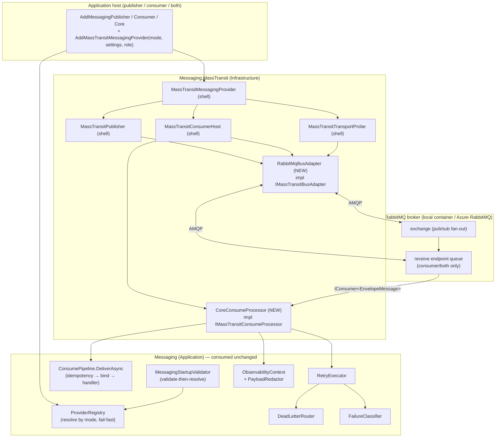
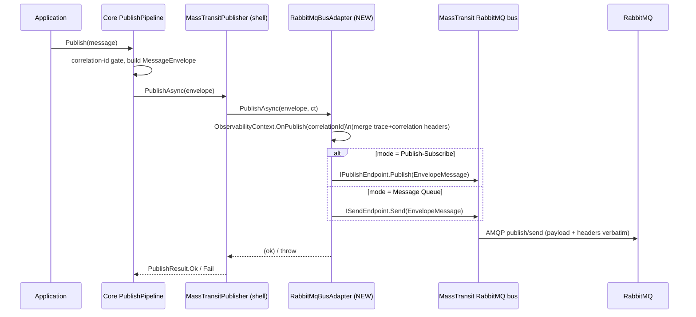
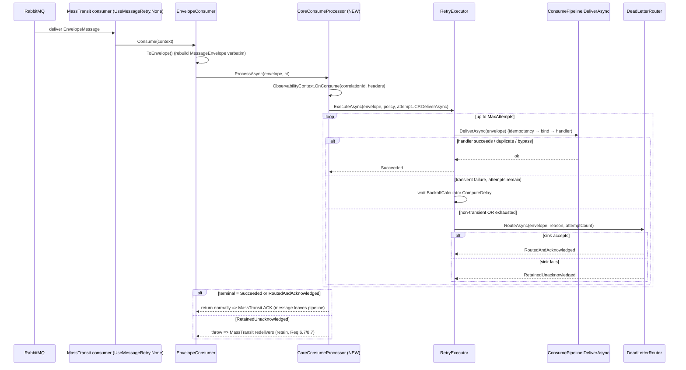

# Design Document: RabbitMQ Provider

## Overview

This feature makes RabbitMQ a live transport for the Messaging Core by completing the
`Messaging.MassTransit` adapter **shell** that already exists in the codebase. The shell was
deliberately left open against two seam ports; this feature supplies their production
implementations and the DI wiring that stands them up, without changing any transport-neutral core
contract.

The two seams:

- **`IMassTransitBusAdapter`** (`src/Messaging.MassTransit/Transport/`) — bus start/stop,
  publish/send of a `MessageEnvelope`, and a reachability probe. Today only shells and a
  *test-local* `RabbitMqBusAdapter` exist. This feature adds a production `RabbitMqBusAdapter` over a
  configured MassTransit RabbitMQ `IBusControl`.
- **`IMassTransitConsumeProcessor`** (`src/Messaging.MassTransit/Consuming/`) — the single point
  where the core consume steps (correlation propagation, idempotency gate, contract binding, handler
  invocation, failure classification, retry, dead-letter routing) run for each delivered envelope
  ahead of the application handler. The port interface already exists as a shell; this feature adds
  the production `CoreConsumeProcessor` that drives the Application-layer pipeline.

**What is already built and consumed unchanged** (verified by reading the source):

- The provider shell `MassTransitMessagingProvider` (`Mode`, `Publisher`, `ConsumerHost`,
  `RequiredSettings`, `CheckTransportAsync`) and its `IMessagingProvider` contract.
- `MassTransitPublisher` (delegates to `IMassTransitBusAdapter.PublishAsync`, maps failure to a
  failed `PublishResult`), `MassTransitConsumerHost` (wraps bus start/stop + a lifecycle state
  machine, drives each delivery through `IMassTransitConsumeProcessor.ProcessAsync`), and
  `MassTransitTransportProbe` (maps `IsTransportReachableAsync` to `TransportHealth`, treats a throw
  as not-reachable).
- The Application-layer consume pipeline: `ConsumePipeline.DeliverAsync` (idempotency gate → bind →
  invoke handler), `IdempotencyGate`, `IContractBinder`, `IHandlerInvoker`.
- The core resilience engine: `FailureClassifier`, `BackoffCalculator`, `DeadLetterRouter`,
  `RetryExecutor` (owns the bounded-attempt policy and dead-letter routing).
- The observability facade `ObservabilityContext` + `PayloadRedactor`, the startup gate
  `MessagingStartupValidator` + `ConfigurationValidator`, `ProviderRegistry`, and
  `ConfigurationBounds`.
- `MassTransitTransport` already contains a `RabbitMq` member — **no enum change is required**.
  (The task brief asked me to confirm this; it is present.)

### Key design decisions (resolved up front)

1. **Reuse the test-local wiring as the production blueprint.** The existing
   `tests/.../MassTransitRabbitMqIntegrationSupport.cs` already proves, against a real broker, the
   exact shape the production seam needs: an `EnvelopeMessage` MassTransit contract carrying the
   envelope verbatim, an `EnvelopeConsumer : IConsumer<EnvelopeMessage>` that forwards to
   `IMassTransitConsumeProcessor`, a receive endpoint with `UseMessageRetry(r => r.None())`, and a
   bus-started reachability flag. The production implementation moves this wiring into
   `Messaging.MassTransit` (Infrastructure) and hardens it (role-scoped endpoints, a real
   reachability probe, observability, redaction). This keeps risk low and matches a pattern the team
   already validated.

2. **`IMassTransitConsumeProcessor` is implemented by a thin Infrastructure adapter that drives the
   Application pipeline, not by re-implementing it.** The core already owns idempotency, binding,
   handler dispatch, classification, retry and dead-letter. The production processor
   (`CoreConsumeProcessor`) composes `ObservabilityContext`, `RetryExecutor`, `ConsumePipeline`
   (via its `DeliverAsync`), and `DeadLetterRouter`, so RabbitMQ behaves identically to the other
   modes (Req 1.3, 6, 7, 8). See *Components and Interfaces*.

3. **The core `RetryExecutor` is the single source of retry/backoff; MassTransit redelivery is
   disabled** with `UseMessageRetry(r => r.None())` on the receive endpoint (Req 8.8). The processor
   returns normally to acknowledge (ack) and throws to let MassTransit redeliver only when the core
   explicitly wants a retain (dead-letter sink failure — Req 6.7, 8.7).

4. **Role-scoped composition.** Publisher-only registers a bus with **no** receive endpoint;
   consumer-only / both register **exactly one** receive endpoint bound to the core processor.
   `AddMassTransitMessagingProvider` is extended with the seam registrations and a role flag derived
   from which core surface (`AddMessagingPublisher`/`Consumer`/`Core`) is composed (Req 4).

5. **Validation and secrets.** RabbitMQ required settings flow through the existing
   `ProviderSettingDescriptor` → `MessagingStartupValidator` gate unchanged; the connection string is
   reported by setting name only and never logged, using `PayloadRedactor` (Req 3, 9.5, 12).

6. **Reachability** is a bounded (≤ 1s) probe mapped to `TransportHealth` by the existing
   `MassTransitTransportProbe`; the production bus adapter implements `IsTransportReachableAsync`
   with a 1-second timeout and not-reachable-on-error/timeout semantics (Req 10).

7. **Azure RabbitMQ is "just a RabbitMQ connection string."** A hosted Azure RabbitMQ broker is
   reached with an AMQP(S) connection string injected from the environment/secret store; no special
   adapter is needed. TLS is selected by the `amqps://` scheme in the connection string. See
   *Production readiness* under *Error Handling*.

### Research notes

- **MassTransit.RabbitMQ package & version.** The adapter `.csproj` references `MassTransit 8.5.11`
  but **not** `MassTransit.RabbitMQ`. The test project already pins `MassTransit.RabbitMQ 8.5.11`
  (matching the core version) and `Testcontainers.RabbitMq 3.10.0`. The design adds
  `MassTransit.RabbitMQ` **pinned to the exact `8.5.11`** to the adapter project so the transport and
  core versions never drift (MassTransit requires the transport package to match the core version;
  an 8.x core with a different-minor transport is unsupported). `MassTransit.RabbitMQ` depends
  transitively on the official `RabbitMQ.Client`, satisfying Req 1.1 (no separate client adapter).
  [MassTransit RabbitMQ transport docs](https://masstransit.io/documentation/transports/rabbitmq).
  Content was rephrased for compliance with licensing restrictions.
- **Testcontainers image tag.** The existing fixture pins `rabbitmq:3.13-management-alpine` — an
  explicit release tag, not `latest` (Req 11.6). The design keeps this tag.

## Architecture

The provider sits in the Infrastructure ring. Dependencies point inward only: the two new adapters
depend on Application (`Messaging`) and Domain (`Messaging.Abstractions`, `Messaging.Contracts`)
ports, never the reverse (Req 1.4, clean-architecture steering).



### Message flow — Publish (Pub/Sub and Queue)



### Message flow — Consume (with retry / dead-letter)



The ack/nack contract (Req 1.9, 7.2, 8.6, 8.7) is realized by the single rule: **the processor
returns normally to acknowledge and throws to retain**. MassTransit acks on normal consumer
completion and redelivers on a thrown exception; because endpoint-level redelivery is disabled, a
throw maps to exactly one broker-level requeue rather than an extra attempt loop that would multiply
the core attempt count (Req 8.8).

## Components and Interfaces

### 1. `RabbitMqBusAdapter : IMassTransitBusAdapter` (NEW, Infrastructure)

**Location:** `src/Messaging.MassTransit/Transport/RabbitMqBusAdapter.cs`
**Responsibility (SRP):** own a configured MassTransit RabbitMQ `IBusControl` and translate the four
seam operations onto it. No core policy lives here.

Contract (already declared by `IMassTransitBusAdapter`):

| Member | Behavior | Requirements |
| --- | --- | --- |
| `StartBusAsync(ct)` | Start `IBusControl`; set started flag; log bus-state=started (redacted). On start failure, surface the error and leave started=false. | 5.1, 5.5, 9.3 |
| `StopBusAsync(ct)` | Stop `IBusControl` (drains in-flight); clear started flag; log bus-state=stopped. | 5.2, 5.3, 9.4 |
| `PublishAsync(envelope, ct)` | Map `MessageEnvelope`→`EnvelopeMessage`; in Pub/Sub call `IPublishEndpoint.Publish`, in Queue resolve the `ISendEndpoint` and `Send`; merge correlation+trace headers. | 1.5, 1.6, 6.1–6.3, 9.1, 9.7 |
| `IsTransportReachableAsync(ct)` | Bounded (≤ 1s) check that the bus is started and the broker connection is up; return false on error/timeout, never throw. | 1.7, 1.8, 10.1–10.5 |

**Construction (DI):** built by a factory given `(MassTransitProviderSettings settings, MassTransitRole role, IMassTransitConsumeProcessor processor, ObservabilityContext observability, ILogger)`.
The factory calls `Bus.Factory.CreateUsingRabbitMq(cfg => …)`:

- `cfg.Host(new Uri(settings.ConnectionString))` — the AMQP(S) endpoint (Azure or local).
- **Role = Publisher:** register no receive endpoint (Req 4.2).
- **Role = Consumer / Both:** register exactly one `cfg.ReceiveEndpoint(queueName, e => { e.UseMessageRetry(r => r.None()); e.Consumer(() => new EnvelopeConsumer(processor)); })` (Req 4.3, 4.5, 8.8).

**Mode shaping (decision):** publish vs send is chosen by `settings` → the provider `Mode`.
Pub/Sub uses the publish endpoint (fan-out exchange); Queue resolves a send endpoint to a named
queue. The mode is injected into the adapter so a single class serves both broker-shaped modes, as
the shell already does.

**Reachability detail:** MassTransit exposes bus health via `IBus.CheckHealth()` /
`IBusControl` state. The probe wraps the check in `Task.WhenAny(check, Task.Delay(1s, ct))`; if the
delay wins or the check throws, it returns `false` (Req 10.3, 10.4). The outer
`MassTransitTransportProbe` (unchanged) turns `false` into `TransportHealth(false, "{Transport} ({Host})")`
— host only, no connection string (Req 10.2).

### 2. `EnvelopeMessage` + `EnvelopeConsumer` (promoted from tests to Infrastructure)

**Location:** `src/Messaging.MassTransit/Transport/EnvelopeMessage.cs`,
`src/Messaging.MassTransit/Consuming/EnvelopeConsumer.cs`.
`EnvelopeMessage` is the MassTransit wire contract carrying the envelope verbatim
(`MessageId`, `CorrelationId`, `MessageType`, `CreatedAtUtc`, `ContractVersion`, `Headers`,
`Payload` bytes). `FromEnvelope`/`ToEnvelope` are the lossless mapping already proven in the test
support. `EnvelopeConsumer : IConsumer<EnvelopeMessage>` rebuilds the `MessageEnvelope` and calls
`IMassTransitConsumeProcessor.ProcessAsync`. Carrying every field as data (not relying on
MassTransit's own envelope) is what guarantees byte-for-byte fidelity (Req 6.1–6.3).

### 3. `CoreConsumeProcessor : IMassTransitConsumeProcessor` (NEW, Infrastructure)

**Location:** `src/Messaging.MassTransit/Consuming/CoreConsumeProcessor.cs`
**Responsibility (SRP):** for each delivered envelope, run the core consume steps ahead of the
handler and translate the terminal outcome into the ack/retain signal. It **drives** core components;
it does not re-implement them.

Composition (constructor injection only):

- `ObservabilityContext` — `OnConsume(correlationId, headers)` for the consume event + span (Req 9.2, 9.7).
- `RetryExecutor` — bounds attempts and routes to dead-letter (Req 8).
- `ConsumePipeline` (as `IMessageConsumerHost`, used via `DeliverAsync`) — the per-attempt unit of
  work: idempotency gate → contract bind → handler invoke (Req 6.4–6.6, 7).
- `DeadLetterRouter` — for the unbindable-contract path (Req 6.6, 6.7).
- `RetryPolicyConfig` — the configured policy passed to the executor.

`ProcessAsync` algorithm:

```
OnConsume(correlationId, headers)                      // observability, best-effort (Req 9.2, 9.8)
result = RetryExecutor.ExecuteAsync(
    envelope, policy,
    processAsync: ct => consumePipeline.DeliverAsync(envelope, ct),   // idempotency+bind+handler
    idempotencyKey: null, ct)
switch result.Outcome:
  Succeeded                     -> return            // normal => ACK (Req 1.9, 7.2)
  DeadLetteredNonTransient,
  DeadLetteredExhausted:
      if result.DeadLetterRouting == RetainedUnacknowledged
          throw RetainForRedeliveryException   // => MassTransit redelivers (Req 6.7, 8.7)
      else
          return                                // routed+acked => leaves pipeline (Req 8.6)
```

Notes:
- `UnknownContractException` from `DeliverAsync` is classified **non-transient** by
  `FailureClassifier`, so an unbindable/unknown-contract payload is dead-lettered without retries and
  the handler is never invoked (Req 6.6). The processor surfaces the error via the dead-letter
  reason.
- `MissingIdempotencyKeyException` (Req 7.5) is thrown by the gate before the handler; it is a
  non-transient failure → dead-letter (no handler invocation, no key recorded).
- Correlation id is propagated unchanged because `DeliverAsync` hands the original `envelope` to the
  handler (the core already guarantees this — Req 6.4).

### 4. DI wiring — `AddMassTransitMessagingProvider` extended (Infrastructure)

**Location:** `src/Messaging.MassTransit/MassTransitMessagingProviderServiceCollectionExtensions.cs`
The existing method already registers the provider, publisher, consumer host, and transport probe
shells. It is extended to:

- accept a `MassTransitRole` (Publisher / Consumer / Both) — or infer it from a flag the core
  surface sets — so the bus is built with or without a receive endpoint (Req 4).
- register `IMassTransitConsumeProcessor → CoreConsumeProcessor` (consumer/both only).
- register `IMassTransitBusAdapter → RabbitMqBusAdapter` via the factory, as a singleton (stable for
  the instance lifetime, Req 2.4).
- when the configured transport is `RabbitMq` but the mode is neither Pub/Sub nor Queue, fail fast
  before any partial registration (Req 2.3) — the provider ctor already throws
  `ArgumentOutOfRangeException` for unsupported modes; the extension mirrors that guard.

Role-scoped effect (Req 4):

| Role | Receive endpoint | Publish/send path | Consume steps |
| --- | --- | --- | --- |
| Publisher-only | none (4.2) | enabled (4.1) | not invoked (4.2) |
| Consumer-only | exactly one (4.3) | app-publish disabled; dead-letter send allowed (4.4) | each delivery (4.3) |
| Both | exactly one (4.5) | enabled (4.5) | each delivery (4.5) |

### 5. Required-settings validation (consumed unchanged + RabbitMQ specifics)

`MassTransitProviderSettings.ToRequiredSettings()` already declares `MassTransit:Transport` (permitted
set = enum names) and `MassTransit:ConnectionString` (required for non-in-memory). For RabbitMQ the
connection string is required and must be a parseable AMQP(S) URI. Because the existing
`ConfigurationValidator` only checks presence + permitted-set/range, the connection-string **format**
check (empty/whitespace/unparseable → invalid, Req 12.4) is added to `MassTransitProviderSettings`
construction and surfaced as a descriptor error by setting name only, never the value (Req 3.5, 12.4).
The validator already aggregates all failures in one pass and reports each affected secret by name
with the value excluded (Req 3.2–3.5).

## Data Models

No core contract changes. The feature adds two Infrastructure-local models and one enum.

### `EnvelopeMessage` (MassTransit wire contract)

| Field | Type | Source envelope field | Notes |
| --- | --- | --- | --- |
| `MessageId` | `Guid` | `MessageId` | verbatim (Req 6.1) |
| `CorrelationId` | `string` | `CorrelationId` | verbatim, char-for-char (Req 6.1, 6.4) |
| `MessageType` | `string` | `MessageType` | verbatim (Req 6.1) |
| `CreatedAtUtc` | `DateTimeOffset` | `CreatedAtUtc` | verbatim UTC (Req 6.1) |
| `ContractVersion` | `int` | `ContractVersion` | verbatim (Req 6.1) |
| `Headers` | `Dictionary<string,string>` | `Headers` | same count, keys, values (Req 6.2) |
| `Payload` | `byte[]` | `Payload` (`ReadOnlyMemory<byte>`) | same length & bytes (Req 6.3) |

`FromEnvelope` copies headers with `StringComparer.Ordinal` and `Payload.ToArray()`; `ToEnvelope`
wraps the bytes back in `ReadOnlyMemory<byte>` — a lossless round trip.

### `MassTransitRole` (NEW enum)

`Publisher`, `Consumer`, `Both` — drives role-scoped endpoint registration (Req 4). Lives in
`src/Messaging.MassTransit/Configuration/`.

### `RetainForRedeliveryException` (NEW, Infrastructure)

Thrown by `CoreConsumeProcessor` only when the dead-letter sink retained the message
(`RetainedUnacknowledged`), so MassTransit redelivers rather than acking (Req 6.7, 8.7). Domain-
specific, not a bare `Exception` (code-conventions).

### Configuration (consumed unchanged)

`MessagingConfiguration.ProviderSettings` supplies `MassTransit:Transport`,
`MassTransit:ConnectionString`, `MassTransit:Host`. `RetryPolicyConfig` (MaxAttempts 1–100/def 5,
PerAttemptDelaySeconds 1–300/def 5, Backoff), `IdempotencyConfig` (Enabled, RetentionSeconds
1–2,592,000/def 86,400), `LifecycleConfig` (ShutdownTimeoutSeconds 1–300/def 30) — all bounds from
`ConfigurationBounds`.

## Correctness Properties

*A property is a characteristic or behavior that should hold true across all valid executions of a
system — essentially, a formal statement about what the system should do. Properties serve as the
bridge between human-readable specifications and machine-verifiable correctness guarantees.*

This feature's pure-logic surfaces are amenable to property-based testing: the envelope
wire-contract round trip, the processor's ack/retain mapping, the bounded attempt count, dead-letter
context preservation, and secret redaction are all universal over large input spaces (arbitrary
envelopes, byte sequences, header maps, attempt counts, connection strings). Broker behavior,
lifecycle state transitions, DI composition, and the core gate/backoff internals are covered by
example, integration, or existing core tests instead (see *Testing Strategy*).

The six properties below are the consolidated set after property reflection (fidelity dimensions
merged; ack/retain merged; attempt bounds merged across failure kinds; secret-leak aspects merged).

### Property 1: Envelope fidelity round trip

*For any* valid `MessageEnvelope`, mapping it to the `EnvelopeMessage` wire contract and back
(`ToEnvelope(FromEnvelope(e))`) yields an envelope whose message id, correlation id, message type,
UTC creation timestamp, and contract version each equal the originals; whose header collection has
the same number of entries with every key present and mapped to its original value; and whose payload
byte sequence is equal in length and in every byte position.

**Validates: Requirements 6.1, 6.2, 6.3**

### Property 2: Correlation id is carried in the published headers

*For any* valid `MessageEnvelope`, the headers the bus adapter hands to the transport on publish/send
contain a correlation-id entry whose value is character-for-character equal to the envelope's
correlation id, so a consume trace links to the originating publish trace by an equal correlation id.

**Validates: Requirements 6.4, 9.7**

### Property 3: Ack-versus-retain mapping

*For any* terminal consume outcome, the `CoreConsumeProcessor` returns normally (acknowledging the
delivery) if and only if the message is to leave the active pipeline — handler success, idempotent
duplicate, bypass, or a dead-letter that was routed and acknowledged — and throws (causing the broker
to redeliver, leaving the delivery unacknowledged) if and only if the dead-letter sink retained the
message.

**Validates: Requirements 1.9, 6.7, 7.2, 8.6, 8.7**

### Property 4: Bounded attempt count by failure kind

*For any* retry policy with `MaxAttempts` in the inclusive range [1, 100], driving a message whose
processing always fails yields exactly one processing attempt when the failure is classified
non-transient, and exactly `MaxAttempts` attempts when it is classified transient, before the message
is dead-lettered; the total number of processing attempts never exceeds `MaxAttempts` (no additional
transport-level redelivery multiplies the count).

**Validates: Requirements 8.1, 8.3, 8.8**

### Property 5: Dead-letter preserves context

*For any* `MessageEnvelope` that is dead-lettered, the resulting dead-letter record preserves the
original message id, the correlation id, the payload bytes (equal in length and every byte), and the
exact total attempt count performed.

**Validates: Requirements 8.5**

### Property 6: No connection string or secret appears in emitted diagnostics

*For any* configured connection string value, no diagnostic the provider emits — bus-state start/stop
log entries, the transport-health unavailable-dependency name, and the connection-failure report —
contains that connection string value or any fragment of it; the broker is referenced only by its
non-secret host display name, and any value under a sensitive key is replaced by the fixed redaction
marker.

**Validates: Requirements 9.5, 9.6, 10.2, 12.5, 12.6**

## Error Handling

The design keeps failures classified and localized; it logs where a failure is handled, never
double-logs across layers, and never leaks a secret (code-conventions).

### Publish-side failures

- A transport publish/send failure is caught by the existing `MassTransitPublisher` and returned as
  a failed `PublishResult` (not thrown), logging message id + correlation id only — never the payload
  or connection string (Req 3.2 of the core; Req 9.5 here). `OperationCanceledException` propagates
  unchanged (caller signal, not a transport failure).

### Consume-side failures

- Per-attempt failures are classified by `FailureClassifier`: transient → retry with backoff;
  non-transient → immediate dead-letter (Req 8.1, 8.3). The attempt bound guarantees a terminal
  state (Req 8.8).
- **Unknown/unbindable contract** (`UnknownContractException`) is non-transient → dead-letter with
  attempt count 1, handler never invoked, reason names the contract (Req 6.6).
- **Missing idempotency key** (`MissingIdempotencyKeyException`, enabled-only) is thrown by the gate
  before the handler → non-transient → dead-letter; key is never recorded (Req 7.5).
- **Dead-letter sink failure**: `DeadLetterRouter` returns `RetainedUnacknowledged`; the processor
  throws `RetainForRedeliveryException` so MassTransit redelivers and the delivery is **not** acked
  (Req 6.7, 8.7). The routing failure is logged once by the router.

### Lifecycle failures

- **Bus start failure**: `RabbitMqBusAdapter.StartBusAsync` surfaces the error; the existing
  `MassTransitConsumerHost.StartAsync` unwinds the state machine back to Stopped and rethrows, so the
  host is left non-running (Req 5.5). Delivery while not Running is rejected by the host
  (`InvalidConsumerHostStateException`) without starting work (Req 5.6).
- **Graceful drain timeout**: owned by the core `GracefulShutdownCoordinator`, which reports the
  exact non-negative in-flight count on timeout (Req 5.4). The adapter's `StopBusAsync` stops the
  bus (draining MassTransit's in-flight consumers) after the host stops accepting.

### Reachability / readiness

- `IsTransportReachableAsync` is bounded to ≤ 1s and returns `false` on error or timeout; it never
  throws (Req 1.8, 10.3, 10.4). The outer `MassTransitTransportProbe` maps `false` to
  `TransportHealth(false, "{Transport} ({Host})")` — host display name only (Req 10.2).

### Production readiness for hosted Azure RabbitMQ (Req 12)

- The connection string is read from `MassTransit:ConnectionString`, sourced from the environment or
  a secret store (never committed) (Req 12.2). "Azure RabbitMQ" is reached by the same code path as
  any RabbitMQ broker — only the connection string differs. **TLS/AMQPS**: when the connection string
  uses the `amqps://` scheme, MassTransit's RabbitMQ host negotiates TLS automatically; the design
  adds no bespoke TLS code, relying on the scheme in the injected string.
- **Startup validation**: an absent connection string is reported missing by setting name (Req 12.3);
  an empty, whitespace, or unparseable connection string is reported invalid by setting name with the
  value excluded (Req 12.4). Both fail the startup gate before any message is processed.
- **Connection failure at runtime** is reported by the `MassTransit:ConnectionString` setting name
  with the value excluded from every log and trace (Req 12.6) — enforced via `PayloadRedactor` and
  the host-only naming rule.

## Testing Strategy

A dual approach: property-based tests for the universal logic properties above, example/unit tests
for discrete behaviors and wiring, and containerized integration tests for broker behavior. The
existing `Messaging.MassTransit.Tests` project (xUnit + `FsCheck.Xunit` + `Testcontainers.RabbitMq`)
is the home for all of these; the test-local `RabbitMqBusAdapter`/`EnvelopeConsumer` are superseded
by the production types and re-pointed at them.

### Property-based tests (library: FsCheck.Xunit, already referenced)

- Do **not** implement property testing from scratch; use `FsCheck.Xunit` (`[Property]`).
- Minimum **100 iterations** per property (FsCheck default is 100; set explicitly where overridden).
- Tag each test with a comment: **Feature: rabbitmq-provider, Property {n}: {property text}**.
- One property-based test per correctness property:
  1. **Property 1 — Envelope fidelity**: generate arbitrary `MessageEnvelope` (random id, correlation
     1–128 chars, type, UTC timestamp, version ≥ 1, 0–64 headers with arbitrary keys/values,
     arbitrary payload bytes incl. empty); assert the `FromEnvelope`/`ToEnvelope` round trip
     preserves every field, header, and byte. Pure, in-memory, no broker.
  2. **Property 2 — Correlation in headers**: generate arbitrary envelopes; assert the merged publish
     headers contain the correlation id unchanged (drive the header-merge step with a fake endpoint
     capturing headers).
  3. **Property 3 — Ack vs retain**: generate arbitrary terminal outcomes (success / duplicate /
     routed-and-acked / retained); assert the processor returns iff acked and throws iff retained,
     using a fake retry-executor/pipeline seam so no broker is needed.
  4. **Property 4 — Bounded attempt count**: generate `MaxAttempts` in [1, 100] and a failure kind;
     an always-failing attempt yields exactly 1 (non-transient) or exactly `MaxAttempts` (transient)
     invocations, never more. Inject the delay function so there is no wall-clock wait; mock the sink.
  5. **Property 5 — Dead-letter preservation**: generate arbitrary failing envelopes + attempt counts;
     assert the captured `DeadLetterMessage` preserves id, correlation, payload bytes, and attempt
     count.
  6. **Property 6 — No secret leak**: generate arbitrary connection-string values; assert none appears
     (as substring) in any emitted diagnostic (bus-state logs via a capturing logger, probe
     dependency name, connection-failure report), and that a sensitive-keyed value equals the fixed
     redaction marker.

### Unit / example tests (xUnit, `Method_Scenario_ExpectedResult`)

- Mode→endpoint selection: Pub/Sub uses publish endpoint; Queue uses send endpoint (fake bus) — Req
  1.5, 1.6.
- Reachability mapping: started→reachable; not-started→false; throwing check→false (no propagation);
  timeout (injected slow check)→false — Req 10.1–10.5.
- Role-scoped composition: publisher→0 receive endpoints + publish enabled; consumer→1 receive
  endpoint + app-publish disabled (dead-letter send allowed); both→1 receive endpoint + publish
  enabled — Req 4.1–4.5.
- Unsupported-mode guard: `RabbitMq` with Streaming/Batch fails fast, no partial registration — Req
  2.3.
- Settings validation: missing connection string (by name); invalid empty/whitespace/unparseable (by
  name, value excluded); two-at-once aggregation — Req 3.2–3.5, 12.3, 12.4.
- Processor flows: unknown-contract → dead-letter, handler not invoked — Req 6.5, 6.6; idempotent
  duplicate → handler not invoked, acked; idempotency disabled → handler invoked with null key — Req
  7.x; observability hook invoked with correlation id on publish/consume — Req 9.1, 9.2; throwing
  observability sink does not fail the operation — Req 9.8; bus start/stop log bus-state — Req 9.3,
  9.4.
- Lifecycle: start failure leaves host Stopped and rethrows — Req 5.5; deliver-while-not-Running
  rejected — Req 5.6.
- Registry: one RabbitMq registration resolves; same instance on repeated resolution — Req 2.1, 2.2,
  2.4.

Example tests should stay few; the properties above carry the broad input coverage.

### Integration tests (Testcontainers, real broker — Req 11)

Reuse `RabbitMqContainerFixture` (pinned `rabbitmq:3.13-management-alpine`, ready ≤ 60s, reaped after
the run — Req 11.2, 11.3, 11.6) and the `[Collection]` sharing. Re-point the existing two tests at the
production `RabbitMqBusAdapter`/`CoreConsumeProcessor`:

1. **Publish-then-consume round trip** over the real broker asserts, within 30s, that the delivered
   envelope's id, correlation id, type, UTC timestamp, version, headers, and payload bytes equal the
   published values — Req 11.4 (and end-to-end evidence for Property 1 over the wire).
2. **Retry exhaustion → dead-letter** asserts a poison message is routed to the dead-letter sink
   within 5s of the final failed attempt (Req 8.4), is not redelivered to the handler, and is not
   reported in-flight — Req 11.5.

These broker-dependent timings (Req 8.4 "within 5s", Req 11.2 "ready ≤ 60s") are intentionally
integration-only; they are not property-tested because they measure wall-clock/broker behavior, not
input-varying logic.

## Tradeoffs and Alternatives

Decisions where the choice was non-obvious:

1. **Drive the core pipeline vs. re-implement consume logic in the adapter.**
   *Chosen:* `CoreConsumeProcessor` composes `RetryExecutor` + `ConsumePipeline.DeliverAsync` +
   `DeadLetterRouter`. *Alternative:* re-implement idempotency/bind/retry as MassTransit filters.
   The chosen path reuses already-tested core logic, guarantees RabbitMQ behaves identically to other
   modes, and keeps the adapter thin (SRP). The cost is one extra indirection (processor → pipeline);
   acceptable given it eliminates duplicated policy and divergence risk.

2. **Core `RetryExecutor` as the single retry source vs. MassTransit redelivery.**
   *Chosen:* disable endpoint redelivery (`UseMessageRetry(r => r.None())`) and let the core own
   attempts/backoff (Req 8.8). *Alternative:* configure MassTransit's redelivery/retry middleware.
   Using MassTransit's would multiply the attempt count and fragment the policy across transports.
   The chosen path keeps attempt bounds uniform and verifiable (Property 4); the cost is that a
   retain maps to a single broker requeue (a thrown consumer), which is exactly the at-least-once
   semantics the core already assumes.

3. **Carry the envelope as a MassTransit message contract (`EnvelopeMessage`) vs. MassTransit's own
   envelope/headers.**
   *Chosen:* a first-class `EnvelopeMessage` carrying every field as data. *Alternative:* map onto
   MassTransit's native message headers and body. The chosen path makes fidelity (Property 1) a pure,
   transport-independent round trip that is cheap to property-test and immune to MassTransit header
   conventions; the cost is a small mapping type, already proven in the test support.

4. **Single bus adapter class for both modes vs. two classes.**
   *Chosen:* one `RabbitMqBusAdapter` parameterized by mode (matching the existing shell), publish vs
   send chosen internally. *Alternative:* `RabbitMqPublishAdapter` + `RabbitMqSendAdapter`. One class
   keeps the seam count low and mirrors how `MassTransitMessagingProvider` already serves both modes;
   the publish/send branch is a single decision point, so SRP is not meaningfully diluted.

## Requirements Coverage Summary

- Req 1 (transport via MassTransit, seams, ack/nack) → `RabbitMqBusAdapter`, `CoreConsumeProcessor`,
  Properties 1, 3.
- Req 2 (selection/resolution) → extended DI + existing `ProviderRegistry`; example tests.
- Req 3 (startup validation) → `MassTransitProviderSettings` + `ConfigurationValidator` (unchanged
  gate) + connection-string format check; example tests, Property 6 for secret exclusion.
- Req 4 (role-scoped) → `MassTransitRole` + role-scoped endpoint registration; example tests.
- Req 5 (lifecycle/drain) → bus adapter start/stop + core state machine + coordinator; example tests.
- Req 6 (fidelity/correlation/binding) → `EnvelopeMessage` round trip + core pipeline; Properties 1,
  2, 3, example tests.
- Req 7 (idempotency) → core gate driven by the processor; example tests.
- Req 8 (retry/backoff/dead-letter) → core `RetryExecutor`/`DeadLetterRouter` with redelivery
  disabled; Properties 3, 4, 5, integration test.
- Req 9 (observability, no secrets) → `ObservabilityContext` + `PayloadRedactor`; Properties 2, 6,
  example tests.
- Req 10 (reachability/readiness) → bounded probe + `MassTransitTransportProbe`; example tests,
  Property 6 for host-only naming.
- Req 11 (containerized verification) → `RabbitMqContainerFixture` + two integration tests.
- Req 12 (Azure RabbitMQ readiness) → injected connection string, AMQPS via scheme, validation +
  redaction; example/smoke tests, Property 6.
