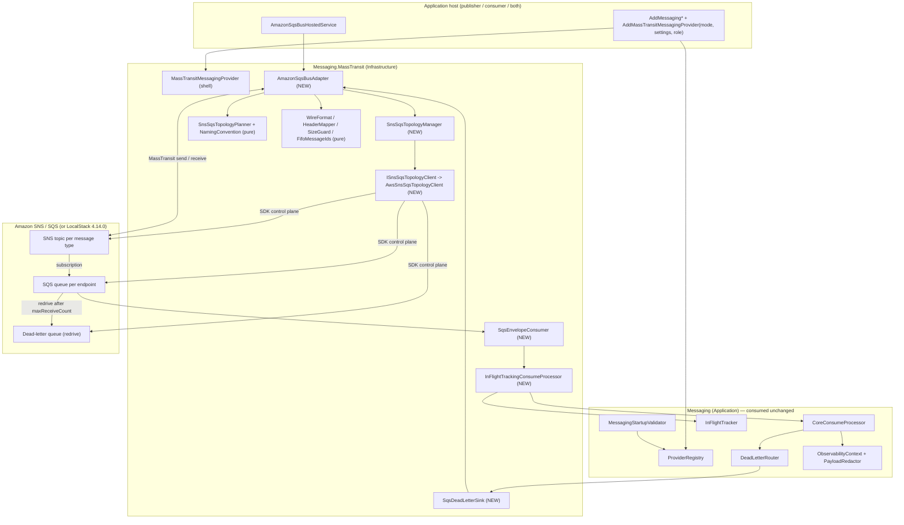
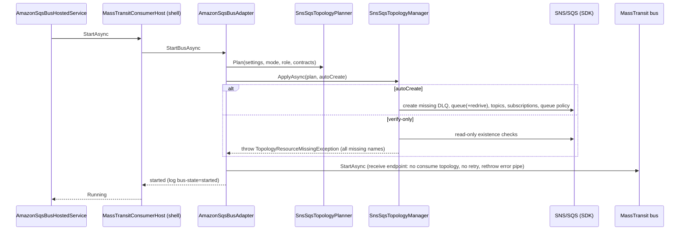
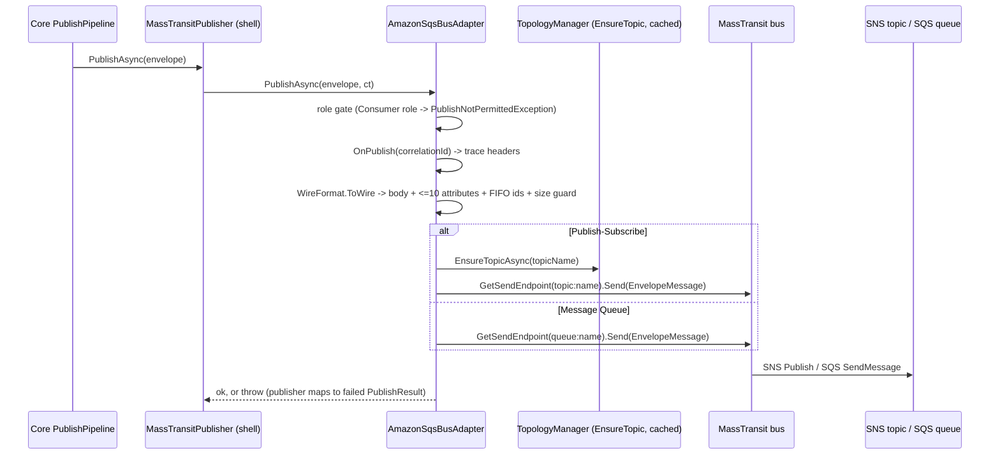

# Design Document: SNS/SQS Provider

## Overview

This feature makes Amazon SNS and Amazon SQS a live transport for the Messaging Core by completing the
`Messaging.MassTransit` adapter **shell** for the `AmazonSqs` transport. As with the RabbitMQ provider, the
two seam ports (`IMassTransitBusAdapter`, `IMassTransitConsumeProcessor`) are filled in and the DI wiring
stands them up, without changing any transport-neutral core contract. SNS/SQS is reached **through
MassTransit** (`MassTransit.AmazonSQS`, which depends on `AWSSDK.SQS` and `AWSSDK.SimpleNotificationService`);
there is no second, hand-written data-plane adapter over the AWS SDK (Req 1.1).

The defining use case is **fan-out**: a publisher publishes once to an SNS topic named after the message type,
and every consuming service owns its own SQS queue subscribed to that topic, so each service receives its own
copy and applies its own retry, dead-letter, and idempotency state (Req 2).

**What is already built and consumed unchanged** (verified by reading the source):

- `MassTransitMessagingProvider`, `MassTransitPublisher`, `MassTransitConsumerHost`,
  `MassTransitTransportProbe` (maps `IsTransportReachableAsync` to `TransportHealth` named
  `"{Transport} ({Host})"`), `RetainForRedeliveryException`, `MassTransitRole`, and
  `MassTransitTransport.AmazonSqs` (**no enum change required**).
- `CoreConsumeProcessor` (observe consume, then `RetryExecutor` over `ConsumePipeline.DeliverAsync`, return
  to acknowledge and throw `RetainForRedeliveryException` to retain), `EnvelopeMessage` (lossless wire
  contract), and `EnvelopeConsumer`.
- The core resilience engine (`FailureClassifier`, `BackoffCalculator`, `DeadLetterRouter`, `RetryExecutor`),
  `ObservabilityContext` + `PayloadRedactor` + `MessagingTraceSource` (`x-correlation-id`, `traceparent`),
  `ConfigurationValidator`, `MessagingStartupValidator`, `ProviderRegistry`, `ConfigurationBounds`,
  `InFlightTracker`, `ConsumerHostStateMachine`, and `ContractRegistration(MessageType, ContractType)`.

**What this feature adds** (all in `src/Messaging.MassTransit/AmazonSqs/` unless noted):

| Component | Responsibility |
| --- | --- |
| `AmazonSqsBusAdapter : IMassTransitBusAdapter` | Start/stop the MassTransit Amazon bus, publish to an SNS topic or send to an SQS queue, bounded reachability probe, role gating, graceful stop. |
| `SnsSqsNamingConvention` | Pure derivation of topic, queue, and dead-letter queue names. |
| `SnsSqsTopologyPlanner` | Pure derivation of the desired `TopologyPlan` from settings, mode, role, and `ContractRegistration`s. |
| `SnsSqsTopologyManager` + `ISnsSqsTopologyClient` | Create or verify topics, queues, subscriptions, queue policies, dead-letter queues, redrive. The only code that touches the AWS SDK control plane. |
| `QueuePolicyDocument` | Pure merge of the SNS-to-SQS access policy (service principal, no wildcard). |
| `SnsSqsWireFormat`, `SnsSqsHeaderMapper`, `SnsSqsMessageSizeGuard`, `FifoMessageIds`, `CorrelationGuid` | Pure mapping of a `MessageEnvelope` to and from the MassTransit message, SNS/SQS message attributes, and FIFO identifiers. |
| `SqsEnvelopeConsumer` | Receive-side `IConsumer<EnvelopeMessage>`: restores trace context and headers (read from `ConsumeContext.Headers`, see R4), then calls the consume processor. |
| `InFlightTrackingConsumeProcessor` | Decorator over `CoreConsumeProcessor` that counts in-flight work and rejects delivery while stopping. |
| `SqsDeadLetterSink : IDeadLetterSink` | Sends a core dead-letter to the Dead_Letter_Queue. |
| `AmazonSqsProviderSettings`, `AmazonSqsStartupValidator` | Typed settings, descriptors, and aggregated fail-fast validation. |
| `AmazonSqsMetrics`, `AmazonSqsBusHostedService` | Provider metrics; bus lifecycle host (consumer, both, and publisher-only roles). |

Shell edits (small, additive): `MassTransitProviderSettings` stops requiring a connection string for
`AmazonSqs` and carries optional `AmazonSqsProviderSettings`; `AddMassTransitMessagingProvider` dispatches on
`settings.Transport` (RabbitMQ path unchanged); the unsupported-mode guard message names the actual transport.

### Key design decisions (resolved up front)

1. **`Topology_Manager` owns provisioning through the AWS SDK; MassTransit owns all message I/O.** Req 1.1
   forbids a separate *transport* adapter over the AWS SDK. Provisioning (create or verify topics, queues,
   subscriptions, policies, redrive) is control-plane work that MassTransit cannot express fully: it has no
   verify-only mode, a fixed `_error` dead-letter name, and no per-operation failure naming. A single
   provisioning path keeps one source of truth. MassTransit is configured to *not* manage topology
   (`ConfigureConsumeTopology = false`, no `Subscribe`) so at start it only looks up the resources the manager
   already provisioned and leaves them unchanged (spike R1: lookup, create only on miss). This is the one
   interpretation of Req 1.1 I want the reviewer to confirm. See *Tradeoffs* #1 and *Risks* R1, R2.
2. **One topic per logical message type, addressed explicitly.** `EnvelopeMessage` is a single CLR type, so
   `Publish<EnvelopeMessage>` would route every message through one topic. The adapter instead resolves the
   MassTransit send endpoint `topic:{derivedTopicName}` (MassTransit's SNS short address) and calls `Send`.
   The topic name derives from `envelope.MessageType` (a string), which both publisher-only and consumer
   processes know, using the same character rules as MassTransit's `AmazonSqsMessageNameFormatter`
   (namespace dots become `_`, namespace separator `-`). A consumer subscribes its queue to one topic per
   `ContractRegistration` (Req 11.6).
3. **The message body is authoritative; message attributes are a bounded projection.** The MassTransit body
   carries every envelope field (as in the RabbitMQ provider). Up to 10 SNS/SQS message attributes carry the
   transport facts: `x-correlation-id`, `traceparent`, `x-message-type`, and up to 7 user headers
   (`h.{key}`). Headers that do not fit travel in the body and are merged back on consume (Req 6.6, 6.7).
   On consume, the headers are read from `ConsumeContext.Headers`, not from the receive transport headers,
   because spike R4 showed the transport headers are empty for SNS-wrapped delivery while the MassTransit
   envelope carries the send headers in the body in both modes.
   MassTransit copies string headers to attributes, so the host is configured with an
   `AllowTransportHeader` allow-list, which makes the 10-attribute cap structural rather than best-effort.
4. **The core `RetryExecutor` is the only retry source.** The receive endpoint uses
   `UseMessageRetry(r => r.None())` (Req 10.9). MassTransit's default fault path would move a faulted message
   to an `_error` queue and delete it, which would defeat "throw to retain". The endpoint therefore replaces
   the error pipe with MassTransit's public `RethrowErrorTransportFilter`. MassTransit's dispatcher catches
   the rethrown exception and calls `ReceiveLockContext.Faulted`, which (verified in `AmazonSqsReceiveLockContext`
   v8.5.11) stops visibility renewal and calls `ChangeMessageVisibility`, so the message is **not deleted** and
   SQS redelivers it. Success returns normally and the lock calls `DeleteMessage`.
5. **Visibility timeout is kept alive by MassTransit, bounded by SQS redrive.** `AmazonSqsReceiveLockContext`
   renews visibility every 0.7 x timeout while the consumer runs, which satisfies Req 10.3 while the core
   retries. SQS redrive (`maxReceiveCount`) is the transport-level poison guard for messages that never reach
   the core (for example a body that is not a valid MassTransit message).
6. **Dead letters keep the original envelope as the body.** `SqsDeadLetterSink` sends the original
   `EnvelopeMessage` to the Dead_Letter_Queue and puts the dead-letter context (reason, attempt count,
   timestamp, idempotency key) in message attributes. The dead-lettered body therefore stays consumable if an
   operator redrives it to the source queue, and the id, correlation id, and payload are preserved byte for
   byte (Req 10.6).
7. **`InFlightTrackingConsumeProcessor` decorates `CoreConsumeProcessor`.** MassTransit delivers directly to
   the consumer, bypassing `MassTransitConsumerHost.DeliverAsync`, so the shell's state-machine gate does not
   see these deliveries. The decorator rejects delivery when not accepting (Req 12.6) and counts in-flight
   work so a timed-out stop reports the exact remaining count (Req 12.4).
8. **LocalStack is pinned and overridable.** Default tag `4.14.0`; override variable
   `LOCALSTACK_IMAGE_TAG` (resolves the second open item). A pure `LocalStackImageTag.Resolve` rejects floating
   tags, and compose and the test fixture share the default.

### Resolved open items

**Open item 1: SQS redrive on LocalStack `4.14.0`.** I ran `localstack/localstack:4.14.0` locally (no auth
token, `SERVICES=sns,sqs`) and exercised both behaviors with `awslocal`:

| Check | Setup | Observed |
| --- | --- | --- |
| Redrive | Standard queue, `VisibilityTimeout=1`, `RedrivePolicy{maxReceiveCount=2}`, one message | Receive 1 and 2 returned the message. Receive 3 returned nothing. The message was in the dead-letter queue. |
| FIFO fan-out | FIFO SNS topic subscribed to a FIFO SQS queue with `RawMessageDelivery=true`; three messages with distinct dedup ids, then a fourth reusing an earlier dedup id | Three messages delivered in publish order; the duplicate was dropped. |

Redrive behaves like AWS: the message moves on the receive attempt after `maxReceiveCount` is exceeded. **No
emulation gap was found**, so no known limitation is recorded for redrive. Requirement 18.9 still asserts it
in the suite so a future image change is caught. Not exercised manually: the non-raw SNS wrapper path, KMS
attributes (LocalStack does not enforce encryption), and the AWS SDK v4 JSON protocol against LocalStack
(see R5).

**Open item 2: image tag override.** The environment variable is `LOCALSTACK_IMAGE_TAG`. Compose uses
`image: localstack/localstack:${LOCALSTACK_IMAGE_TAG:-4.14.0}` and the fixture reads the same variable with the
same default.

### Research notes

- **Package pins.** `MassTransit.AmazonSQS 8.5.11` (matches `MassTransit 8.5.11`; its nuspec for `net8.0`
  depends on `AWSSDK.SQS 4.0.100.14` and `AWSSDK.SimpleNotificationService 4.0.100.15`). The adapter and test
  projects add explicit, pinned `PackageReference`s for those two SDK packages because the topology client and
  test assertions use their types directly (relying on a transitive version is fragile).
  `Testcontainers.LocalStack 3.10.0` is added to the test project (same Testcontainers line as the existing
  `Testcontainers.RabbitMq 3.10.0` and `Testcontainers.Kafka 3.10.0`).
  [MassTransit Amazon SQS docs](https://masstransit.io/documentation/transports/amazon-sqs).
- **MassTransit behaviors confirmed in the v8.5.11 source** (content rephrased for compliance with licensing
  restrictions):
  - Hosts support `Credentials(...)`, `AccessKey/SecretKey`, `Config(AmazonSQSConfig)`,
    `Config(AmazonSimpleNotificationServiceConfig)`, and `AllowTransportHeader(...)`; `UseDefaultHost` uses the
    AWS default credential chain.
  - Queue and topic names ending in `.fifo` automatically set `FifoQueue` / `FifoTopic`. Send contexts expose
    `GroupId` and `DeduplicationId` (`SetGroupId`, `SetDeduplicationId` extensions).
  - Its queue policy uses principal `Service: sns.amazonaws.com` with an `aws:SourceArn` condition, not a
    wildcard principal; this design writes the same shape with `ArnEquals` so the manager owns the document.
  - Receive endpoints expose `WaitTimeSeconds`, `PrefetchCount`, `ConcurrentMessageLimit`,
    `RedeliverVisibilityTimeout`, `MaxVisibilityTimeout`, `QueueAttributes`, `ConfigureConsumeTopology`, and
    `DisableMessageOrdering` (message ordering per group is on by default).
  - The SQS header provider reads SNS-wrapped bodies (`TopicArn`, wrapper attributes), so both raw and wrapped
    delivery reach the consumer; Requirement 18.11 verifies both against LocalStack. Spike R4 showed that
    wrapped delivery leaves `ReceiveContext.TransportHeaders` empty, so the consumer reads
    `ConsumeContext.Headers`.

## Architecture

The provider lives in the Infrastructure ring. Dependencies point inward only (Req 1.4).



### Startup and topology (consumer or both role)



### Publish flow (Publish-Subscribe and Message Queue)



### Consume flow (retry, dead-letter, retain)

```mermaid
sequenceDiagram
    participant Q as SQS queue
    participant MT as MassTransit receive endpoint
    participant SC as SqsEnvelopeConsumer
    participant DC as InFlightTrackingConsumeProcessor
    participant CP as CoreConsumeProcessor
    participant SK as SqsDeadLetterSink
    participant D as Dead-letter queue

    Q->>MT: message (raw or SNS-wrapped)
    MT->>SC: Consume(EnvelopeMessage + ConsumeContext.Headers)
    SC->>SC: FromWire (rebuild headers from ConsumeContext.Headers + body), restore traceparent as ambient parent
    SC->>DC: ProcessAsync(envelope)
    DC->>DC: TryBeginProcessing (reject if stopping)
    DC->>CP: ProcessAsync
    alt success, duplicate, or routed-and-acknowledged dead letter
        CP-->>MT: returns -> lock.Complete -> DeleteMessage
    else transient, attempts remain
        CP->>CP: backoff (MassTransit keeps renewing visibility)
    else non-transient or exhausted
        CP->>SK: SendAsync(DeadLetterMessage)
        SK->>D: send original envelope + context attributes
        alt sink accepted
            CP-->>MT: returns -> DeleteMessage
        else sink failed
            CP-->>MT: throws RetainForRedeliveryException -> Rethrow filter -> lock.Faulted (no delete)
            Note over Q,MT: SQS redelivers after visibility; redrive moves it after maxReceiveCount
        end
    end
```

## Components and Interfaces

### 1. `AmazonSqsBusAdapter : IMassTransitBusAdapter, IAsyncDisposable` (NEW)

**Location:** `src/Messaging.MassTransit/AmazonSqs/AmazonSqsBusAdapter.cs`. Mirrors `RabbitMqBusAdapter`: a
public `Create(...)` factory builds the `IBusControl`; an `internal` constructor takes a ready bus so unit
tests use a fake (the project already exposes internals to `Messaging.MassTransit.Tests`).

| Member | Behavior | Requirements |
| --- | --- | --- |
| `StartBusAsync` | Consumer or both role: `plan = Planner.Plan(...)`, `Topology.ApplyAsync(plan)`, then `bus.StartAsync`. Publisher role: start the bus only. Log `bus-state=started`. A failure leaves `_started=false` and propagates. | 5.1, 12.1, 12.5, 15.3 |
| `StopBusAsync` | `tracker.StopAccepting()`, then `bus.StopAsync(timeoutToken)`. `ShutdownTimeoutSeconds` is clamped by `ConfigurationBounds`. On timeout: stop, record `ShutdownResult(timedOut, tracker.InFlightCount)`, log a warning with the count. Unfinished messages are not deleted. | 12.2, 12.3, 12.4 |
| `PublishAsync` | See *Publish flow*. Consumer role throws `PublishNotPermittedException`. | 1.5, 1.6, 2.1, 7.1, 8.2, 11.4 |
| `IsTransportReachableAsync` | `false` if not started. Otherwise bounded to 1 second: `sqs:ListQueues(MaxResults=1)` and `sns:ListTopics` through `ISnsSqsTopologyClient.PingAsync`. Any error, authorization failure, or timeout returns `false`, never throws. | 1.7, 1.8, 16.1-16.5 |
| `SendToDeadLetterQueueAsync` (internal, `IDeadLetterQueueSender`) | Sends the original `EnvelopeMessage` to `queue:{dlq}` regardless of role, so a Consumer role can dead-letter. | 11.4, 10.6 |

`Create` builds the bus with `Bus.Factory.CreateUsingAmazonSqs`:

- **Host and credentials.** Explicit keys: `h.AccessKey/SecretKey` (and `h.Credentials(new SessionAWSCredentials(...))`
  when a session token is configured). Default chain: `cfg.UseDefaultHost(RegionEndpoint, ...)`. When
  `ServiceUrl` is set, `h.Config(new AmazonSQSConfig { ServiceURL, AuthenticationRegion })` and the SNS
  equivalent; the SDK ignores `RegionEndpoint` once `ServiceURL` is set, so `AuthenticationRegion` carries the
  signing region. `h.AllowTransportHeader(...)` allows only the keys `SnsSqsHeaderMapper` produces.
- **Receive endpoint (consumer or both role only, exactly one).**
  `cfg.ReceiveEndpoint(plan.Queue.Name, e => { ... })`:
  `e.ConfigureConsumeTopology = false`; `e.WaitTimeSeconds`, `e.PrefetchCount` (= `MaxMessagesPerReceive`),
  `e.ConcurrentMessageLimit` (= `ConcurrencyLimit`); `e.UseMessageRetry(r => r.None())`;
  `e.ConfigureError(x => x.UseFilter(new RethrowErrorTransportFilter()))` (needs `using MassTransit.Middleware;`;
  shape confirmed by spike R3). `e.QueueAttributes` is not set: for an existing queue MassTransit ignores it
  (spike R1), so the manager is the only owner of queue attributes and verifies or creates the queue before
  the bus starts (if the queue were missing, MassTransit would create it with its own attributes);
  `e.Consumer(() => new SqsEnvelopeConsumer(decoratedProcessor))`. `DisableMessageOrdering` is never called, so
  FIFO queues keep per-group sequential processing (Req 8.6).
- **Publisher role:** no receive endpoint and no queue (Req 11.1).

### 2. `SnsSqsNamingConvention` (NEW, pure)

- `TopicName(string messageType, options)`: apply MassTransit-style formatting to the namespace-qualified
  name (last `.` splits namespace from type; namespace dots become `_`; separator `-`; nested `+` becomes `_`),
  replace every character outside `[A-Za-z0-9_-]` with `_`, prepend `TopicNamePrefix`, append `.fifo` in FIFO
  mode if absent. Throws `ResourceNameTooLongException(subject, limit)` when the result exceeds 256 (topic) or
  80 (queue) characters including `.fifo`. It never truncates (Req 4.5).
- `QueueName(string endpointName, options)`: kebab-case (`KebabCaseEndpointNameFormatter` rules), same
  sanitizing, `QueueNamePrefix`, `.fifo`, limit 80.
- `DeadLetterQueueName(queueName, suffix)`: insert the suffix before `.fifo`, so `.fifo` stays last (Req 4.8).
- A unit test asserts parity with `AmazonSqsMessageNameFormatter.GetMessageName` for CLR types whose
  `FullName` equals the message type string, so an MT-native peer agrees on topic names.

### 3. `SnsSqsTopologyPlanner` (NEW, pure) and `TopologyPlan`

Inputs: `AmazonSqsProviderSettings`, `MessagingMode`, `MassTransitRole`, the registered `ContractRegistration`s.
Output (`TopologyPlan`):

- Publisher role: empty plan (topics are ensured lazily on first publish). Req 11.1 holds because no queue is
  planned.
- Consumer or both, Publish-Subscribe: one `QueueSpec` + its dead-letter `QueueSpec`, one `TopicSpec` per
  distinct `ContractRegistration.MessageType`, one `SubscriptionSpec` per (topic, queue) pair (Req 11.6).
- Consumer or both, Message Queue: queue + dead-letter queue only.

### 4. `SnsSqsTopologyManager` and `ISnsSqsTopologyClient`

`ISnsSqsTopologyClient` is a narrow port (ISP) over the SDK: `GetQueueUrlAsync`, `GetQueueAttributesAsync`,
`CreateQueueAsync(name, attributes)`, `SetQueueAttributesAsync`, `GetTopicArnAsync`, `CreateTopicAsync(name,
attributes)`, `ListSubscriptionsByTopicAsync`, `SubscribeAsync(topicArn, queueArn, attributes)`, and
`PingAsync`. `AwsSnsSqsTopologyClient` implements it over `IAmazonSQS` and `IAmazonSimpleNotificationService`;
unit tests use an in-memory fake (Req 17.6).

`ApplyAsync(plan, autoCreate)`:

1. **Auto-create:** for each dead-letter queue, queue, topic, subscription, in dependency order: look up; if
   absent, create; if present, leave unchanged (Req 5.1). A queue is created with `VisibilityTimeout`,
   `MessageRetentionPeriod`, `RedrivePolicy{deadLetterTargetArn, maxReceiveCount}`, `FifoQueue`, and
   `KmsMasterKeyId` when configured. The dead-letter queue gets the maximum retention (1,209,600 s) because
   SQS measures retention from the original enqueue time. A topic gets `FifoTopic` and `KmsMasterKeyId`.
   A subscription is created only when `ListSubscriptionsByTopic` shows no entry for the (topic, queue) pair
   (Req 5.2), with `RawMessageDelivery` per settings. The queue policy is merged (see 5) whenever a
   subscription for the queue is created or the existing policy lacks that topic's statement.
2. **Verify-only:** the same lookups with no mutating call. All missing resources are collected and thrown as
   one `TopologyResourceMissingException` naming each (Req 5.7); the consumer host stays Stopped.
3. **Failures:** an SDK authorization or service error is wrapped in `TopologyOperationFailedException`
   carrying the operation name (for example `sqs:CreateQueue`) and the resource name, never credential values
   (Req 5.8, 14.10). A resource whose existing FIFO/standard type disagrees with the mode throws
   `TopologyConflictException(resource, existingType)` (Req 8.7). AWS ties the `.fifo` suffix to the FIFO type,
   so this is a defensive check that is unreachable against real AWS naming rules.
4. `EnsureTopicAsync(name)`: used by the publish path. Auto-create: create if absent. Verify-only: throw
   `TopologyResourceMissingException` if absent. Results are cached per topic name for the process lifetime.
5. Each outcome logs a structured entry: resource kind, resource name, outcome (Req 15.4).

### 5. `QueuePolicyDocument` (NEW, pure)

`Merge(existingPolicyJson, queueArn, topicArns)` returns a policy that keeps unrelated statements and contains
exactly one `Allow` statement per topic ARN: `Principal {"Service":"sns.amazonaws.com"}`,
`Action sqs:SendMessage`, `Resource queueArn`, `Condition {"ArnEquals":{"aws:SourceArn": topicArn}}`, with a
deterministic `Sid` derived from the topic ARN so a second merge is a no-op. It never emits a wildcard
principal (Req 5.3, 14.9).

### 6. Wire format, header mapping, size guard, FIFO ids, correlation

- **`SnsSqsHeaderMapper.Split(headers, traceHeaders)`.** Reserved attributes: `x-correlation-id`,
  `traceparent` (from `traceHeaders`), and `x-message-type`. A user header is *eligible* for an attribute when
  its key matches `^[A-Za-z0-9_-]{1,200}$`, its value is non-empty and at most 1,024 characters, and it is not
  one of the reserved keys. Eligible headers are ordered by `StringComparer.Ordinal` key and the first
  `10 - 3 = 7` become attributes named `h.{key}`; every other header stays in the body. The allow-list given
  to `AllowTransportHeader` is the reserved keys plus the selected `h.*` keys, so MassTransit cannot add an
  eleventh attribute (Req 6.6, 6.7).
- **`SnsSqsWireFormat.ToWire` / `FromWire`.** `ToWire(envelope, traceHeaders)` returns an `EnvelopeMessage`
  whose `Headers` hold only the body-resident headers, plus the attribute headers, FIFO ids, and correlation
  Guid. `FromWire(message, consumeHeaders)` takes the headers of `ConsumeContext.Headers` (spike R4: populated
  in raw and wrapped modes, unlike `ReceiveContext.TransportHeaders`, which is empty when wrapped). Rule: the
  delivered header collection is rebuilt from the `h.*` headers in `consumeHeaders` (prefix removed) plus the
  body-resident headers, with reserved transport keys (`x-correlation-id`, `traceparent`, `x-message-type`)
  excluded. A key present in both sources has one entry, so `h.*` headers that duplicate body headers do not
  produce duplicates. The result equals the published collection exactly (Req 6.4, 6.9). A header whose key
  collides with a reserved key stays in the body.
- **`SnsSqsMessageSizeGuard`.** `Check(envelope, attributes, limit)` measures the `System.Text.Json`
  serialization of the `EnvelopeMessage` (the serializer MassTransit 8 uses), adds the UTF-8 size of each
  attribute name, type, and value, and adds a fixed 2,048-byte allowance for the MassTransit envelope. It
  throws `MessageTooLargeException(actual, limit)` before any send (Req 6.8). Because MassTransit serializes
  internally, this is a conservative estimate, not the exact wire size; the integration suite probes the
  boundary (R6).
- **`FifoMessageIds`.** Group id: `CorrelationId` (default) or `MessageType` per `FifoGroupSelection`, with
  characters outside the SQS group-id set mapped to `_` and length capped at 128. Deduplication id:
  `MessageId` in `D` format (Req 8.2, 8.3).
- **`CorrelationGuid.From(string)`.** `Guid.Parse` when the correlation id is a Guid, otherwise the first 16
  bytes of its SHA-256. `SendContext.CorrelationId` is a `Guid?`, so this is the only way to populate the
  MassTransit correlation identifier (Req 7.1); the authoritative, character-for-character value rides in the
  body and in the `x-correlation-id` attribute (Req 7.2).

### 7. `SqsEnvelopeConsumer`, `InFlightTrackingConsumeProcessor`, `CoreConsumeProcessor`

- `SqsEnvelopeConsumer : IConsumer<EnvelopeMessage>` rebuilds the envelope through `FromWire`, parses
  `traceparent` from `ConsumeContext.Headers` (works in raw and wrapped modes), and starts a `messaging.receive` activity with that parent on the
  `Messaging.Core` source. `CoreConsumeProcessor`'s consume span (which would otherwise be a root, because the
  restored envelope headers deliberately exclude transport keys) becomes its child, so each of the N fan-out
  consume traces links to the one publish trace (Req 15.5).
- `InFlightTrackingConsumeProcessor : IMassTransitConsumeProcessor` wraps the inner processor. It calls
  `InFlightTracker.TryBeginProcessing()`; when false it throws `MessageDeliveryRejectedException`
  (MassTransit then releases the message back to the queue). It always calls `CompleteProcessing()` in
  `finally` (Req 12.4, 12.6).
- `CoreConsumeProcessor` is reused unchanged: idempotency gate, bind, handler, classification, bounded retry,
  dead-letter routing, acknowledge by return, retain by `RetainForRedeliveryException`.
  Unknown contract, unbindable payload, and missing correlation id are non-transient and dead-lettered without a
  handler call; a dead-letter sink failure retains the message (Req 6.11, 6.12, 7.4).
  Idempotency state is independent per consuming service because each service owns its idempotency store and a
  provider instance serves exactly one Consumer_Queue (Req 9.7); the fan-out integration test runs each
  endpoint with idempotency enabled to prove it.

### 8. `SqsDeadLetterSink : IDeadLetterSink` (NEW)

Sends `deadLetter.Envelope` as an `EnvelopeMessage` to `queue:{deadLetterQueueName}` through the adapter's
`SendToDeadLetterQueueAsync`. Context attributes: `x-dead-letter-reason` (truncated to 1,024 characters, no
payload), `x-attempt-count`, `x-dead-lettered-at`, `x-idempotency-key` (when present), `x-correlation-id`. In
FIFO mode it sends the same group id and a deduplication id of `{messageId}:dlq`. A send failure throws, which
`DeadLetterRouter` converts to `RetainedUnacknowledged` (Req 10.7, 10.8). Registered with `TryAddSingleton` so a
host or test double that supplies its own sink wins.

### 9. `AmazonSqsBusHostedService : IHostedService` (NEW)

Starts the bus on host start and stops it on host stop. Consumer or both role: it drives
`IMessageConsumerHost.StartAsync/StopAsync` so the shell state machine tracks Running and Stopped. Publisher
role: it calls `StartBusAsync/StopBusAsync` on the adapter directly (a publisher-only host has no processor, so
the consumer host cannot be resolved). The MassTransit shell had no hosted service before; this follows the
Kafka provider's `KafkaConsumerHostedService`.

### 10. DI wiring (`AddMassTransitMessagingProvider` extended)

The method keeps its signature `(mode, settings, role)`. Behavior added:

- The unsupported-mode guard runs first and now names the transport: "SNS/SQS backs only Publish-Subscribe and
  Message Queue" (Req 3.3). The `IMessagingProvider` registration stays a plain `AddSingleton`, so the registry
  still detects zero or duplicate providers per mode (Req 3.1, 3.2, 3.4).
- A `switch (settings.Transport)` selects `RegisterRabbitMqBusSeam` (existing code, unchanged) or
  `RegisterAmazonSqsSeams`, which `TryAdd`s `IMassTransitBusAdapter` (built by `AmazonSqsBusAdapter.Create`),
  `ISnsSqsTopologyClient`, `ISnsSqsTopologyManager`, the in-flight-tracking processor (consumer or both),
  `IDeadLetterSink`, `AmazonSqsMetrics`, and the hosted service.
- Inside the `IMessagingProvider` factory, when `MessagingConfiguration` selects PubSub or MessageQueue with
  transport `AmazonSqs`, `AmazonSqsStartupValidator.ValidateOrThrow(configuration)` runs, as the Kafka provider
  does (Req 13.1).

### 11. Settings and validation

`MassTransitProviderSettings.ToRequiredSettings()` returns the existing two descriptors plus
`AmazonSqsProviderSettings.Describe()` when the transport is `AmazonSqs`. `AmazonSqsStartupValidator.Validate`
(static, pure) produces one aggregated, de-duplicated list (first error per setting name wins):

1. the core `ConfigurationValidator` pass over the descriptors (presence and permitted set or range);
2. explicit checks the core validator does not make: non-numeric text for a numeric setting (the core pass
   treats an uninterpretable value as acceptable), non-boolean text for a boolean setting, blank required
   values, region format `^[a-z]{2}(-[a-z]+){1,2}-\d{1,2}$`, `ServiceUrl` is an absolute `http` or `https` URI,
   and an `http` URL only for loopback or container-network hosts (`localhost`, loopback IPs,
   `host.docker.internal`, `host.containers.internal`, `*.localhost`, or a single-label host such as a compose
   service name) (Req 13.4, 14.7);
3. exactly one of `AccessKeyId` / `SecretAccessKey` present (Req 13.5; the one error names both settings);
4. FIFO naming: any prefix or suffix that makes a derived name exceed its limit with `.fifo` (Req 13.6);
5. `MaxReceiveCount` below `Retry.MaxAttempts`: one error naming `AmazonSqs:MaxReceiveCount` and
   `Retry.MaxAttempts` (Req 10.11).

Secret-bearing settings (`AccessKeyId`, `SecretAccessKey`, `SessionToken`, `ServiceUrl`, which can carry
userinfo) declare `PermittedValuesOrRange: null`. The core validator echoes the offending value into its
message only when a permitted range is declared, so a null range keeps secrets out of every error (Req 13.8).
`Region` is non-secret and may be echoed.

## Data Models

No core contract changes. New Infrastructure-local types:

### `AmazonSqsProviderSettings` (setting names are `AmazonSqs:{Name}`)

| Setting | Type | Default | Permitted | Secret |
| --- | --- | --- | --- | --- |
| `Region` | string | none (required) | AWS region identifier | no |
| `EndpointName` | string | none (required) | non-blank | no |
| `ServiceUrl` | string | none | absolute http(s) URI; `http` only for local hosts | yes (treated as) |
| `AccessKeyId`, `SecretAccessKey`, `SessionToken` | string | none | both keys or neither | yes |
| `TopicNamePrefix`, `QueueNamePrefix` | string | empty | naming chars | no |
| `DeadLetterQueueSuffix` | string | `_error` | naming chars | no |
| `AutoCreateTopology` | bool | `true` | `true, false` | no |
| `RawMessageDelivery` | bool | `true` | `true, false` | no |
| `Fifo` | bool | `false` | `true, false` | no |
| `FifoGroupSelection` | enum | `CorrelationId` | `CorrelationId, MessageType` | no |
| `KmsMasterKeyId` | string | none | non-blank when present | no |
| `MaxReceiveCount` | int | 5 | `1..1000` | no |
| `VisibilityTimeoutSeconds` | int | 30 | `1..43200` | no |
| `MessageRetentionSeconds` | int | 345600 | `60..1209600` | no |
| `MaxMessageSizeBytes` | int | 262144 | `1..262144` | no |
| `WaitTimeSeconds` | int | 20 | `0..20` | no |
| `MaxMessagesPerReceive` | int | 10 | `1..10` | no |
| `ConcurrencyLimit` | int | 10 | `1..1000` | no |

Already-owned settings stay where they are: `MassTransit:Transport` (must be `AmazonSqs`),
`Retry.*`, `Idempotency.*`, and `Lifecycle.ShutdownTimeoutSeconds` (1 to 300, default 30).
`AmazonSqsProviderSettings.FromProviderSettings(IReadOnlyDictionary<string,string>)` is a lenient parser that
applies defaults; strict checking is the validator's job. `MassTransitProviderSettings.Host` (the non-secret
display name) is the `ServiceUrl` host when set, otherwise the region, so health output reads
`AmazonSqs (us-east-1)` (Req 14.4, 16.2).

### Topology and wire records

- `TopologyPlan(TopicSpec[] Topics, QueueSpec[] Queues, SubscriptionSpec[] Subscriptions)`;
  `TopicSpec(Name, Fifo, KmsKeyId)`; `QueueSpec(Name, IsDeadLetter, DeadLetterTarget, MaxReceiveCount,
  VisibilityTimeoutSeconds, RetentionSeconds, Fifo, KmsKeyId)`; `SubscriptionSpec(TopicName, QueueName,
  RawMessageDelivery)`.
- `SnsSqsWireMessage(EnvelopeMessage Body, IReadOnlyDictionary<string,string> AttributeHeaders, string?
  GroupId, string? DeduplicationId, Guid CorrelationGuid)`.
- Attribute names: `x-correlation-id`, `traceparent`, `x-message-type`, `h.{userKey}`; dead-letter attributes
  `x-dead-letter-reason`, `x-attempt-count`, `x-dead-lettered-at`, `x-idempotency-key`.

### New exceptions (domain-specific, per code conventions)

`PublishNotPermittedException`, `MessageTooLargeException(actual, limit)`,
`ResourceNameTooLongException(subject, limit)`, `TopologyResourceMissingException(IReadOnlyList<string>)`,
`TopologyOperationFailedException(operation, resource)`, `TopologyConflictException(resource, existingType)`,
`MessageDeliveryRejectedException`. `RetainForRedeliveryException` is reused. No exception message includes a
credential, a connection value, or payload bytes.

### IAM actions by role (least privilege)

| Role | Always | Added when `AutoCreateTopology = true` |
| --- | --- | --- |
| Publisher | `sns:Publish`, `sns:GetTopicAttributes`, `sns:ListTopics` (probe), `sqs:ListQueues` (probe), `sqs:SendMessage` (Message Queue mode) | `sns:CreateTopic` |
| Consumer | `sqs:ReceiveMessage`, `sqs:DeleteMessage`, `sqs:ChangeMessageVisibility`, `sqs:GetQueueUrl`, `sqs:GetQueueAttributes`, `sqs:SendMessage` (dead-letter queue), `sns:ListSubscriptionsByTopic`, `sns:GetTopicAttributes` | `sqs:CreateQueue`, `sqs:SetQueueAttributes`, `sns:CreateTopic`, `sns:Subscribe` |

Spike R1 closed the earlier concern: with `ConfigureConsumeTopology = false` and pre-provisioned resources,
MassTransit makes only lookup calls at bus start, so verify-only deployments need no create actions. The bus
itself needs `sqs:GetQueueUrl`, `sqs:GetQueueAttributes`, and `sqs:ReceiveMessage` at start, and
`sqs:DeleteMessage` (also `DeleteMessageBatch`) and `sqs:ChangeMessageVisibility` in steady state. It issues no
`sqs:CreateQueue`, `sqs:SetQueueAttributes`, or `sns:*` call at start. MassTransit also creates an
auto-delete temporary bus queue (`{machine}_..._bus_*`), which probably needs `sqs:CreateQueue` (and delete) even
in verify-only deployments; this is to be verified against the IAM policy before the README is written.

## Correctness Properties

*A property is a characteristic or behavior that should hold true across all valid executions of a system-essentially, a formal statement about what the system should do. Properties serve as the bridge between human-readable specifications and machine-verifiable correctness guarantees.*

The pure-logic surfaces of this provider are good property-test targets: name derivation, the envelope wire
mapping and attribute budget, the size guard, FIFO identifiers, the queue-policy merge, topology reconciliation
against a fake client, dead-letter mapping, the in-flight decorator, aggregated startup validation, diagnostic
redaction, and image-tag resolution. Behavior that depends on real SNS/SQS (fan-out, redrive, FIFO ordering,
visibility renewal, shutdown redelivery, readiness) is covered by LocalStack integration tests instead, and the
core retry, backoff, classification, and ack-versus-retain properties already exist for `CoreConsumeProcessor`,
which this provider reuses unchanged.

Reflection on the properties removed the following redundancy: 7.2 (correlation unchanged into the core) and 6.3 to
6.5 and 6.9 collapse into the wire round trip (Property 3); 13.8 is asserted once, across every diagnostic, in Property 14
rather than again inside Property 13; 14.9 is the no-wildcard clause of Property 8; 5.2 and 11.6 are part of the
topology reconciliation property (Property 9).

### Property 1: Topic and queue name derivation

*For any* message type string or endpoint name, any non-negative prefix, and either delivery mode, deriving the
name either throws `ResourceNameTooLongException` or returns a name that (a) equals the reference derivation
`prefix + sanitize(format(input)) + fifoSuffix` (never a truncation), (b) contains only `[A-Za-z0-9_-]` plus a
trailing `.fifo` in FIFO mode, (c) ends in `.fifo` if and only if FIFO mode is on, (d) is at most 256
characters for a topic and 80 for a queue, and (e) is identical when derived a second time from the same input
and options.

**Validates: Requirements 4.1, 4.2, 4.3, 4.4, 4.5, 4.6, 4.7**

### Property 2: Dead-letter queue name derivation

*For any* valid queue name and any dead-letter suffix, the dead-letter queue name equals the queue name with the
suffix appended before any `.fifo` suffix, so `.fifo` stays last, and deriving it twice gives the same name.

**Validates: Requirements 4.8**

### Property 3: Envelope wire round trip

*For any* valid `MessageEnvelope` (any message id, 1 to 128 character correlation id, message type, UTC
timestamp, contract version of at least 1, 0 to 64 headers with arbitrary keys and values including keys that
collide with reserved transport keys, and any payload including empty and non-ASCII bytes) and any trace
headers, `FromWire(ToWire(envelope))` yields an envelope with equal message id, correlation id, message type,
timestamp, and contract version, a header collection with the same keys and values and no extra entries, and a
payload equal in length and at every byte position.

**Validates: Requirements 6.3, 6.4, 6.5, 6.7, 6.9, 7.2**

### Property 4: Message attribute budget and header partition

*For any* header collection of 0 to 64 entries, the attribute headers produced by `SnsSqsHeaderMapper` together
with the three reserved attributes number at most 10; the attribute headers and the body headers are disjoint;
and their union equals the original collection.

**Validates: Requirements 6.6, 6.7**

### Property 5: Correlation id mapping

*For any* correlation id of 1 to 128 characters, the outgoing `x-correlation-id` attribute equals the correlation
id character for character; the MassTransit correlation Guid is deterministic (the same input always gives the
same Guid); and when the correlation id parses as a Guid, the MassTransit correlation Guid equals that Guid.

**Validates: Requirements 7.1**

### Property 6: Message size guard

*For any* envelope, attribute set, and limit between 1 and 262,144 bytes, `SnsSqsMessageSizeGuard.Check` throws
`MessageTooLargeException` if and only if the measured size exceeds the limit, and the exception reports both
the measured size and the limit.

**Validates: Requirements 6.8**

### Property 7: FIFO group and deduplication identifiers

*For any* envelope and either group-selection rule, the group id is derived from the selected field
(correlation id or message type), uses only characters SQS allows, is at most 128 characters, and is the same
for the same input; the deduplication id equals the message id in `D` format; and two envelopes with distinct
group-field values drawn from the allowed character set get distinct group ids.

**Validates: Requirements 8.2, 8.3**

### Property 8: Queue policy merge is scoped and idempotent

*For any* existing policy document (including empty, and documents with unrelated statements) and any set of
topic ARNs, `QueuePolicyDocument.Merge` yields a policy that (a) keeps every unrelated existing statement,
(b) contains exactly one `Allow sqs:SendMessage` statement per topic ARN whose principal is the SNS service
principal and whose `aws:SourceArn` condition equals that ARN, (c) introduces no wildcard principal, and
(d) is unchanged when merged a second time with the same inputs.

**Validates: Requirements 5.3, 14.9**

### Property 9: Topology reconciliation is complete, non-destructive, and idempotent

*For any* topology plan (including a queue consuming N message types) and any subset of its resources already
present in a fake SNS/SQS client, applying the plan with auto-create leaves every planned resource present,
leaves every pre-existing resource unchanged, holds exactly one subscription per (topic, queue) pair, and a
second application issues no mutating call and leaves the fake state identical to the state after the first.

**Validates: Requirements 5.1, 5.2, 5.9, 11.6**

### Property 10: Verify-only never mutates and names every missing resource

*For any* topology plan and any subset of its resources present, verify-only mode issues zero mutating calls, and
it either succeeds (when nothing is missing) or throws `TopologyResourceMissingException` whose name set equals
exactly the set of missing resources.

**Validates: Requirements 5.6, 5.7**

### Property 11: Dead-letter sink preserves the original message

*For any* `DeadLetterMessage`, the message `SqsDeadLetterSink` sends has a body whose message id, correlation id,
and payload bytes equal the original envelope's, and carries the attempt count and failure reason in its
attributes without including any payload bytes.

**Validates: Requirements 10.6**

### Property 12: In-flight tracking and rejection

*For any* sequence of deliveries whose inner processor succeeds or throws, and any point at which
`StopAccepting` is called, the in-flight count returns to zero once all started deliveries finish (including
those that throw), every delivery started after `StopAccepting` is rejected with
`MessageDeliveryRejectedException` without invoking the inner processor, and the count observed at any moment
equals the number of started-but-unfinished deliveries.

**Validates: Requirements 12.4, 12.6**

### Property 13: Startup validation reports each invalid setting exactly once

*For any* generated provider-settings dictionary (each setting independently valid, absent, out of range,
non-numeric, or malformed; credentials complete, half, or absent; `ServiceUrl` valid https, valid local http,
non-local http, or malformed; `MaxReceiveCount` above or below `Retry.MaxAttempts`), the validator returns one
error for each distinct invalid or missing setting name and none for valid settings, each out-of-range error
carries the permitted range, and the result is empty if and only if every setting is valid.

**Validates: Requirements 10.11, 13.1, 13.2, 13.3, 13.4, 13.5, 13.6, 13.7, 13.9, 14.7**

### Property 14: No secret in diagnostics

*For any* generated access key, secret key, session token, and service URL containing userinfo, no configuration
error, exception message, log entry, health dependency name, or metric label emitted by the provider (validation,
bus start and stop, topology, probe, publish failure) contains the secret value or a fragment of it, any
sensitive field routed through the redactor appears as the fixed marker, and the dependency name uses only the
region or the service URL host.

**Validates: Requirements 13.8, 14.3, 14.4, 14.5**

### Property 15: LocalStack image tag resolution

*For any* override string, `LocalStackImageTag.Resolve` returns the default `4.14.0` when the override is null or
empty, returns the override when it is a patch-level version (`major.minor.patch`), and otherwise throws, so
`latest`, bare major tags such as `4`, and partial versions are never accepted.

**Validates: Requirements 18.4**

## Error Handling

Failures are classified and localized; each is logged once where it is handled, and none leaks a secret or
payload (code conventions).

### Publish side

- Consumer-role publish throws `PublishNotPermittedException`; the shell's `MassTransitPublisher` maps any
  adapter exception to a failed `PublishResult` and logs message id and correlation id only.
- `MessageTooLargeException` (actual size and limit) and `ResourceNameTooLongException` are raised before any
  send, so nothing is partially sent (Req 4.5, 6.8).
- In verify-only mode a missing topic raises `TopologyResourceMissingException` from `EnsureTopicAsync`, which
  the publisher reports as a failed publish.
- `OperationCanceledException` propagates unchanged.

### Consume side

| Situation | Outcome |
| --- | --- |
| Handler succeeds, idempotent duplicate, or bypass | `CoreConsumeProcessor` returns; the lock calls `DeleteMessage`. |
| Transient failure | Core retries with backoff inside one delivery; MassTransit renews visibility so SQS does not redeliver mid-retry (Req 10.3). |
| Non-transient failure, unknown or unbindable contract, missing correlation id, missing idempotency key | Dead-lettered with attempt count 1, handler not invoked, then deleted once the sink confirms (Req 6.11, 7.4, 9.5, 10.4, 10.7). |
| Retries exhausted | Dead-lettered after `MaxAttempts` attempts (Req 10.1, 10.5). |
| Dead-letter send fails | `RetainForRedeliveryException`, rethrown by the error pipe; the message is not deleted and is redelivered after the visibility timeout; an error log and metric are emitted (Req 6.12, 10.8). |
| Body that is not a valid MassTransit message | The rethrow error pipe leaves it undeleted; SQS redrive moves it to the dead-letter queue after `MaxReceiveCount` receives, where it stays for inspection (Req 10.10). |
| Delivery while stopping | `MessageDeliveryRejectedException`; the message returns to the queue untouched (Req 12.6). |

### Topology

`TopologyOperationFailedException` names the operation (for example `sns:CreateTopic`) and the resource, never
credentials (Req 5.8, 14.10). `TopologyResourceMissingException` lists every missing resource and leaves the
consumer host Stopped (Req 5.7). `TopologyConflictException` names the resource and the conflicting type
(Req 8.7).

### Lifecycle

Bus start failure propagates; the shell `MassTransitConsumerHost` unwinds its state machine to Stopped (Req 12.5).
A stop whose timeout elapses stops the bus, logs the exact in-flight count, and leaves unfinished messages
undeleted for redelivery (Req 12.4).

### Reachability

`IsTransportReachableAsync` returns `false` on error, authorization failure, or a 1-second timeout and never
throws; `MassTransitTransportProbe` maps `false` to `TransportHealth(false, "AmazonSqs ({region or host})")`
(Req 16). Queue-depth gauges (`ApproximateNumberOfMessages`, `...NotVisible`, `...Delayed`) are sampled outside
the readiness path, so a sampling failure never changes readiness (Req 16.6). SQS does not expose the age of
the oldest message through `GetQueueAttributes` (it is a CloudWatch metric only), so the provider does not
report it; Req 16.6 is conditional on being readable.

### Security

Credentials come from the AWS default chain unless explicit keys are configured; explicit keys are read from the
environment or secret store through `ProviderSettings`, never committed. Traffic uses HTTPS unless a local-host
`http` override is configured. Customer-managed key ids are applied to topics and queues the manager creates.
The queue policy grants the SNS service principal access scoped to one topic ARN per statement.
Diagnostics reference the service only by region or `ServiceUrl` host.

## Testing Strategy

A dual approach: property-based tests for the pure logic above, example tests for wiring and discrete
behavior, and LocalStack integration tests for transport behavior. All live in `Messaging.MassTransit.Tests`
(xUnit 2.5.3, `FsCheck.Xunit 3.4.0`, existing `MassTransitTestSupport`).

### Property-based tests

- Library: `FsCheck.Xunit`; no hand-rolled property framework.
- Each property runs `[Property(MaxTest = 100, QuietOnSuccess = true, Arbitrary = ...)]` (the existing
  convention), at least 100 cases (Req 17.9).
- Each test carries a comment `// Feature: sns-sqs-provider, Property {n}: {property text}`.
- One test per property; files under `tests/Messaging.MassTransit.Tests/AmazonSqs/`:
  `NamingConventionPropertyTests` (1, 2), `WireFormatRoundTripPropertyTests` (3), `HeaderBudgetPropertyTests` (4),
  `CorrelationMappingPropertyTests` (5), `MessageSizeGuardPropertyTests` (6), `FifoMessageIdsPropertyTests` (7),
  `QueuePolicyMergePropertyTests` (8), `TopologyReconciliationPropertyTests` (9, 10),
  `DeadLetterSinkPropertyTests` (11), `InFlightTrackingPropertyTests` (12),
  `AmazonSqsStartupValidationPropertyTests` (13), `AmazonSqsDiagnosticsNoLeakPropertyTests` (14),
  `LocalStackImageTagPropertyTests` (15).
- Generators: envelopes reuse the generator shape in `EnvelopeMessageFidelityPropertyTests`, extended with
  empty and non-ASCII payloads, 0 to 64 headers, and reserved-key collisions. Topology properties use an
  in-memory `FakeSnsSqsTopologyClient` with a mutation counter.

### Example (unit) tests, no network or container (Req 17.1)

- Adapter with a fake `IBusControl`: Pub/Sub sends to `topic:{name}` once per publish (1.5, 2.1); Message Queue
  sends to `queue:{name}` (1.6); role gating for publisher, consumer, and both, including dead-letter send from
  the consumer role (11.1 to 11.5); start order topology then bus (12.1); start failure leaves `_started=false`
  (12.5); stop with and without timeout (12.2 to 12.4); polling settings mapped to the endpoint (12.7).
- Reachability: reachable, unreachable, throwing, authorization error, and timeout with an injected slow ping
  (1.7, 1.8, 16.1 to 16.5).
- Topology manager against the fake client: attribute mapping for redrive, visibility, retention, KMS
  (5.4, 5.5, 5.10, 14.8); authorization failure naming operation and resource (5.8); type conflict (8.7).
- Consume wiring: unknown contract dead-letters without invoking the handler (6.11); sink failure retains
  (6.12, 10.8); missing correlation id dead-letters (7.4).
- Observability: publish and consume events, bus-state and topology logs, trace link via `ActivityListener`,
  metrics via `MeterListener` with no correlation id label, throwing sink suppressed (15.1 to 15.7).
- DI: one registration resolves, same instance on repeated resolution, unsupported-mode guard registers
  nothing, zero or two providers for a mode fail in the registry (3.1 to 3.4); descriptors present (13.10).
- Naming parity with `AmazonSqsMessageNameFormatter` for CLR types.

### Integration tests (Testcontainers, LocalStack, no auth token)

- **Fixture** `LocalStackContainerFixture` (mirrors `RabbitMqContainerFixture`): one shared container per
  collection `[Collection("localstack-integration")]`, built with `Testcontainers.LocalStack 3.10.0`:
  `new LocalStackBuilder().WithImage($"localstack/localstack:{LocalStackImageTag.Resolve(env LOCALSTACK_IMAGE_TAG)}")
  .WithEnvironment("SERVICES", "sns,sqs").WithCleanUp(true)`. Startup is wrapped in a 60-second
  `CancellationTokenSource`; expiry throws a `TimeoutException` naming the container and no test runs
  (Req 18.2). The container is reaped by Testcontainers' cleanup, which touches only containers this process
  started (Req 18.3). The fixture never sets `LOCALSTACK_AUTH_TOKEN` and uses dummy credentials supplied at
  runtime (`test` / `test`) (Req 18.17). If `Testcontainers.LocalStack 3.10.0` misbehaves with the pinned image,
  fall back to the generic `ContainerBuilder` with a `/_localstack/health` wait.
- **Isolation:** each test class derives a random prefix (`t{8 hex}-`) used as `TopicNamePrefix` and
  `QueueNamePrefix` (Req 18.16). The readiness test uses its own dedicated container so stopping it affects no
  other class (Req 18.15).
- **Scenarios** (one class each, real MassTransit bus, production adapter and processor):
  1. Fan-out: one publish, three endpoints, each handler receives one copy within 30 seconds whose id,
     correlation id, type, timestamp, version, headers, and payload equal the published values (18.5, 2.2, 2.3,
     7.3, 9.7); an endpoint whose handler fails leaves the other two unaffected (2.6); publish to a topic with
     no subscription completes (2.7).
  2. Competing consumers: two instances on one queue, 20 messages, each handled exactly once (18.6, 2.4).
  3. Late subscription (18.7, 2.5).
  4. Retry exhaustion to dead letter within 5 seconds of the final attempt, exactly `MaxAttempts` attempts, no
     redelivery, other queues unaffected, queue not in flight; visibility 2 s with total retry time above it
     proves renewal (18.8, 10.1, 10.3, 10.5, 10.7, 10.9).
  5. SQS redrive: receive a message `MaxReceiveCount` times without deleting, then observe it in the
     dead-letter queue (18.9, 10.10). Manually confirmed on `4.14.0` (see *Resolved open items*).
  6. Topology: creates topics, queues, subscriptions, policy (no wildcard principal), dead-letter queue, redrive;
     second start unchanged; verify-only fails naming a missing resource (18.10).
  7. Raw delivery enabled and disabled (18.11, 6.1, 6.2).
  8. FIFO ordering within a group and deduplication of a repeated id (18.12, 8.4 to 8.6). Manually confirmed for
     SNS FIFO to SQS FIFO with raw delivery on `4.14.0`.
  9. Idempotent duplicate delivery runs the handler once (18.13, 9.4, 9.8).
  10. Graceful shutdown with in-flight messages: completed messages deleted, unfinished redelivered after restart
      (18.14, 12.4).
  11. Readiness: reachable while LocalStack runs, not reachable naming the service after it stops (18.15).
  12. Header and size boundary: more than 10 headers round trip; payload just below and just above the limit
      (R6).
- Timing-based criteria (within 30 s, within 5 s, 60 s readiness) are integration-only; they measure broker
  behavior, not input-varying logic.

### Compose and fixture consistency (declarative, smoke)

`DockerComposeLocalStackFileTests` read `docker-compose.yml` and assert: the `localstack` service image is
`localstack/localstack:${LOCALSTACK_IMAGE_TAG:-4.14.0}` and the default equals `LocalStackImageTag.DefaultTag`
(Req 19.1, 19.4); a `healthcheck` runs `awslocal sqs list-queues` and `awslocal sns list-topics` (19.2); no
`LOCALSTACK_AUTH_TOKEN`, access key, or `latest` appears (19.3); the `kafka` service block is byte-identical to
its current content (19.6). Compose is declarative configuration, so property testing does not apply.

### Environment notes from the spike

- Testcontainers on macOS Docker Desktop needed `DOCKER_HOST=unix:///var/run/docker.sock`.
- The fixture's 60-second startup timeout can be exceeded when several LocalStack containers start
  concurrently. Parallel test classes should share one collection fixture (the `localstack-integration`
  collection) instead of each starting a container.

### Test project changes

Add `Testcontainers.LocalStack 3.10.0`, `AWSSDK.SQS 4.0.100.14`, and `AWSSDK.SimpleNotificationService
4.0.100.15` to the test project; add `MassTransit.AmazonSQS 8.5.11` plus the two SDK packages to the adapter
project.

## Local development (Req 19)

`docker-compose.yml` gains a `localstack` service next to the unchanged `kafka` service:

```yaml
  localstack:
    # Pinned 4.x release (runs without LOCALSTACK_AUTH_TOKEN). Never use "latest".
    image: localstack/localstack:${LOCALSTACK_IMAGE_TAG:-4.14.0}
    container_name: messaging-core-localstack
    ports:
      - "4566:4566"
    environment:
      SERVICES: sns,sqs
      AWS_DEFAULT_REGION: us-east-1
    healthcheck:
      test: ["CMD-SHELL", "awslocal sqs list-queues >/dev/null 2>&1 && awslocal sns list-topics >/dev/null 2>&1"]
      interval: 5s
      timeout: 10s
      retries: 12
      start_period: 15s
    restart: "no"
```

`docker compose up -d --wait` returns when both APIs answer. The service runs on the host against
`AmazonSqs:ServiceUrl = http://localhost:4566` with dummy credentials. The README gains: how to start the
environment; the settings that select the transport (`MassTransit:Transport = AmazonSqs`, `AmazonSqs:Region`,
`AmazonSqs:EndpointName`, `AmazonSqs:ServiceUrl`, dummy `AccessKeyId` / `SecretAccessKey`); the pinned tag and
`LOCALSTACK_IMAGE_TAG`; and why the tag is pinned (newer LocalStack images need `LOCALSTACK_AUTH_TOKEN`; 4.x does
not and receives no further updates) (Req 19.5).

## Tradeoffs and Alternatives

1. **Manager-owned provisioning vs MassTransit-owned topology.** *Chosen:* the manager provisions through the
   SDK; MassTransit only moves messages. *Alternative:* let MassTransit create everything (`Subscribe`,
   `EnableRedrivePolicy`, `QueueAttributes`) and add only an SDK read-only verifier. MassTransit-owned topology
   is less code and already writes a service-principal queue policy, but it has no verify-only mode, fixes the
   dead-letter name at `_error` (Req 4.8 asks for a configurable suffix), and offers no per-operation failure
   naming (Req 5.8). Splitting provisioning between two actors would give two sources of truth. Cost of the
   choice: more code and the alignment risk R1. I'd switch if the R1 spike shows MassTransit rejects
   pre-provisioned resources.
2. **`topic:` send per logical type vs `Publish<EnvelopeMessage>` vs one shared topic with filter policies.**
   *Chosen:* `topic:{name}` per message type. `Publish<EnvelopeMessage>` yields one CLR-type topic for every
   message; a shared topic with SNS filter policies would put all types in every queue's subscription and break
   "topic named after the message type". Cost: the adapter depends on MassTransit's `topic:` address scheme.
3. **Body-authoritative envelope with an attribute projection vs attributes-only headers.** *Chosen:* body holds
   everything not placed in attributes. Attributes-only would break at 10 attributes and for headers with
   unsupported characters. Cost: two header sources merged on consume, bounded by Property 3 and 4.
4. **Retain by rethrow error pipe vs MassTransit `_error` queue.** *Chosen:* rethrow. MassTransit's default
   moves the message to an error queue and deletes the original, which contradicts retain-on-sink-failure
   (Req 10.8). Cost: transport-level poison messages loop until SQS redrive instead of being moved immediately;
   bounded by `MaxReceiveCount`.
5. **Dead-letter body is the original envelope with context in attributes vs a wrapper body.** *Chosen:* original
   envelope. It stays redrivable and preserves id, correlation, and payload byte for byte. Cost: dead-letter
   context is limited to attribute-sized values (reason truncated to 1,024 characters).
6. **Size estimate vs exact wire size.** *Chosen:* serializer-based estimate plus a fixed 2,048-byte envelope
   allowance. MassTransit serializes internally, so exact size is not available before send. Cost: a payload
   within ~2 KB of the limit may be rejected early; the boundary integration test (R6) sizes the allowance.
7. **`InFlightTracker` decorator vs `GracefulShutdownCoordinator`.** *Chosen:* decorator plus
   `bus.StopAsync(timeoutToken)`. The coordinator assumes polling already stopped; MassTransit's stop both stops
   polling and awaits in-flight consumers. Cost: the adapter owns a small timeout rule that mirrors the
   coordinator's clamp.
8. **`Testcontainers.LocalStack` module vs generic `ContainerBuilder`.** *Chosen:* the module (matches the
   RabbitMQ and Kafka fixtures). Generic builder is the documented fallback.
9. **Shared consume processor vs a provider-specific one.** *Chosen:* reuse
   `CoreConsumeProcessor`, adding only the decorator and the consumer. One consume behavior across transports.

## Risks and spikes (to close before or during implementation)

| ID | Risk | Mitigation |
| --- | --- | --- |
| R1 | MassTransit issues its own `CreateQueue`/`CreateTopic` at start and could reject differing attributes. | **Closed (spike `AmazonSqsSpikeR1R2Tests`).** With `ConfigureConsumeTopology = false`, bus start against a pre-provisioned queue, topic, and subscription succeeds and leaves all attributes unchanged. MassTransit does a `GetQueueUrl`/`GetQueueAttributes` lookup and creates only on a miss, so there is no idempotent-create rejection; endpoint `QueueAttributes` are ignored for an existing queue. No SNS calls at start. **Design change:** the manager must verify or create the queue before the bus starts (a missing queue would be created with MassTransit's own attributes), and the endpoint does not set `QueueAttributes`. IAM at start (verify-only): `sqs:GetQueueUrl`, `sqs:GetQueueAttributes`, `sqs:ReceiveMessage`; steady state `sqs:DeleteMessage`(`Batch`), `sqs:ChangeMessageVisibility`; no `CreateQueue`, `SetQueueAttributes`, or `sns:*`. The temporary bus queue is covered under R2. |
| R2 | MassTransit may eagerly create auxiliary `{queue}_error` / `{queue}_skipped` queues. With a non-default dead-letter suffix `_error` becomes a second queue. | **Closed (spike `AmazonSqsSpikeR1R2Tests`).** Neither queue is created eagerly, with the default or a non-default suffix (set through `cfg.SendTopology.ErrorQueueNameFormatter` / `DeadLetterQueueNameFormatter`). The error queue is created lazily on the first fault using the configured suffix. With the rethrow error pipe (R3) no fault-queue write happens, so the plan needs no auxiliary queues. **Design change:** none to the plan. A MassTransit temporary bus queue (`{machine}_..._bus_*`, auto-delete) is created; whether it needs `sqs:CreateQueue` in verify-only IAM is **to be verified** before the IAM table is final. On the fault path (not used here, because of the rethrow pipe) `Fault<T>` publishing touched SNS. |
| R3 | `ConfigureError(... RethrowErrorTransportFilter)` must leave the message undeleted. | **Confirmed (spike `AmazonSqsSpikeR3Tests`).** Endpoint shape: `cfg.ReceiveEndpoint(q, e => { e.ConfigureConsumeTopology = false; e.UseMessageRetry(r => r.None()); e.ConfigureError(x => x.UseFilter(new RethrowErrorTransportFilter())); e.Consumer(...); })` with `using MassTransit.Middleware;`. A throwing consumer: the message is not deleted, is redelivered after the visibility timeout, and moves to the dead-letter queue after exactly `maxReceiveCount` receives. A returning consumer deletes it. No `_error` queue is created. Integration scenario 4 still covers the sink-failure path. |
| R4 | Raw and SNS-wrapped bodies both reach the consumer with attributes. | **Confirmed with a design change (spike `AmazonSqsSpikeR4Tests`).** The body deserializes in both modes (MassTransit unwraps the SNS notification). Raw: `x-correlation-id`, `traceparent`, and `h.*` appear in `ReceiveContext.TransportHeaders`. Wrapped: the SQS message has no message attributes (SDK v4 returns null), `ReceiveContext.TransportHeaders` is empty, and the attributes exist only in the wrapper JSON. In both modes `ConsumeContext.Headers` holds all three, because the MassTransit envelope serializes `SendContext.Headers` into the body. **Design change (user decision "Read from ConsumeContext.Headers"):** `SqsEnvelopeConsumer` and `SnsSqsWireFormat.FromWire` read `x-correlation-id`, `traceparent`, and `h.*` from `ConsumeContext.Headers` (components 6 and 7, consume flow, key decision 3). Message attributes stay for SNS filter policies and non-MassTransit peers; the `AllowTransportHeader` allow-list (a predicate over `HeaderValue<string>`, using `header.Key`) still caps attributes at 10. |
| R5 | AWS SDK v4 (`4.0.x`) uses a newer SQS protocol; LocalStack `4.14.0` support is unconfirmed from .NET. | **Closed (spike `AmazonSqsSpikeR5Tests`).** AWS SDK v4 (SQS 4.0.100.14, SNS 4.0.100.15) and `MassTransit.AmazonSQS` 8.5.11 work against LocalStack 4.14.0: topic, queue, policy, subscription, publish, receive, delete, and bus send/consume. No SDK v3 fallback is needed. Gotcha: SQS and SNS both define `MessageAttributeValue`; qualify the SNS type. |
| R6 | Size-estimate allowance may be wrong. | **Confirmed (`SnsSqsHeaderAndSizeBoundaryIntegrationTests`, LocalStack 4.14.0).** A message whose estimate is 262,136 bytes (limit 262,144) is delivered intact. One about 256 bytes of payload over the limit is rejected before send and the topic is not created. For an estimate at the limit, the SQS wire size (body plus attribute names, types, and values) was 261,282 bytes against an estimate of 260,087 without the allowance, so MassTransit adds 1,195 bytes, below the 2,048-byte allowance. The constant stays at 2,048 (about 850 bytes of headroom, at the cost of rejecting messages within about 2 KB of the limit early). The run used the default MassTransit serializer with no custom headers. |

## Requirements Coverage Summary

- Req 1 (via MassTransit, seams, ack/retain) → `AmazonSqsBusAdapter`, reused `CoreConsumeProcessor`; examples,
  integration scenarios 1 and 4.
- Req 2 (fan-out) → topic per type, queue per endpoint, subscription per pair; integration scenarios 1 to 3;
  see Property 9.
- Req 3 (selection and resolution) → extended DI switch, existing registry; example tests.
- Req 4 (naming) → `SnsSqsNamingConvention`; Properties 1, 2.
- Req 5 (topology) → `SnsSqsTopologyManager`, `QueuePolicyDocument`; Properties 8, 9, 10; example tests;
  integration scenario 6.
- Req 6 (format, headers, size, contracts) → wire format, mapper, guard; Properties 3, 4, 6; scenarios 7, 12.
- Req 7 (correlation) → Property 3, 5; fan-out scenario.
- Req 8 (FIFO) → `FifoMessageIds`; Property 7; integration scenario 8.
- Req 9 (idempotency) → core gate; scenarios 1, 9.
- Req 10 (retry, dead letter, redrive) → core engine, `SqsDeadLetterSink`, rethrow pipe; Properties 11, 13;
  scenarios 4, 5.
- Req 11 (roles) → role-scoped planner and adapter; example tests; Property 9.
- Req 12 (lifecycle) → adapter start/stop, decorator, hosted service; Property 12; scenario 10.
- Req 13 (validation) → `AmazonSqsStartupValidator`; Property 13, 14.
- Req 14 (credentials, security) → host configuration, policy merge, validator; Properties 8, 13, 14.
- Req 15 (observability) → `ObservabilityContext`, `AmazonSqsMetrics`, receive-side trace link; example tests.
- Req 16 (readiness) → bounded probe; example tests; scenario 11.
- Req 17 (unit tests) → *Testing Strategy*.
- Req 18 (integration tests) → LocalStack fixture and 12 scenarios; Property 15.
- Req 19 (local environment) → compose service, README, compose file tests.
